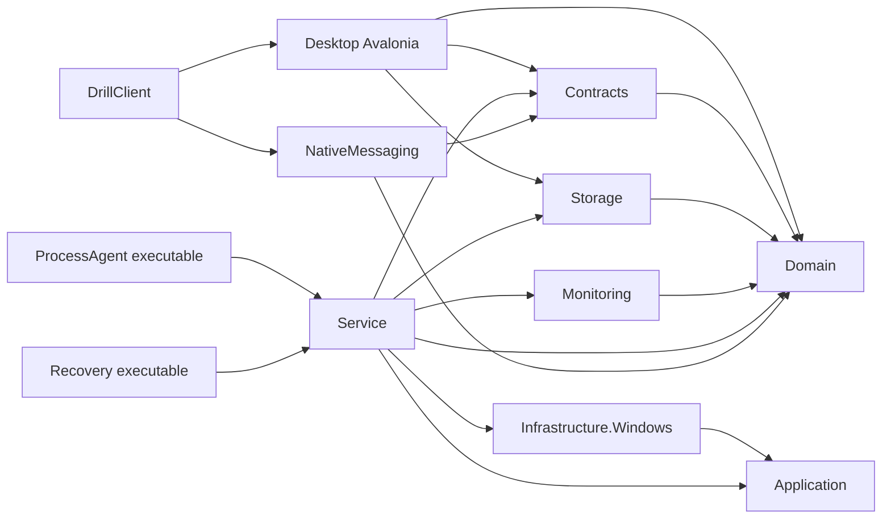
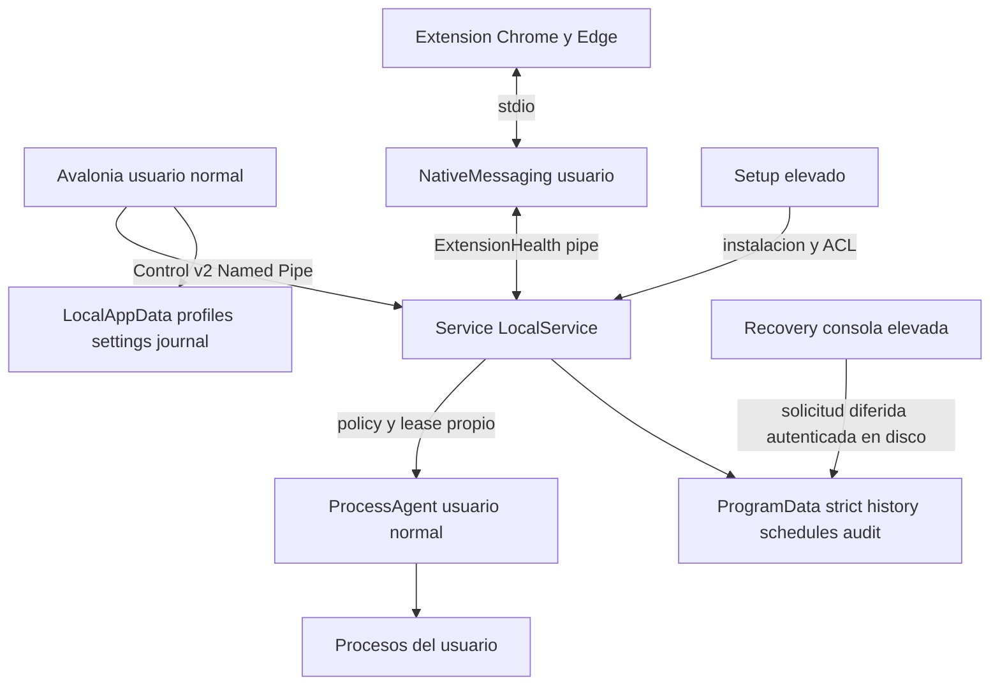
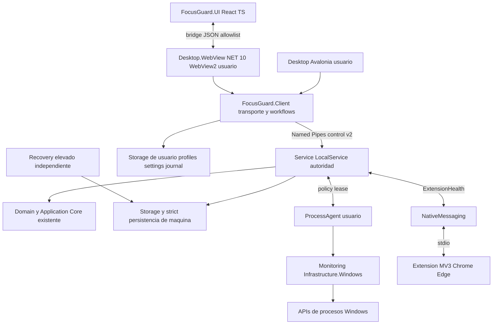
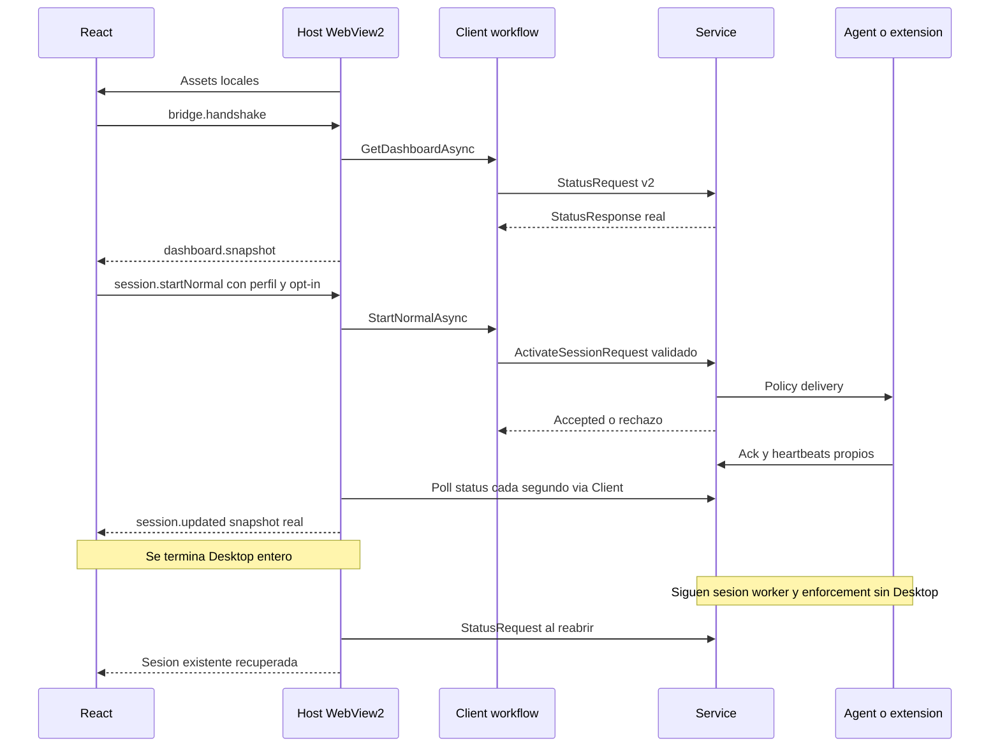

# FocusGuard — Plan técnico de migración de UI
**Revalidación adicional de Fase 4 (FG-366, .123):** `ipc-policy.json` pertenece al usuario instalado, su ACL está protegida, los cinco roles declarados y los 12 hashes de EXE/DLL coinciden con Program Files, y el servicio corre como LocalService. Read-only; no sustituye la matriz completa, el ACK dedicado ni el reboot drill. Evidencia: `artifacts/fg366-output/installed-ipc-policy-hash-audit.json`.
**Aceptación adicional de Fase 8 (FG-367, .123):** la vista Perfiles presenta el nombre guardado; el catálogo de aplicaciones filtra `Adobe` a seis resultados y restaura la lista inicial al limpiar búsqueda, sin modificar reglas ni sesión. Evidencia: `artifacts/fg367-output/installed-profile-catalog-readonly.json`.
**Continuidad del Agent instalada (FG-368, .123):** terminé el Agent PID5336 durante una sesión normal de 1 min en `gpt test`; el supervisor del Host lo reinició como PID31992. `enforcementConnected` bajó y volvió a true con el mismo SessionId/EndUtc; la sesión expiró naturalmente, Strict permaneció false y TestTarget no se ejecutó. Restauré preferencias al SHA anterior y reabrí el Host. Esto demuestra recuperación por pérdida real de proceso en .123; falta repetirla con .128 instalado y cubrir reboot/recovery. Evidencia: `artifacts/fg368-output/installed-agent-channel-loss-recovery.json`.
**Aceptación adicional de Fase 8 (FG-369, .123):** Today registró la sesión de FG-368 como completada; `Ver resumen` mostró 1 min de enfoque y 0 intentos bloqueados, sin abrir Repetir ni guardar reflexión/capturas. Evidencia: `artifacts/fg369-output/installed-today-session-summary-readonly.json`.
**Repetir en el Host instalado (FG-370, .123):** desde el resumen de FG-368, Repetir rellenó el formulario como borrador y dejó `Revisar sesión` como siguiente paso; Diagnostic permaneció Expired con el mismo SessionId y preferencias idénticas. Evidencia: `artifacts/fg370-output/installed-repeat-draft-readonly.json`.
**Host y DPI instalado (FG-371, .123):** el Host es del propietario y Medium, Per-Monitor V2 a 96 DPI, ventana 1216×799; Service LocalService y canales Ready. Es el estado del monitor actual, no un cambio real de monitor/escala. Evidencia: `artifacts/fg371-output/installed-host-window-dpi-owner.json`.
**Rendimiento idle instalado (FG-372, .123):** 60 s, Service 74,28 MiB WS/34,72 MiB privada/0 % CPU; árbol React 7 procesos/423,07 MiB WS/217,29 MiB privada; total 12 procesos y 0,0304 % CPU; todos los gates idle pasan. No representa carga activa/sostenida. Evidencia: `artifacts/fg372-output/focusguard-resources-0.1.123-idle-60s.json`.
**Preflight de rollback (FG-374):** Setup .128 contra .123 valida manifiesto y 31/31 archivos; servicio LocalService Ready, sesión Expired, Strict apagado y consentimiento presente. El preflight no llama al instalador ni cambia el estado de la máquina; el rollback real .128→.123 sigue pendiente. Evidencia: `artifacts/fg374-output/rollback-preflight-0.1.128.json` y `docs/progress/20261009-fg-374-rollback-preflight-128.md`.
**ACK browser instalado (FG-375, .123):** con una política vigente, un status NativeMessaging sin ID/hash ACK devolvió política y `EnforcementConfirmed=true`; la UI mantuvo `Confirmada`. El test confirma la lectura no destructiva del ACK en .123; falta repetirlo con .128 instalado. Evidencia: `artifacts/fg375-output/installed-native-status-ack-preservation.json`.
**Ventana instalada en área menor (FG-376, .123):** a 1025×701 no apareció recorte horizontal y el botón al pie de la tarjeta se alcanzó mediante scroll vertical; la ventana volvió a 1216×799 sin confirmar el borrador ni cambiar la sesión. La pantalla conservaba una revisión con validez hasta 13:27:27 frente a una lectura a las 13:30; se registra como observación para reproducir, no como defecto confirmado. Esto no cubre .129 ni la matriz exacta 1024×700, 800×600 y 720×480. Capturas: `D:\TEMP\FocusGuard-FG376-viewport-validation-20261009\`.
**Revisión normal/ciclo vencida (FG-377, fuente y candidato .129):** las revisiones conservadas tras `expiresUtc` ahora se retiran automáticamente, con mensaje y foco de regreso; `confirm` verifica otra vez antes de enviar y no transmite startNormal/startCycle vencidos. Dos pruebas de reloj falso fallaban antes. El servicio no cambió.
**Aviso de revisión vencida (FG-378, .130 instalado):** en el Host real de Program Files, la alerta ahora aparece bajo el encabezado y encima del formulario cuando vence una revisión normal; mantiene `role=alert`, devuelve el foco a «Revisar sesión» y deja el servicio conectado, sin iniciar sesión. Visible en 1216×799 y 1025×701 sin recorte horizontal; la matriz exacta 1024×700/800×600/720×480 sigue pendiente. Capturas en `D:\TEMP\FocusGuard-FG378-20261009\`.
**Horario de 1 min (FG-379, .130 instalado):** el horario temporal timer-only se activó el viernes a las 14:36, el servicio inició la sesión automáticamente y la expiró en el fin original 14:37. Actividad registra «Menos de 1 min», 0 intentos bloqueados y «Sesión completada»; eliminé el horario de prueba para que no se repita. Capturas en `D:\TEMP\FocusGuard-FG378-20261009\`. Decisión del propietario (2026-10-09): conservar 1 min como duración mínima; FG379 ya comprobó que el horario inicia y expira en ese minuto. La intención de bloqueo de los horarios queda como una decisión separada, porque el resumen mostró «Desconocido».
**Navegación adaptable (FG-380, .132 instalado):** el selector de secciones ahora sustituye al rail hasta 1000 px; el rail conserva su altura sticky solo desde 1001 px, y el skip link usa el espacio del encabezado compacto. .130 cortaba «Programación» a 800×600; el primer candidato .131 dejó el contenido fuera del viewport porque el rail conservó `height:100vh`; .132 corrige ambas reglas. El Host piloto instalado muestra el contenido a 1024×700, 800×600 y 720×480 sin recorte horizontal; evidencia en `D:\TEMP\FocusGuard-FG380-validation-20261009\`.
**Perfiles a 800 px (FG-381, .132 instalado, read-only):** tras cambiar desde el rail a la ruta «Perfiles», el selector nativo conserva esa sección a 800×600. La lista permanece en dos columnas; los paneles de Aplicaciones y Sitios web se apilan con scroll vertical y sin recorte horizontal. No añadí, edité ni quité reglas/perfiles. Capturas: `D:\TEMP\FocusGuard-FG381-profiles-viewport-20261009\`.
**Lectura de perfiles sin escrituras repetidas (FG-382, .133 instalado):** en .132 abrir Perfiles actualizó `profiles.db` LastWrite aunque ningún control de edición fue activado. La causa fue `ListProfilesAsync → EnsureSchemaAsync`: repetía `PRAGMA user_version=3` y el seed en cada lectura; una prueba aislada confirmó que el PRAGMA no-op cambia el timestamp del archivo. .133 mantiene `foreign_keys=ON` por conexión, consulta `user_version`, evita DDL/seed cuando el schema ya es v3 y rechaza una versión futura; las migraciones aditivas v0–v2 se mantienen. Antes/después de instalar .133 y leer Perfiles: schema3, 5 perfiles, 5 reglas app, 30 sitios, LastWrite idéntico `2026-10-09T20:14:31.1250109Z`, 61,440 bytes; `UpdatedUtc` más reciente sigue en 2026-10-03. Evidencia: `D:\TEMP\FocusGuard-FG382-validation-20261009\`.
**Continuidad real Host/Service (FG-383, .133 instalado):** sesión Timer normal de 1 min en perfil `2`, bloqueo OFF/Strict OFF. Diagnostic registró `SessionId=d8a8a35e-89dd-4f9f-9cbe-2f497fc9911e` y `EndUtc=2026-10-09T20:38:05.9596933Z`; al cerrar Host con WM_CLOSE el servicio mantuvo Active/mismo fin; reabrí `--pilot` como usuario y Diagnostic volvió a mostrar el mismo ID/EndUtc Active con 17s restantes; expiró naturalmente como Expired. `serviceReady/extensionReady=true`, `enforcementConnected=false` porque el bloqueo no se solicitó. Se restauró `desktop-settings.json` byte por byte y su LastWrite original; se conserva un registro completado de 1 min en Activity. La captura activa observó el encabezado superior parcialmente cortado después de enfocar el campo duración; FG-384 rastrea ese scroll residual. Evidencia D: `D:\TEMP\FocusGuard-FG383-session-continuity-20261009\`.
**Encabezado al iniciar sesión (FG-384, .134 instalado):** .133 conservaba el scroll del formulario tras confirmar y cortaba el encabezado en la vista activa. `App.tsx` ahora vuelve al inicio cuando aparece un `SessionId` nuevo (sin cambiar comandos/IPC) y mantiene el reset terminal existente. La prueba de scrollTop360 fallaba antes y pasa ahora. En .134 instalado, Timer1 min con bloqueo/Strict OFF muestra el encabezado completo, Servicio Conectado, Extensión Disponible y «No solicitado»; expira naturalmente.
**Estado vigente (2026-10-10): .138 está instalado (FG409).** Registra la sesión normal interrumpida por parada ordenada (FG405/406) o por caída/kill vía journal y recuperación SCM (FG407); rollback real .138→.137 con TreeDifferences=0 (FG408); pendiente la checklist con el propietario FG-410. Antes: .135 instalado y reparado. .132 conserva la matriz responsive; .133 evita escrituras repetidas al leer schema v3; .134 corrige el scroll al iniciar Active; .135 conserva intención explícita de horarios timer-only o con bloqueo en status/historial y la recupera en el diario local. La primera instalación mostró mezcla .129, sin causa demostrada; reinstallation .135 exit0; nueve archivos críticos y manifest31/31 ahora coinciden por SHA. Setup self-test, `test-installer`, browser packages, React145/145, npm test, extensión19/19 y solución .NET serial895/895 pasan. FG386 verificó el horario timer-only de 1min y repetición tras borrarlo; profile2/regras/settings intactos. FG387 acepta el formulario a720×480 con scroll y sin recorte horizontal. FG389 midió .135 idle60s: Service69.17MiB WS/0% CPU, React tree446.17MiB WS, total12 procesos/0.0673% CPU; gates idle pasan. Edge .135 real sigue pendiente (FG388): extensión cargada en perfil temporal, sync/marcadores personales impidieron navegación; perfil D:526.6MB sigue presente después de un rechazo automático de borrado. Host .135 en Resumen/1216×799, Service/Extension Ready e Inactive, sin sesión activa; `desktop-settings.json` conserva SHA original. El registro de prueba FG386 permanece en Activity. FG390 reabrió su SessionId exacto y confirmó en el Host .135 el borrador Repeat con Strict y bloqueo apagados, CTA «Revisar sesión» y servicio Inactive; no se inició sesión. FG391 validó desde React el bloqueo real de `FocusGuard.TestTarget.exe` en .135, resumen con 1 intento bloqueado y expiración natural; perfil/reglas y preferencias originales siguen intactos. Edge sigue pendiente: el lanzamiento aislado fue rechazado por revisión automática con «blocked by policy» y no se intentó otra vía; no se probó bloqueo de navegación. FG392 ya eliminó su perfil temporal y restauró la configuración. FG393 verificó foco por Tab en el Host .135 y flecha Abajo Perfiles→Actividad; Narrator/forced-colors/DPI siguen pendientes. FG394 aceptó status del Diagnostic instalado y denegó a ese rol el pipe ProcessAgent (`DENIED_EOF`) bajo LocalService; falta la matriz completa y rollback. FG395 cerró/reabrió el Host .135 como owner Medium con el mismo SessionId/EndUtc activo y confirmó expiración natural. FG396 verificó ACL/owner y hashes EXE/DLL de los seis roles declarados en `ipc-policy.json`; matriz completa y rollback siguen abiertos. FG397 obtuvo `DENIED_EOF` para un StatusRequest válido desde PowerShell no listado, mientras Diagnostic permitió status sin cambiar el servicio. FG398 midió 60s de enforcement activo en .135: 12 procesos/0.516% CPU, 7 en árbol React/438.9MiB WS; intentos bloqueados=1, Expired natural y gates activos pasan. FG400 confirmó baseline instalado Per-Monitor V2/96DPI a1216×799; cambio real de escala/monitor y matriz OS siguen pendientes. FG401 probó el rol NativeMessaging instalado con un status de solo lectura; navegador real y bloqueo web siguen pendientes. FG402 probó pérdida/recuperación del Agent bajo enforcement activo en .135: mismo SessionId/EndUtc, false→true y UI Confirmada; reboot/Edge quedan abiertos. FG403 reinició el servicio .135 con sesión Expired y verificó Ready/ExtensionReady/Inactive bajo LocalService; no sustituye rollback ni restart con sesión activa. Limpieza anterior: 84.882 GiB de salidas/cache generadas conservadas en `D:\TEMP\FocusGuard-E-artifacts-archive-20261009`; no se tocaron archivos personales ajenos al repo. Espacio actual tras build y perfil temporal: E118.92 GiB libres (127.69 GB decimales), D25.39 GiB. Avalonia sigue; Fase10 no se inicia.

**Método de aceptación instalada (FG-350):** el Host instalado (`FocusGuard.UI.exe --pilot`) se lanza como propietario con integridad media (helper `FocusGuardInteractiveShell.ExecuteFromDesktop` del propio instalador) y `WEBVIEW2_ADDITIONAL_BROWSER_ARGUMENTS=--remote-debugging-port=…` solo en `127.0.0.1` y solo durante la prueba; un controlador CDP externo al repositorio lee el DOM y emite clics reales contra el servicio real. No es una función del producto, no se añadió al repositorio y se cierra al terminar (puerto comprobado cerrado). Las sesiones de prueba son de 1–3 minutos; el strict real de temporizador y de ciclo se hizo sin bloqueo para que expirara solo (no requiere recuperación). Nunca se imprimió ni archivó un código de recuperación.

**Aceptado en el Host instalado (.120–.122):** revisión estricta (centrado, desenfoque, foco, requisitos, caducidad, Esc); **strict real de temporizador** y **de ciclo** (Enfoque→Descanso→Enfoque→`Expired`, saltar deshabilitado); sesión normal timer-only con resumen, objetivo, reflexión persistida, Repetir (solo borrador) y detener con revisión; **bloqueo real de aplicación** desde React (cierre en 2,2 s, audit `Terminated`, resumen «Intentos bloqueados: 2»); **bloqueo web real en Chrome** (`facebook.com` → «Page blocked by FocusGuard», audit `Blocked`); horarios reales (uno habilitado de 3 min arrancó solo y quedó «Iniciada»); compacto con TopMost real (`WS_EX_TOPMOST`); Preferencias en la primera apertura; recorrido de las siete pantallas; rendimiento con sesión activa y bloqueo conectado (Service 77,9 MB / 0,06 % CPU; 11 procesos 811 MB / 0,40 % CPU; gates `true`; 60 s).

**Defectos que solo aparecieron al aceptar en el instalado (todos con prueba que falla antes):** (1) **HIGH RISK:** todo ciclo estricto con excepciones de descanso terminaba `Failed` porque la persistencia estricta exigía reglas `Allow` y el contrato/FG-216 exigen `Block` (la prueba de servicio usaba un store simulado que lo ocultaba); (2) Preferencias fallaba en la primera apertura (`BridgeUnavailable` sin reintento; FG-347 era insuficiente); (3) literal «{minutes}» en la revisión estricta; (4) diálogos estricto y de fin de sesión descentrados por el reset de Tailwind; (5) botones de confirmar genéricos al eliminar horario/detener sesión; (6) sin confirmación al guardar la reflexión; (7) botón de revisar deshabilitado sin motivo en formularios inválidos; (8) capturas bloqueadas tras terminar una sesión estricta por el `strictMode` residual; (9) horario de 1 min que quedaba `Missed`: el editor guardaba `min=2` y el worker no iniciaba con menos de 1 min restante. **FG-355 corrige el contrato y está incluido en el candidato vigente .127; la aceptación instalada de .127 sigue pendiente.**

**Decisión del propietario aplicada en FG-355:** mantener horarios de 1 min; al arrancar tarde se usa solo el tiempo que resta hasta el fin programado, sin moverlo. **Decisión resuelta por FG-386 (.135):** los horarios conservan su elección explícita de bloqueo y esa intención acompaña el status, el historial y el diario local; no se asume bloqueo activado. **Decisiones resueltas por el propietario (2026-10-10, FG-413):** (a) la confirmación estricta es el nombre exacto del perfil (SPEC/UX_SPEC actualizados; la frase de dos palabras queda solo en la UI clásica hasta la Fase 10); (b) FG-410 demostró la liberación real, y tras expirar el Host muestra «Estricto finalizado» con el texto de bloqueo liberado (`strictMode` sigue siendo el tipo de sesión en el IPC).

**Pendiente:** equivalencia instalada completa de Fase8; validar otros estados/horarios e intención local programada; Edge real y bandeja/notificaciones con UI cerrada; aceptación instalada FG-406 del registro/aviso de interrupción (FG405), reboot/recovery/reloj; DPI real, Windows11, Narrator y forced-colors; carga prolongada; rollback real contra baseline conocido y reconciliado; repetir FG-354 sin host nativo previo; ACK dedicado; resolver decisiones del propietario; Fase10.
**Estado histórico (2026-10-08): .112 instalado; candidato .117 construido, no instalado.** (Superado por el estado vigente anterior; se conserva como registro.) Host React PID29404 está abierto en `--pilot`. El servicio LocalService PID13424 y extensión siguen `Ready`; al cierre de las pruebas SessionState=`Stopped`, Strict apagado y EnforcementConnected=false. FG339 acepta arranque React, bloqueo de app y continuidad del Host; FG340/341 prueban bloqueo web en Chrome y Edge (Edge usa extensión .98). FG343 valida desde React la creación/eliminación de un perfil y una regla web Block en .112. FG344 valida Today/cronología y el borrador Repeat sin iniciar otra sesión. FG342 mantiene navegación y selector de perfil visibles durante reglas largas en desktop; .117 pasa React121/121, TypeScript/Vite/CSP/contraste/layout, pruebas de paquete/instalador y cinco smokes. Setup .117 SHA `98247C63849449EBE3DC14ECE396E4B53FDAC5FD0E21B136DF4E7C531A708DB6`; distribución ZIP SHA `8DABC6A637D8A379536C7B4D812399E07CB2F300A05B01C9340B79472F8FD9C2`. FG335 confirma Native Messaging/heartbeat reciente; FG337 corrige en fuente el ACK borrado por `status`, pero el servicio .112 no incluye el fix. FG336 confirma .112 Per-Monitor V2 a 96 DPI. Pendiente: instalar/validar .117 en LocalService, aceptación visual sticky instalada y alinear extensión Edge, completar paridad de ciclos/strict/capturas/objetivos/preferencias/schedules/compact, handshake Agent independiente durante política activa, reboot/recovery, rollback instalado, cambio real de monitor/escala, Windows 11, Narrator/forced-colors, rendimiento activo y gates de Fase10. Avalonia permanece disponible hasta demostrar equivalencia.
**FG-298/305 (.102 instalado):** responsive a720×480 y preview solo lectura; React114/114, extensión19/19, 877 pruebas .NET, build/CSP/contraste/responsive contract, installer tests, cuatro Host smokes exit0, manifest31/31 y UI18/18 SHA pasan. Captura instalada: artifacts/fg305-output/fg305-installed-0.1.102-720x480.png; Fase9 forced-colors/DPI siguen pendientes.
**FG-289/290/291/292:** SaveIfAbsent protege consentimiento; Programación diferencia piloto desactivado de Host incompatible; Chrome bloqueó example.com durante sesión .100 y lo liberó al expirar. FG-291 verificó Repeat desde el resumen Classic en .102; Edge sigue pendiente. Evidencia FG-291: artifacts/fg305-output/fg291-classic-repeat-0.1.102.json.
**Aceptación histórica .98 (FG-288):** La sesión de dos minutos y el bloqueo de FocusGuard.TestTarget.exe se documentaron entonces. La instalación vigente es .102.
**FG-241/244/246/247/248/249/250/251/252/253/254/255/256/257/260/261/263:** paquete .90 instalado; React .90 inicia con el título completo y skip link visible/focused. Base EN/ES, accesibilidad de componentes, ciclos/historial, radios nativos, Radix, Profile responsive, selector720px, distribución UI exacta y reset inicial/terminal. Servicio y extensión reportan Ready durante sesión `Inactive`; esto no prueba Edge ni bloqueo web real. UIA de esta pasada sólo ve el pane WebView2, no el árbol React. Paridad real Edge, rollback, cliente local con rol inválido, aceptación instalada ampliada y Fase10 abiertos.

| Fase | Implementado y probado | Pendiente para cerrar |
| --- | --- | --- |
| 0–2 | Auditoría, límites de arquitectura y extracciones iniciales | Terminadas; detalles en sus checkpoints |
| 3 · Continuidad del agente | FG383 (.133) valida cierre/reapertura del Host con el mismo SessionId/EndUtc en timer-only. FG402 (.135) terminó el Agent durante enforcement activo: false→true en ~5 s, mismo SessionId/EndUtc, Host «Confirmada», TestTarget bloqueado y expiración natural. | Reinicio/recuperación de Windows y cambio de reloj; FG403 solo reinició el servicio con sesión inactiva; FG404 confirma que reiniciar el servicio con sesión normal activa la pierde (Inactive, sin aviso ni registro en historial/audit), como documenta SPEC.md:214. FG405 (código, .136 sin instalar) registra la interrupción en historial/audit al detener el servicio y el Host la avisa; FG406 lo acepta instalado en .136. |
| 4 · Seguridad IPC | Política protegida y roles provisionados. En .135, FG394 permite Diagnostic y deniega su pipe ProcessAgent; FG396 comprueba ACL y hashes de seis roles; FG397 deniega PowerShell no listado; FG401 acepta status de NativeMessaging. Servicio LocalService Ready tras FG403. | Matriz positiva/negativa completa de roles; NativeMessaging lanzado por navegador y bloqueo Edge real; ACK/reconexión dedicada; reboot/Strict; rollback contra baseline conocido y reconciliado. |
| 5 · Host WebView2 | Host .135 abre como usuario y permanece Ready. FG387 valida viewport 720×480; FG395 cierra/reabre Host durante timer-only activo conservando SessionId/EndUtc. FG400 confirma baseline Per-Monitor V2 a 96 DPI, no una transición. | Cambio real de DPI/monitor, Windows 11, Narrator y forced-colors. |
| 6 · Base React | React/TypeScript, tokens, ES/EN, CSP, teclado, reduced-motion y contratos forced-colors; React145/145 y build/verify-dist pasan. FG393 prueba foco por Tab y flechas; FG377–380 cubren expiración/responsive; FG384 corrige el scroll al iniciar sesión. | Narrator, reduced-motion y forced-colors reales; teclado completo en diálogos/compacto y demás transiciones de scroll. |
| 7 · Dashboard | FG391 valida bloqueo real de FocusGuard.TestTarget.exe en React; FG398 mide enforcement activo 60 s; FG402 prueba recuperación del Agent durante enforcement conservando SessionId/EndUtc. FG395 valida cierre/reapertura con timer-only sin enforcement. | Bloqueo web en Edge real; errores y cierre/reapertura con enforcement activo; recuperación tras reboot; FG404: el reinicio del servicio con sesión normal activa la pierde sin aviso (FG405/FG406: registro en historial/audit y aviso aceptados en .136). |
| 8 · Migración de funciones | React implementa perfiles/reglas, ciclos/strict, Today/historial/capturas/repetir, horarios, preferencias/ayuda y compacto. FG381 acepta perfiles a 800×600 read-only; FG385 acepta edición instalada; FG386 valida intención y repetición de horario; FG390 confirma Repeat como borrador. | Equivalencia instalada completa; capturas/reflexión y otros horarios; bandeja/toasts; decisiones estrictas pendientes. |
| 9 · Paridad y distribución | .135 instalado/reparado: manifest31/31, Setup health, nueve hashes críticos; .NET895/895, React145/145, extensión19/19, browser-package e installer tests pasan. FG391/398/402 prueban enforcement, rendimiento activo y recuperación Agent; FG403 reinicia el servicio inactivo y confirma Ready; FG404 caracteriza la pérdida de la sesión normal activa al reiniciar el servicio. | DPI real; Windows 11/accesibilidad; carga prolongada; reboot/recovery/reloj; rollback contra baseline reconciliado; FG-354 sin host nativo previo; Edge real: el lanzamiento aislado fue bloqueado por policy, sin prueba de navegación. |
| 10 · Sustitución | **Iniciada por decisión del propietario (2026-10-10, FG-415): retirada en dos pasos.** Paso 1 hecho en código e instalador .141: el Host React hace bandeja, avisos, resumen, pantalla de bloqueo, inicio con Windows, instancia única y health probe; el instalador ya no instala Avalonia y la política IPC exige WebViewHost. Avalonia sigue en el repositorio, compilando y con tests, como respaldo. | Instalar .141 y verificar en la app real (bandeja, avisos con la ventana cerrada, bloqueo con app real, inicio con Windows); paso 2 tras la confirmación del propietario: borrar `FocusGuard.Desktop` y sus tests |

**Aceptación instalada de Fase 8 (FG343–345 en .112; edición de perfiles/reglas en .134 con FG385; horario e intención de sesión en .135 con FG386):** React crea/elimina perfiles y reglas, carga Today/cronología, prepara Repeat sin iniciar sesión y guarda/lee/elimina horarios temporales. FG386 confirma que un horario timer-only mantiene 1min, se inicia y expira al fin programado, conserva enforcement apagado tras borrar el horario y ofrece repetirlo con la misma configuración. Sigue pendiente la equivalencia completa con Classic, especialmente ciclos/Strict, capturas, objetivos/reflexiones, otros horarios, preferencias y compacto/bandeja/notificaciones.

FG-305, FG-309, FG-310, FG-311, FG-312 y FG-291 siguen aceptados en .102. FG-330 instaló .112; FG331 verifica policy, clientes permitidos/rechazados, assets y Host; FG315 valida Activity instalada bajo 64 KiB; FG332 acepta reposo .112. FG333 ejecutó fallo de actualización .113 y confirmó restauración exacta de .112. FG320/321/326/328 están instalados, pero falta evaluación durante Active y aceptación visual/Narrator. Pendientes: (1) revisar Host visual/lectores de pantalla; (2) sesión normal .112 y comprobar UI/continuidad/copy; (3) bloqueo real app/Edge; (4) matriz IPC total y reboot/recovery; (5) cambio real DPI y Windows11; (6) carga activa/sostenida; (7) equivalencia y gates Fase10. La nueva UI no será predeterminada ni se retirará Avalonia hasta cerrar Fase10.

### Historial de checkpoints

Las entradas siguientes describen el estado en su fecha; la tabla anterior expresa el estado actual.
FG-296 acepta un punto de navegación por teclado en el Host React .100 instalado. En FocusGuard.UI normal PID25072, modo Solo lectura, Tab mueve el foco hasta Vista compacta; la captura muestra un anillo de foco claramente visible y el árbol accesible nombra el botón Vista compacta Ctrl+Shift+M. Service/extension estaban Ready, sesión Expired y el CTA de inicio seguía deshabilitado. Alcance deliberadamente limitado a un tab stop; faltan el recorrido completo, forced-colors, Narrator, DPI y QA de otras páginas. Se aplicaron como guía las skills de diseño solicitadas: UI/UX Pro Max, Emil, Taste, Frontend Design y Apple Design; no se modificó CSS ni markup. Evidencia D:/TEMP/focusguard-fg166-validation/artifacts/fg290/fg296-react-keyboard-focus-0.1.100.json y fg296-react-keyboard-focus-0.1.100.png.
FG-295 mide rendimiento idle del paquete instalado .100 durante 60s (7 muestras cada10s), con servicio en Expired y serviceReady/extensionReady true. En el equipo con12 procesadores lógicos, FocusGuard Service PID46424 promedia0.98% de un lógico = 0.082% del equipo; pico normalizado0.104%. Private Working Set promedio/pico24.46MB; Private Bytes al cierre28.69MB. ProcessAgent PID31896: CPU media0.033% del equipo, Private Working Set20.51MB; Host normal React PID25072: 0.028%, 28.72MB; Desktop PID39216: 0.032%, 110.46MB. Había un Desktop, un React Host normal y el ProcessAgent; el Pilot estaba cerrado. Evidencia D:/TEMP/focusguard-fg166-validation/artifacts/fg290/fg295-idle-resource-0.1.100.json. La carga activa/sostenida y reinicio/recovery aún requieren pruebas separadas.
FG-294 comprueba continuidad instalada en .100. Con el perfil existente gpt test se aceptó una sesión normal de 1min, enforcement true y Strict off. El servicio LocalService PID46424 reportó Active/enforcementConnected=true, SessionId 1a9e5900-bc6b-4233-9aad-10e87e0ddb21 y EndUtc 23:45:26.961Z. El proceso React piloto PID41300 cerró de forma ordenada. Tras el cierre, el servicio mantuvo el mismo SessionId y EndUtc, Active y enforcementConnected=true; el Host normal PID25072 siguió abierto y mostró gpt test con canales confirmados. El temporizador llevó la sesión a Expired y enforcementConnected=false, sin reiniciar el servicio (PID46424 estable). Strict quedó off, no se lanzó FocusGuard.TestTarget.exe y el perfil no se modificó. Evidencia D:/TEMP/focusguard-fg166-validation/artifacts/fg290/fg294-owner-session-continuity-0.1.100.json.
FG-293 acepta la frontera de roles sobre la instalación .100. El cliente instalado FocusGuard.DrillClient.exe status recibió respuesta de diagnóstico y confirmó ServiceReady=true, session Expired, SessionId fe128764-a78a-48fb-ad1f-09a785397c3b antes y después. Luego probe-agent-role-denied envió un heartbeat al pipe ProcessAgent como rol Diagnostic y recibió DENIED_EOF (exit0). FocusGuard Service permaneció Running como NT AUTHORITY\LocalService, PID46424 antes/después. No se activó sesión, no hubo cambio de perfil y no se tocó el registro del servicio. Evidencia D:/TEMP/focusguard-fg166-validation/artifacts/fg290/fg293-installed-role-rejection-0.1.100.json.
FG-292 confirma bloqueo web con Setup .100. En un perfil Chrome desechable se cargó la extensión oficial desde C:\Program Files\FocusGuard\browser-extension\staging; la UI muestra versión 0.1.100 e ID emhdinkjpinjnmldipnejnbeefgonjnj, coincidente con el origen autorizado en el manifiesto Native Messaging. Se creó el perfil temporal Codex QA Edge Block 20261007 con la única regla web example.com en Block, y se inició una sesión Timer normal de 1 minuto, enforcementEnabled=true y Strict off. El servicio respondió Active y enforcementConnected=true para SessionId fe128764-a78a-48fb-ad1f-09a785397c3b y profileId b635970e-85f2-4796-98c2-5a86db650edd. Al navegar a https://example.com, Chrome mostró la página local de la extensión chrome-extension://emhdinkjpinjnmldipnejnbeefgonjnj/status.html con “example.com will still be there later”; el resumen React de Activity registra Intentos bloqueados: 1. El temporizador venció sin intervención; el servicio pasó a Expired/enforcementConnected=false y la navegación posterior cargó Example Domain. Strict Off. Se borraron el perfil de FocusGuard de prueba y el user-data-dir aislado, se cerró el Chrome de prueba y el Native Messaging host de ese Chrome terminó. El Chrome habitual quedó abierto sin modificar. Edge queda pendiente: Edge Guest no habilita Extensions y la primera ventana Edge desechable mostró confirmación de inicio de sesión automático; se cerró antes de navegar. Evidencia: D:/TEMP/focusguard-fg166-validation/artifacts/fg290/fg292-installed-browser-block-0.1.100.json y capturas fg292-*.png.
FG-291 instala y comprueba Setup .100 tras confirmación del usuario. Hashes instalados coinciden: 18/18 recursos UI y 8/8 ejecutables; manifiesto de extensión 0.1.100; Service PID46424 Running como LocalService. Orca 1.4.222 está activo. Con el Host React piloto y Classic abiertos, inicia una sesión normal de 2min en gpt test, Strict off y bloqueo activado. El diario local guarda SessionId a4f7bbde-0308-4cc6-a27f-8bc4883ff0cf, profileId cbeb439e-426c-4a8a-80c6-9cbb388d7929 y enforcementEnabled:true; React muestra Activating, después confirmación de los canales solicitados y el historial registra Sesión completada tras expirar por timer. El resumen ofrece Revisar y repetir esta configuración; al abrirlo, el borrador conserva gpt test, 2min y bloqueo activado. No se inició una segunda sesión; Strict off y perfil sin cambios. En modo normal, Programación muestra Esta ventana está en modo de solo lectura. Para editar, abre FocusGuard en modo piloto; FocusGuard clásico también está disponible. y Nueva programación aparece deshabilitado. No se creó ningún horario. Repeat Classic queda pendiente: Orca sólo expone el nodo raíz de FocusGuard.Desktop y no se logró navegar al historial. Esta sesión tuvo 0 intentos bloqueados porque no se ejecutó TestTarget; el bloqueo real sigue sustentado por FG-288 en .98. Evidencia: D:/TEMP/focusguard-fg166-validation/artifacts/fg290/fg291-installed-acceptance-0.1.100.json y capturas fg291-*.png.

FG-288 verifica continuidad activa y bloqueo real de aplicación en Host .98 instalado. En modo piloto elegí el perfil existente `gpt test`, con una regla FileName Block `FocusGuard.TestTarget.exe`, un sitio Allow y sin excepciones de descanso. Inicié una sesión normal de2min con enforcement y Strict Off; Service reportó Active, enforcementConnected=true, SessionId `f3aa6759-4deb-45ff-b2b7-8c255c4d95cc` y EndUtc fijo. El TestTarget PID19136 salió en3s con código de terminación; la vista de resumen de Actividad muestra `Intentos bloqueados: 1`. Cerré el Host piloto y reabrí el normal antes del fin: seguían el mismo SessionId/EndUtc y Active/enforcementConnected=true. Expiró naturalmente como `Expired`, sin Stop; el proceso objetivo no quedó abierto. Se añadieron dos sesiones breves de prueba a Activity, sin cambiar reglas ni preferencias. Recibo y captura del Host reabierto: `D:/TEMP/focusguard-fg166-validation/artifacts/fg280/installed-active-session-continuity-0.1.98.json` y `installed-active-session-host-reopen-0.98.png`. El bloqueo web en navegador sigue pendiente; esta sesión sólo usó un destino web Allow.

FG-287 confirma la causa de los SCM7034 en actualizaciones previas. `RestartManagerPreflight` devolvía `FocusGuard Service` y `FocusGuard.NativeMessaging` junto con aplicaciones interactivas. Setup llamaba `CloseProcess`; para el Service sin ventana, `CloseMainWindow` falla y a los3s `Process.Kill(entireProcessTree:true)` finalizaba el servicio antes de que el script pudiera usar `Stop-Service`. Los eventos7034 de15:04:46 y15:25:11 siguen a los updates .96/.97 cuyos preflights reportaban cerrar el Service. El filtro Setup conserva sólo Desktop/Agent para confirmación del usuario; el script detiene el Service y suspende/revoca NM dentro de su transacción. La smoke de clasificación falló antes/pasó después, dotnet solution y tests de Setup pasan. En .98 instalado, la captura preflight muestra sólo Desktop/Agent, los mensajes identifican el manejo ordenado del Service/NM, y tras completar Setup el número histórico de7034 quedó en70 (sin evento nuevo). Artefacto visual `D:/TEMP/focusguard-fg166-validation/artifacts/fg280/setup-preflight-no-service-or-native-host-0.1.98.png`; recibo `installed-acceptance-fixed-0.1.98.json`.

FG-286 correlaciona el 7034 con la ruta de cierre de Setup y el momento de reemplazo. `service-failures.jsonl` termina en06-oct y el `ipc-control-rejection.json` rescatado está fechado14:43Z, no coincide con los eventos .NET/SCM de la tarde del7-oct; Application log no registra excepción del Service en esas ventanas. El Setup .98 filtrado no produce evento nuevo, por lo que la correlación queda confirmada y el contador histórico se mantiene70. Evidencia de eventos y recibos: `D:/TEMP/focusguard-fg166-validation/artifacts/fg280/scm7034-baseline-before-fixed-setup-0.1.98.json` y `scm7034-after-fixed-setup-0.1.98.json`.

FG-285 ensaya rollback owner-present con un payload candidato .98 que difiere del .97 instalado. El wrapper administrativo pasó `-ClientMetadataQueryConsent` y el failpoint `-InjectFailureAfterCopyForRollbackTest`; el instalador copió el payload, lanzó la excepción intencional, restauró el backup y no reportó `Rollback also failed`. La verificación interna de fingerprint no lanzó excepción. En una verificación independiente, 7/7 ejecutables y 18/18 UI coinciden con .97, la distribución instalada vuelve a .97, no quedó el ZIP Chrome .98, y las rutas Chrome/Edge, Run y Start Menu apuntan a Program Files. Service PID24372 corre como LocalService y DrillClient confirma Ready/extensionReady/Inactive. No se inició/detuvo sesión ni se editó perfil. Transcript y recibo: `D:/TEMP/focusguard-fg166-validation/artifacts/fg280/owner-present-rollback-0.1.98.log` y `owner-present-rollback-acceptance-0.98-to-0.97.json`.

FG-284 ensaya roles contra el Service .97 real como LocalService. El DrillClient Diagnostic instalado, cuya ruta/hash se confirma contra el paquete y cuya autorización se demuestra mediante un `StatusRequest` de Control exitoso, conecta al pipe `FocusGuard.ProcessAgent.v1` y envía sólo un heartbeat válido. El Service cierra con `DENIED_EOF`; el código de `ProcessAgentPipeService` autoriza antes de `relay.RecordHeartbeat`, por lo que no se registró heartbeat. Service PID44716 y Agent PID24952 quedaron estables; DrillClient posterior sigue Ready/extensionReady/Inactive con SessionId nulo. 7/7 binarios y 18/18 UI coinciden con .97; cuatro smokes instalados pasan. Detalle: `docs/progress/20261007-fg-284-installed-role-mismatch.md`; JSON `D:/TEMP/focusguard-fg166-validation/artifacts/fg280/installed-role-mismatch-0.1.97.json`. Rollback owner-present sigue pendiente (FG-285).

FG-281 instala Setup .96 y acepta visualmente los cambios acumulados FG-280/282 en WebView2. Los hashes de18/18 recursos UI y 7/7 ejecutables principales coinciden con el paquete. Orca a1216×799 confirma el estado “Solo lectura”, una instrucción de continuación y `FocusGuard.TestTarget.exe` sin duplicar; un Tab deja foco visible en la navegación Perfiles. Los cuatro smokes del ejecutable instalado pasan; el Host PID2916 y Service PID25748 permanecen iguales. DrillClient da Ready/extensionReady/Inactive como LocalService. No se editó el perfil ni se inició/detuvo una sesión. Captura posterior, hashes y recibo: `D:/TEMP/focusguard-fg166-validation/artifacts/fg280/installed-acceptance-0.1.96.json`; pantalla `installed-profile-readonly-after-0.1.96.png`.

FG-283 mide reposo .96 durante60.01s: Service66.79MB WS/26.00MB private/0%CPU; árbol React7 procesos/438.91MB WS/224.40MB private; FocusGuard11 procesos/787.14MB WS/445.19MB private/0.0716%CPU. Pasan los límites de Service y los gates de una instancia Classic y un Host React. Es sólo una muestra idle, no una carga sostenida ni activa. Detalle: `D:/TEMP/focusguard-fg166-validation/artifacts/fg280/focusguard-resources-0.1.96-inactive-host-60s.json`.

FG-282 corrige una contradicción visible en el Host .94 instalado a1216×799: el encabezado decía “Configura” aunque el modo fuera de consulta y los controles estuvieran deshabilitados; el carril lateral decía “Vista de consulta” sin una instrucción clara. Ahora el estado es “Solo lectura”, la descripción de Perfiles es neutral y los avisos explican que esas acciones están desactivadas en esta ventana, cómo abrir FocusGuard en modo piloto y que Classic sigue disponible. Ayuda y mensajes de inicio, edición, acciones de sesión y capturas quedaron alineados en ES/EN. Se mantuvieron colores, estructura y movimiento; no hacía falta animación para comunicar un bloqueo persistente. UI112/112, TypeScript, build Vite/CSP/recursos/contraste, extensión19/19, tests de instalador y cuatro smokes .96 exit0 pasan. Manifest31/31 presentes, UI18/18 hashes coinciden con dist; Chrome/Edge14 entradas y hashes coinciden con distribución. Setup .96 SHA `C86DECD751A22430AA355C480A208FB88FC0CA1DF0A1C7E9ADD7FA72C998D823`; ZIP SHA `D0E1EC0579CE5A135A2F437D4BF04151A14C20BA27BCA0407FE8748BF308AAEA`. El Service .94 se comprobó Ready/extensionReady/Inactive como LocalService PID9308 después de los smokes; no se iniciaron sesiones ni se editaron perfiles. .96 no instalado: token no elevado. Captura pre-cambio y recibo en `docs/progress/20261007-fg-282-readonly-copy.md` y `D:/TEMP/focusguard-fg166-validation/artifacts/fg280/build-receipt-0.1.96.json`. FG-281 debe instalar/verificar .96, que reemplaza el paquete .95 antes de instalarse.

FG-280 corrige en `ProfileEditor` la duplicación visual del destino de las reglas guardadas: el valor crudo sólo aparece como detalle cuando difiere del nombre presentado. Se añadieron regresiones para valor Unresolved idéntico y para etiqueta amigable con destino exacto distinto. React112/112, TypeScript, build Vite, verificación CSP/recursos/contraste, tests de extensión19/19, Ipc.Windows81/81 y cuatro smokes de Host publicados pasan. Setup .95 está empaquetado: manifest31/31, UI18/18, cuatro smokes exit0; SHA-256 Setup `2BF3383A8FB8BA962DC2B639434E02F3F9A7287E00D110DCC16FFFD17D97EF2F`, ZIP `BE100FE3358E78FF04C4E4F1E8499F5154A4D741428DB812D974DD747D3C22BE`. No instalado: .94 sigue vigente; el ejecutor no tiene token elevado. No se inició sesión ni se cambió el perfil capturado. La aceptación real del cambio queda en FG-281; receta, hashes y captura pre-cambio en `docs/progress/20261007-fg-280-saved-rule-duplicate.md` y recibo en `D:/TEMP/focusguard-fg166-validation/artifacts/fg280/build-receipt.json`.

FG209 (2026-10-05) completa el review strict de timer y ciclos en Host/React. El Host limita cada review al documento y a su preparación vigente, genera y retiene temporalmente la credencial en memoria, exige guardar el código, reconocer el riesgo para trabajo sin guardar y escribir el nombre exacto del perfil; consume antes de pedir activación y no reintenta un resultado desconocido. React ofrece guardado local explícito del código y guía al helper de recuperación instalado, sin lanzarlo ni elevarlo automáticamente. Pruebas UI/Host y build Release pasan; el paquete 0.1.58 fue generado y comprobado, no instalado. Replay strict, semántica Block en descansos y aceptación real de LocalService/recovery permanecen pendientes. Detalle: `docs/progress/20261005-fg-209-strict-review.md`.

FG210 completa el replay strict desde historial como borrador: el contrato lo habilita sólo con perfil actual, consentimiento conocido y configuración válida; React conserva strict y abre el flujo `session.strict.prepare`, que genera nueva preparación/código y no activa por su cuenta. El journal no contiene código ni se reutiliza el secreto anterior. Suite React 69/69, Host 133/133, build Release y package 0.1.59 verificados; no instalado. La semántica de Block en descansos y la aceptación instalada siguen pendientes. Detalle: `docs/progress/20261005-fg-210-strict-replay.md`.

FG211 añade navegación anterior/siguiente por fecha local en Activity y consulta el intervalo local de medianoche a medianoche convertido a UTC. El Host ya validaba intervalos UTC de hasta dos días; no cambia protocolo ni almacenamiento. Refresh y error despejan los resultados previos, la siguiente fecha se bloquea en hoy y se cierra el detalle de sesión al cambiar el día. UI 70/70, Host 133/133, Release sin warnings/errores, Graphify y paquete 0.1.60 pasan; no instalado. Captura desktop 1280 px revisada; aceptación responsive estrecha y host instalado siguen en Fase 9. Detalle: `docs/progress/20261006-fg-211-history-navigation.md`.

FG212 presenta el objetivo existente y permite guardar la reflexión en resumen/historial React. El resumen compone el texto sólo del journal local del sessionId esperado; guardar verifica que el servicio reconoce la sesión terminada y actualiza el journal bajo el lock compartido con Classic. La nota no toca enforcement y el borrador permanece ante errores. React73/73, Client109/109, Host138/138, Release sin warnings/errores, Graphify y package0.1.61 pasan; no instalado. El formulario React aún no captura objetivos nuevos. Detalle: `docs/progress/20261006-fg-212-session-reflection.md`.

FG213 añade objetivo opcional React de 240 caracteres para timer/ciclo/strict. Se muestra la cadena local en la revisión; sólo se incluye en la confirmación final del Host y se guarda en el journal tras `Accepted`. El servicio y enforcement no reciben el campo. El parser exige valor exacto y acotado; Repeat restaura el objetivo editable. React73/73, Client109/109, Host139/139 y Release sin warnings/errores; Graphify/package0.1.62 verificados, no instalado. Falta todavía la verificación visual con un browser runner; el formulario funcional está cubierto por tests DOM. Detalle: `docs/progress/20261006-fg-213-objective-field.md`.

FG214 lee la intención una vez por cambio a sesión activa y enseña el objetivo sólo cuando el sessionId local coincide con el estado del servicio. El DTO no concede control ni reemplaza el reloj autoritativo. React74/74, Host139/139 y Release sin warnings/errores; Graphify y paquete0.1.63 verificados, no instalado. La evidencia visual del browser sigue pendiente. Detalle: `docs/progress/20261006-fg-214-active-objective.md`.

FG215 proyecta el acento de perfil ya persistido por el Host en `profiles.list` y `session.intent.get`, con validación nullable/exact-hex en los contratos React. Los indicadores del perfil seleccionado/activo y el borde de progreso de Focus usan `--profile-accent`; las acciones, el focus ring, el tema compartido y los colores de warning/break conservan sus tokens semánticos. React75/75, Host139/139 y Release sin warnings/errores; Graphify y package0.1.64 verificados (29/29 recursos y hashes del Setup/payload coincidentes), no instalado. La prueba DOM confirma el alcance de los estilos, pero falta captura visual del host/browser y aceptación instalada en Fase9. Detalle: `docs/progress/20261006-fg-215-profile-accent.md`.

FG216 corrige la divergencia de reglas de descanso: Storage ya sólo conserva `Block`, el editor clásico los crea y React comunica que esos destinos siguen bloqueados; ahora `CycleIpcProtocol`, Client y Host validan esa misma semántica. Reviews normal y strict exponen los nombres de los destinos bloqueados (con límite y aviso de truncado); React normal usa una divulgación accesible para no cargar la pantalla inicial. Una prueba SQLite/pipe comprueba que durante el descanso autorizado se aplican las excepciones almacenadas y al cierre de fase vuelven las reglas normales. No hay conversión de datos. React76/76, Contratos60/60, Client109/109, Host139/139 y build Release sin warnings/errores; Graphify/package0.1.65 verificados, no instalado. La suite completa también mostró fallos fuera de este cambio en dos pruebas Desktop y falta el artefacto ColdIdentityProbe en Ipc.Windows.Tests; se registran en el checkpoint sin modificarlos. Detalle: `docs/progress/20261006-fg-216-break-exceptions.md`.

FG217 lleva al editor Profile React la lectura, paginación y edición de las excepciones `Block` que siguen bloqueadas durante descansos. El resumen describe la consecuencia y el detalle mantiene controles separados para apps/sitios, Block-only y vacíos explícitos. El Host publica revisiones por separado y comandos tipados para agregar/quitar; SQLite compara y escribe en una transacción inmediata. Classic usa el mismo CAS y recarga ante conflicto. React80/80, Host140/140, Client109/109, Storage38/38, tres pruebas Desktop focalizadas y Release (0 warnings/errores) pasan. Graphify y package0.1.66 verificados, no instalado. La prueba visual instalada sigue pendiente: el instalador rechazó la ejecución antes de modificar el equipo porque esta sesión no tiene token elevado. Detalle: `docs/progress/20261006-fg-217-profile-break-settings.md`.

FG218 lleva el preset predeterminado de `ProfileCycleSettings` a `profiles.list`/`profile.get`, expone su guardado por el CAS existente y preselecciona Cycle al iniciar sin quitar la elección por sesión. El selector representa un default fuera de página y muestra también sus duraciones; Session intent y Repeat validan/preservan el nombre, id y configuración opcionales. React81/81, Host140/140, Client109/109, Storage38/38, tres pruebas Desktop enfocadas y Release (0 warnings/errores) pasan. Graphify y package0.1.67 verificados (29/29, ZIP1730, SHA Setup AA94451746795DC6C4649B4CA5C23EABE6CCD0815F8B5A790A04CD5888A22719), no instalado. La aceptación visual instalada sigue pendiente porque el shell no tiene token elevado. Detalle: `docs/progress/20261006-fg-218-default-cycle-preset.md`.

FG219 corrige los conteos de Profile, inicio, programaciones y revisiones para mostrar singular con 1 y plural con los demás valores en español e inglés. UI reutiliza un helper de copy local; la traducción no añade colores ni movimiento. El nuevo chunk local `count-label.js` está permitido por la política WebView2, es copiado por el Host y aparece en el payload/manifiesto/validación del Setup. React82/82, Host141/141, Client109/109, Storage38/38, tres pruebas Desktop y Release (0 warnings/errores) pasan. Graphify y package0.1.68 verificados (30/30 archivos, ZIP1731 entradas), no instalado. La captura del Host instalado anterior muestra el texto defectuoso antes del cambio; el paquete corregido espera aceptación visual instalada. Detalle: `docs/progress/20261006-fg-219-count-copy.md`.

FG220 sincroniza Ayuda React con las funciones disponibles: ciclo predeterminado/perfil, reglas y descansos, sesiones normales/strict, programaciones, conexión y recuperación. Retira la referencia antigua a que ciclos, strict y horarios requieren Classic y explica explícitamente qué permanece bloqueado durante descansos. React83/83, Host141/141, Client109/109, Storage38/38, tres pruebas Desktop enfocadas y Release (0 warnings/errores) pasan. Graphify/package0.1.69 verificados (30/30, ZIP1731), no instalado. La ventana instalada previa abrió y cerró como usuario normal y el servicio siguió listo/inactivo; la captura no es del paquete nuevo. Detalle: `docs/progress/20261006-fg-220-help-guidance.md`.


FG221 corrige el layout responsive del Profile editor: cada control de excepciones de descanso queda asociado a su etiqueta y los editores app/sitio usan una columna hasta 1300 px. React83/83 y Release solution (0 advertencias/0 errores) pasan en el árbol E; la compilación incluye TypeScript, Vite y verificación CSP/assets. Package0.1.71: 30/30 recursos del manifest, ZIP1731; Setup SHA-256 `F20456D708DE6BC17958F60D47B955F21E9181C5738C612944A8EE40AED8A888`, menú ZIP `30B8B5763290EF5278F5924D7A5000774B8F26D5935109DD29BE61241ED99E20`. El árbol E `dist/chunks/ProfileEditor.js`, paquete e instalación comparten SHA-256 `3FAE4CEE102E7F9402ABC04F04AA88847E255A8022089A8610B44D6F443DB2E7`.

FG222 retest exitoso: el primer timer `gpt test` de 1 min llegó a Active sin Desktop/Agent y expiró sin enforcement. Con las entradas HKCU Run comprobadas, Desktop minimizado inició ProcessAgent PID44392. En el retest, status mostró `enforcementConnected=true`; el target `FocusGuard.TestTarget.exe` con lifetime120 desapareció antes de 4 s con 19 s restantes. Luego el Host PID38136 cerró y se reabrió como PID30724; antes/después el servicio reportó el mismo sessionId `ea46d89f-1224-42ce-8832-8ae6694e8900`, mismo endUtc y enforcementConnected=true. La sesión expiró normalmente; perfil/horarios no cambiaron y quedaron dos sesiones de prueba en Actividad. El sitio `focusguard.invalid` tiene acción Allow; browser block y otros usuarios/remoto siguen pendientes. Desktop supervisor unit tests 6/6. Detalle: `docs/progress/20261006-fg-222-active-agent-attempt.md`.

FG223 preparó una aceptación web aislada en el perfil temporal `FG Browser QA 20261006` con único target Block `focusguard-test.invalid`; el timer normal recibió estado Ready/ExtensionReady y enforcement, pero la política del executor rechazó crear Chrome temporal con `--load-extension`/`--remote-debugging-port` antes de iniciar el proceso. No se abrió URL ni se declaró browser block. El timer expiró, el perfil se borró, volvió la lista original y no existe el directorio Chrome temporal. Evidencia: `D:\TEMP\focusguard-fg166-validation\artifacts\fg222\phase4-installed-acceptance\fg222-agent-session-attempt.json`. Sigue pendiente una vía de navegador permitida.

FG224 mantiene visibles Cancelar/Revisar/Confirmar en el diálogo largo de programación: `.schedule-dialog-body` scrollable/keyboard-focusable y pie `.schedule-dialog-actions` separado; Submit conserva asociación con `schedule-entry-form`. `ScheduleEditor.test` verifica estructura del pie, vínculo form y que Cancel no invoque `schedule.save`. React 84/84; `dotnet build FocusGuard.slnx -c Release --no-restore` 0 warnings/0 errors; package0.1.72 standalone generado y verificado (30/30 recursos, ZIP1731, hashes Setup/ZIP, chunk ScheduleEditor source/package igual `E9A17C23946A16AC129C648918FD8B00D36E34B103F3A2DE5FCA775785FEA8B4`). No instalado: visual smoke del diálogo nuevo pendiente. Detalle: `docs/progress/20261006-fg-224-schedule-footer.md`.

FG225 añade el modo compacto base al Host React: ventana nativa arrastrable, restore bounds, `Ctrl+Shift+M`, TopMost y resumen autoritativo con tiempo/fase/perfil/fin/avisos. Bridge sólo cambia ventana. React92/92, Host148/148, Release0/0 y Setup0.1.73 31/31, ZIP1732; bundle378.59 KB y chunk4.07 KB. No instalado. Classic conserva ownership único de tray. Detalle: `docs/progress/20261006-fg-225-compact-mode.md`.

FG226 porta el plegado de detalles de Classic a React: 480×340 DIP expandido y 480×220 plegado; el contenido esencial y los avisos permanecen visibles. Fin, objetivo, salud y TopMost quedan en los detalles; bridge `window.compactDetails.set` modifica sólo la vista y se liga al documento. React93/93, Host149/149, Release0/0, `test-installer`, Graphify; Setup0.1.74 31/31, ZIP1732, main bundle379.28 KB. 0.1.74 no instalado; QA visual/DPI pendiente. El package0.1.73 previo permanece intacto. Detalle: `docs/progress/20261006-fg-226-compact-details.md`.

FG227 añade un launcher piloto a la bandeja Classic y conserva su tray como propietario único. La nueva acción inicia el Host instalado con --pilot fijo, detecta y reactiva la instancia existente; no cambia el botón Open FocusGuard ni toca servicio/sesiones. Desktop188/188, Desktop UI15/15 y build Release0/0; Setup0.1.75 generado, no instalado. Detalle: docs/progress/20261006-fg-227-react-pilot-launcher.md.

FG228 amplía el medidor al árbol de FocusGuard.UI y sus procesos WebView2, y permite guardar el JSON fuera del payload. La muestra breve del Host instalado 0.1.71 está preservada en `D:\TEMP\focusguard-fg166-validation\artifacts\performance\react-host-0.1.71.json`; el árbol React (7 procesos) registró 395.35 MB de working set y 206.31 MB de memoria privada. Es un baseline preliminar, no valida el paquete 0.1.77 ni carga sostenida. Detalle: docs/progress/20261006-fg-228-resource-baseline.md.

FG229 arregla la visibilidad/composición de full y compacto: `CompactFocus` queda oculto fuera de compacto, el header full separa la acción y el shortcut, y la tarjeta compacta organiza marca/controles/tiempo/detalles/alertas. Offline ya no repite detalle ni presenta facts desconocidos. React95/95, Release0/0, installer checks, Setup self-test, manifest31/31, ZIP1732; paquete0.1.76 SHA y screenshots se registran en `docs/progress/20261006-fg-229-react-shell-layout.md`. Smoke full 1216×799 y compact 480×340 client se hizo desde una copia D:\TEMP y no valida el service handshake. También se inspeccionó el Profile tab instalado 0.1.71 en lectura; servicio siguió Running. 0.1.76 aún no instalado.

FG230 corrige el mínimo WinForms que impedía alcanzar 220 DIP en compacto plegado. El mínimo exterior ahora suma el chrome no-cliente medido a la altura plegada. Host149/149, Release0/0, installer tests y package-self-test pasan; Setup0.1.77 manifest31/31 y ZIP1732. Smoke temporal midió por Win32 client480×220, outer496×259; captura y hashes en `docs/progress/20261006-fg-230-compact-client-height.md`. El servicio no se modificó y el Setup0.1.77 no está instalado.

FG223 (2026-10-06): el intento Chrome con flags temporales sigue sin repetirse. Para la aceptación real se creó y luego borró un perfil Edge aislado, se cargó extensión FocusGuard0.1.77 por UI, y se usó el Host instalado0.1.71 con `--pilot` bajo LocalService. Un perfil FocusGuard temporal tenía `focusguard-test.invalid` y `bing.com` en Block; la segunda sesión normal finita confirmó la regla y Edge redirigió Bing a `extension://…/status.html`, que indicó `www.bing.com` y tiempo restante. Ambas sesiones se detuvieron manualmente; el perfil/reglas FocusGuard y perfil/extensión Edge temporales se retiraron. Default personal y el perfil Edge preexistente no contienen la extensión; servicio sigue Running. El historial conserva dos entradas de prueba. Evidencia: `docs/progress/20261006-fg-223-browser-block-verified.md`.

FG231 (2026-10-06): `dotnet test FocusGuard.slnx -c Release --no-restore` pasó todos los proyectos al compilar primero; `extension npm test`19/19 y `npm run check` pasan. Una primera corrida `--no-build` no contó como aceptación: no había ColdIdentityProbe en Release y la correlación ProcessAgent falló una vez bajo carga; el helper y el caso correlación pasan aislados y la suite build-enabled completa termina exit0. Detalle: `docs/progress/20261006-fg-231-solution-test-sweep.md`.

FG232 toma dos muestras inactivas de10s/12 CPU del árbol UI+WebView2 de7 procesos: .77 temporal376.27 MB WS/194.50 MB private/0.052% CPU; .71 instalado394.17/201.82/0.104%. Los gates de servicio y proceso único pasan. No declara mejora: el .77 temporal no autentica el handshake y las muestras no son sostenidas. JSON/hashes: `docs/progress/20261006-fg-232-resource-compare.md`.

FG233 smoke de teclado del Host .77 temporal sin conexión: tras seis Tab, el control `Actualizar estado` muestra anillo de foco mint. Captura `D:\TEMP\focusguard-fg166-validation\artifacts\fg230\react-host-0.1.77-keyboard-focus.png`. Esto verifica un recorrido básico, no lector de pantalla, contraste, responsive ni instalado. Detalle: `docs/progress/20261006-fg-233-keyboard-smoke.md`.

FG234 verificó en el sistema instalado LocalService `Running` el pipe `FocusGuard.Control.v2`: el pipe aparece localmente y una conexión `NamedPipeClientStream("localhost", pipeName)` obtiene `System.UnauthorizedAccessException` con Win32 error5 (`Access to the path is denied`). No se escribió contenido; el servicio siguió Running. Esto confirma rechazo del trayecto remoto de red; el usuario local con SID distinto permanece pendiente. Detalle: `docs/progress/20261006-fg-234-localservice-remote-pipe.md`.

La aceptación instalada 0.1.71 confirmó `LocalService`, cliente diagnóstico autorizado, rechazo/aislamiento de `untrusted-status`, denegación native 5 para servidor impostor first/additional, aislamiento de header/frame parcial en control/Agent/extension-health, y rollback inyectado post-copy con payload/owner restaurados. La sonda de IPC se compiló contra client libraries 0.1.30 y habló con endpoints v2 del servicio 0.1.71; no es una aceptación de handshake Agent válido durante sesión. Tras pruebas, status: serviceReady/extensionReady=true, sessionState=Inactive. React83/83; `dotnet build FocusGuard.slnx -c Release --no-restore`: 0 warnings/0 errors.

Smoke visual instalado: Perfil break a 1216x799, Perfiles y Ayuda a 1024x700, Programación a 1216x799; los tamaños originales de ventana se restauraron. `pilotEnabled=false` muestra “Vista de consulta” y desactiva edición/creación, por lo que el texto es correcto; estos capturas no verifican flujos `--pilot`. Detalle: `docs/progress/20261006-fg-221-profile-responsive-layout.md`. Evidencia externa: `D:\TEMP\focusguard-fg166-validation\artifacts\fg222\phase4-installed-acceptance\` y `D:\TEMP\focusguard-fg166-validation\artifacts\fg222\rollback-0.1.71.log`.

Fecha: 2026-10-02. Estado: propuesta ejecutable; Fase 1A y subpaso de status/timer normal de 1B implementados en FG-166. React/WebView2 y las fases siguientes permanecen pendientes.

FG-167 continúa Fase 1: ProfileWorkflow, preferencias y journal compartidos, adapters Avalonia y compatibilidad de datos validados. Quedan la preparación/activación de ciclos y strict, estado de desconexión y límites de plataforma antes de dar por terminada toda Fase 1.

FG-168 extrae preparación/activación de ciclos y timers strict a SessionWorkflow, preservando los snapshots revisados y el protocolo. Estado stale/desconectado y límites de plataforma siguen pendientes. Esta entrega está validada en D:/TEMP/focusguard-fg166-validation; E: estaba desconectado, por lo que FG-168 aún no está sincronizado con el checkout original.

FG-169 separa conexión y estado de sesión: retiene el último snapshot confirmado ante fallos, muestra estado desactualizado/desconocido y bloquea mutaciones hasta reconciliar. La reconexión sólo acepta estado ready del backend. E: reapareció durante este hito; FG-168 y FG-169 se sincronizan juntos con comprobación de hashes. FG-170 completa la extracción nativa de la Fase 2: contratos en Client y adaptadores en Platform.Windows; seguridad IPC/agent y paridad instalada siguen pendientes.

FG-171 completa la Fase 3A de disponibilidad del listener ProcessAgent: deadline de cinco segundos por conexión y aislamiento de framing inválido/desconexiones/cancelación. Reproducción previa: 8 fallos de 11 pruebas; validación final: 481 .NET y 19 extensión. FG-172 completa Fase 3B: transporte/actor del agente con deadline 2 s, lease monotónico 3 s, limpieza de prueba local, handshake tras reconexión/reinicio, endpoint por build, auditoría acotada sin replay y revisión de supervisión. Fase 4 (identidad/roles/ACL) continúa pendiente; ensayos instalados y con LocalService no se sustituyen por pruebas de componentes.


Estado histórico al checkpoint FG-174 (2026-10-03; superado por la matriz de fases superior): Fase4 contaba entonces con base nativa de identidad/roles/manifiesto, pero sin integración instalada completa. El propietario había autorizado readonly0x1000; FG-176 conectó la autenticación a transports/listeners y al instalador .1.26, mientras la aceptación LocalService permanecía pendiente. Fase5 tenía el Host WinForms/WebView2 como shell local con status.get. Las fases4/5 no se cerraban; las pruebas y avances posteriores están en los checkpoints FG-181 y FG-275/276.

Repositorio inspeccionado: `E:/FocusGuard/FocusGuard-Autopilot`. La ruta configurada `C:/Users/Stuart/Documents/FocusGuard/FocusGuard-Autopilot` no existe en esta máquina. HEAD: `7820a8a277ace810adfa180dd6a254f3dd82b823`; el análisis corresponde al **working tree actual**, que contiene abundantes cambios y archivos nuevos anteriores a esta tarea. HEAD por sí solo no representa el producto analizado. No se han revertido esos cambios.

## 1. Resumen original de FG-166 (referencia histórica)

### Avance de implementación — FG-166

La auditoría y los inventarios siguientes describen la baseline de Fase 0. FG-166 añade `FocusGuard.Client`, mueve el transporte v2 a esa biblioteca, introduce `ISessionWorkflow`/`SessionWorkflow` para estado e inicio normal con perfil guardado y adapta Avalonia. DrillClient ya no referencia Desktop. ProcessAgent ahora está en la solución. Los flujos strict/cycle, datos, motor e IPC server permanecen como en la baseline. Un perfil eliminado se rechaza antes de activar; el error tiene texto EN/ES. Los subpasos restantes de Fase 1 quedaron completados en FG-167/168/169; FG-170 completa el límite de plataforma de Fase 2. No se declara paridad ni piloto instalado.

Actualización FG-167: los perfiles/reglas/presets y journal/preferencias ya usan componentes Client sin Avalonia. Los formatos y límites existentes no cambian. Se mantienen en la UI la confirmación, los guards de edición durante sesión activa y la presentación de repeat; `IProfileWorkflow` conserva temporalmente la forma de `IProfileStore` para migración incremental, no es una API JS genérica. La preparación de ciclos/strict y estado stale siguen pendientes. Evidencia: `docs/progress/20261002-fg-167-profile-journal.md`.

Actualización FG-168: preparación y activación comparten Client, la revisión/consentimiento permanece en Avalonia y la autoridad/TTL en Service. Los tests caracterizan una discrepancia **previa y aún sin corregir**: SQLite permite sólo Block en reglas de descanso, mientras CycleIpcProtocol.ValidatePrepareRequest permite sólo Allow. Es una deuda HIGH RISK a resolver por separado con decisión explícita de semántica; no adaptar reglas silenciosamente para introducir React. Evidencia: `docs/progress/20261002-fg-168-cycle-strict.md`.

**Recomendación: mantener el backend existente y añadir un host .NET 10 + WebView2 con React, en paralelo con Avalonia.** El repositorio ya tiene gran parte de la separación buscada: Domain puro, Windows Service autoritativo, Named Pipes v2, persistencia strict, agente de procesos, Native Messaging y extensión Chrome/Edge. No hay razón encontrada para rehacer el bloqueo ni introducir Electron o Rust.

El cambio principal es extraer la coordinación reutilizable del enorme `FocusViewModel`, separar transporte y presentación, endurecer los límites IPC y construir un dashboard real. El servicio instalado usa **LocalService**, no LocalSystem. El bloqueo de aplicaciones ocurre en **FocusGuard.ProcessAgent**, en la sesión del usuario; el bloqueo web ocurre en la **extensión MV3**, no dentro de WebView2 ni mediante hosts/DNS/firewall. Conservar ambos componentes es obligatorio.

No crear inmediatamente un `FocusGuard.Core` que duplique Domain/Application, ni reemplazar los diez proyectos de tests por uno. Usar «Core» como nombre conceptual de `FocusGuard.Domain` + `FocusGuard.Application`; incorporar las extracciones a esos límites o a una biblioteca de cliente según su responsabilidad. Mantener los proyectos de infraestructura y recuperación.

Primer slice: host WebView2 sin elevación, React empaquetado localmente, perfiles reales, status real, timer normal con bloqueo expresamente habilitado, updates mediante polling del host, cierre completo de Desktop y reapertura conservando sesión/enforcement. El backend conserva el rango de 1 minuto a 30 días; el slice mantiene inicialmente los límites de configuración persistida actuales. Strict y ciclos existentes pueden visualizarse; su creación seguirá en Avalonia hasta migrar sus revisiones. No presentar `Activating`, `Disconnected` o `Degraded` como idle ni como protección plena.

Riesgos prioritarios: autorización de procesos en pipes; ausencia de deadline y aislamiento suficiente en el endpoint ProcessAgent; pérdida de supervisión del agente al salir de Desktop; errores de estado por desconexión; downgrade incompatible; payloads stale del instalador. La interfaz por sí sola no puede resolver estos problemas ni aumentar las garantías antiadministrador.

### Evidencia y validación de esta auditoría

Se inventariaron 472 archivos bajo `src`, `tests`, `extension`, `scripts`, `docs`, excluyendo bin/obj/node_modules/artifacts. Se revisaron los 24 `.csproj`, solución, dependencias, especificaciones, ADRs, reporte graphify, módulos de ejecución, ViewModels, contratos, tests relevantes y scripts de distribución. Es una auditoría de arquitectura y migración; no es una lectura semántica exhaustiva de cada línea ni una prueba de seguridad dinámica de todos los escenarios.

| Verificación ejecutada | Resultado |
|---|---|
| `dotnet --info` | SDK 10.0.302; Windows 10 19045 x64; runtime .NET 10.0.10 |
| `dotnet build FocusGuard.slnx --configuration Release --nologo` | Passed; 0 warnings, 0 errors |
| `dotnet build src/FocusGuard.ProcessAgent/FocusGuard.ProcessAgent.csproj --configuration Release --nologo` | Passed; 0 warnings, 0 errors; necesario porque no está listado en la solución |
| `dotnet test FocusGuard.slnx --configuration Release --no-build --nologo --logger 'trx;LogFilePrefix=migration-audit' --results-directory artifacts/migration-audit` | 398 passed: Application 4, Contracts 46, Desktop 158, Desktop.UiTests 14, Domain 34, Infrastructure 15, Monitoring 12, NativeMessaging 23, Service 74, Storage 18 |
| `npm run check` en `extension` | Passed |
| `npm test` en `extension`, junto a compilaciones/tests .NET | 18/19; test de navegación con 10.000 reglas midió mediana 10,580 ms frente a límite 10 ms |
| Repetición de `npm run check` y `npm test` sin esa carga paralela | Passed; 19/19, sin modificar código ni umbral |

TRX y snapshot de estado Git: `artifacts/migration-audit/`. El test OwnerPresent retorna sin realizar terminación si no está activado `FOCUSGUARD_RUN_OWNER_PRESENT_PROCESS_TEST=1`: su marca passed no demuestra terminación real en esta auditoría. Los E2E existentes ejercitan protocolos/componentes con relojes y receptores controlados; no sustituyen un ensayo de servicio instalado + agente + navegador real. No se habilitó ese opt-in, instaló servicio, reinició Windows ni lanzó sesiones reales. No se recompiló instalador: sólo cambia documentación, ningún componente distribuido. El build ordinario es de desarrollo; no demuestra compatibilidad de un nuevo host de producción.

Documentos `README.md` y `docs/architecture.md` conservan descripciones de «safe foundation/simulator» que ya no reflejan todo el código. Las decisiones aquí se apoyan en source y tests, no en esas afirmaciones desactualizadas. `graphify-out/GRAPH_REPORT.md` identifica FocusViewModel como hub de 139 conexiones; sus relaciones inferidas se contrastaron con source.

## 2. Arquitectura del snapshot inicial FG-166 (histórica)

### Proyectos existentes

Todos usan `net10.0` heredado de `Directory.Build.props`, salvo Setup: `net10.0-windows`, WinForms. C# 14, nullable y warnings-as-errors. Avalonia centralizado en 12.1.0, SQLite/Hosting.WindowsServices/ProtectedData en 10.0.0.

| Proyecto bajo `src/` | Responsabilidad actual | Referencias de proyecto directas |
|---|---|---|
| FocusGuard.Domain | Session, Profile, Rules, matchers, cycle plans, policy/hash, calendario semanal | Ninguna |
| FocusGuard.Application | IApplicationProcessController, cierre auditado, modelos de terminación | Ninguna |
| FocusGuard.Contracts | Envelopes, codecs/validación, DTOs control/ciclos/activity/capture/recovery/agent/extension/schedules | Domain |
| FocusGuard.Storage | SQLite profiles/presets/history/captures; interfaces actualmente en esta biblioteca | Domain |
| FocusGuard.Monitoring | Receptor confirmado, evaluación de políticas, simulador | Domain |
| FocusGuard.Infrastructure.Windows | Inspección/gateway/controlador de procesos, exclusiones | Application |
| FocusGuard.Service | Generic Host Windows Service, sesión autoritativa, pipes, distribución, strict/recovery/scheduler | Domain, Contracts, Monitoring, Application, Infrastructure.Windows, Storage |
| FocusGuard.ProcessAgent | Proceso separado por sesión Windows; consume política y ejecuta worker de procesos | **Service**, transitivamente sus dependencias |
| FocusGuard.NativeMessaging | stdio browser host, framing, puente a pipe de salud/política | Domain, Contracts |
| FocusGuard.Recovery | Consola elevada independiente de UI, recuperación diferida | **Service** |
| FocusGuard.Desktop | Avalonia, ViewModels, perfiles locales, settings/journal, tray, compact/block/summary/toasts, supervisión agent | Domain, Contracts, Storage |
| FocusGuard.Setup | Instalador gráfico elevado WinForms, payload/Restart Manager/rollback | Ninguna |
| FocusGuard.DrillClient | Herramienta de ensayos controlados | **Desktop**, NativeMessaging |
| FocusGuard.TestTarget | Ejecutable inocuo para pruebas de procesos | Ninguna |

`FocusGuard.slnx` incluye 13 proyectos src y 10 de tests; omite ProcessAgent aunque `scripts/build-installer.ps1` sí lo publica. Los tests son `FocusGuard.{Domain,Application,Contracts,Storage,Monitoring,Infrastructure.Windows,NativeMessaging,Service,Desktop}.Tests` y `FocusGuard.Desktop.UiTests`. Este último usa Avalonia.Headless.XUnit/xunit.v3; los restantes usan xunit v2. `extension/` es un paquete separado con TS strict, JS MV3, tests Node y lockfile. No existe frontend React/Vite ni biblioteca WebView2 actualmente.

### Cómo funciona el producto real

| Función | Fuente principal | Comportamiento que debe preservarse |
|---|---|---|
| Inicio/fin | `Service/InMemoryFocusService.cs`, `Domain/Session.cs`, `Service/FocusSessionExpirationWorker.cs` | El nombre InMemory no significa mock: es la implementación real con dependencias de persistencia. 60 s–30 días, estados Draft/Activating/Active/Expired/Stopped/RecoveryPending/Recovered/Failed. Worker consulta status cada segundo incluso sin UI. No duplicar máquina de estados en JS. |
| Aplicaciones | `ProcessAgent/Program.cs`, `Service/ProcessEnforcementWorker.cs`, `Monitoring/ConfirmedProcessPolicyEvaluator.cs`, `Infrastructure.Windows/Processes/*` | Scan 500 ms; cierre cooperativo y gracia 2 s; validar instancia PID+inicio/path; matching filename/path/folder/hash según reglas; exclusiones de sistema/recovery/accesibilidad. Service registra relay, no ejecuta el worker de enforcement en su host actual. ProtectedProcessPolicy incluye FocusGuard.Desktop.exe y FocusGuard.UI.exe; no incluye Desktop.WebView.exe ni msedgewebview2.exe. |
| Web | `NativeMessaging/*`, `Service/ExtensionHealthPipeService.cs`, `extension/src/{native-health,navigation-enforcement,policy-integrity}.js`, `rule-engine.ts` | Native Messaging + policy acknowledgements; extensión evalúa localmente y redirige a status page propia. Allow prevalece; páginas internas permitidas; auditoría sanitizada. No TLS interception, VPN ni proxy. |
| Confirmación de protección | `Service/PolicyDistributionCoordinator.cs`, ADR 0009 | Leases independientes por canal. Al menos un canal solicitado confirmado permite Active; salud agregada connected sólo si todos los solicitados están disponibles. Un canal ausente no desactiva el otro. |
| Ciclos | `Domain/FocusCyclePlan.cs`, `Contracts/Cycle*`, prepare/activate en InMemoryFocusService | 25/5/15 cada 4, 50/10/20 cada 3, 90/20/30 cada 2; límites custom, 1–24 ciclos o duración finita. Prepare expira a 2 min y se consume una vez. Backend avanza fases y autoriza breaks. Skip sólo normal/current break. |
| Breaks | `Domain/Rules.cs`, `PolicyDistribution.cs`, ADR 0012/0014; tests CycleBreak* | En descanso autorizado se usa el set Block-only de excepciones en vez de las reglas de foco; al límite UTC exacto se restauran las reglas normales. Host/Client/contrato preservan los Block guardados, sin conversiones. La aceptación instalada sigue en Fase9. |
| Persistencia estricta | `StrictSessionStore.cs`, `StrictPolicyPersistence.cs` | Snapshot atómico, bounded/versionado, HMAC-SHA256; key DPAPI LocalMachine y ACL de ProgramData; LastObservedUtc/boot; corrupción cuarentena/fail-open. Normal no se restaura al reiniciar servicio/reboot. |
| Clock protection | `StrictPolicyPersistenceCoordinator`, `Domain/Session.cs` | Strict reconcilia máximo de wall UTC, ancla persistida y elapsed monotónico. Service status/fases usa UTC. No afirmar que todas las fases/timers normales usan reloj monotónico: hay diferencias actuales que requieren caracterización, no una reescritura en esta migración. |
| Recuperación | `Recovery/Program.cs`, `Service/DelayedRecovery.cs`, `Contracts/RecoveryContracts.cs` | Elevación explícita, código por entrada interactiva, PBKDF2/salt, solicitud firmada y demora (UI usa 15 min). Recovery no depende de Desktop y service efectúa release. |
| Startup/reboot | `scripts/install-focusguard.ps1`, `Desktop/WindowsStartupRegistration.cs` | Servicio SCM auto como LocalService; Agent y Desktop HKCU Run; Desktop `--minimized`; Setup relanza interactivos mediante Shell para no heredar elevación. Strict recupera snapshot y redistribuye; cada consumidor vuelve a confirmar. |
| Watchdog/protección | `Desktop/ProcessAgentStartup.cs`, `App.axaml.cs`, workers/heartbeats | Supervisor de Agent cada 5 s vive **en Desktop**; heartbeat agent 500 ms y freshness relay 3 s. No se encontró watchdog privilegiado independiente ni configuración `sc failure` en el instalador actual. Salir Desktop cancela supervisor, no mata Agent ni service. No prometer invulnerabilidad a matar el agente. |
| Perfiles/presets | `Storage/SqliteProfileStore.cs`, `CyclePresetStorage.cs`, FocusViewModel | `%LocalAppData%/FocusGuard/profiles.db`; backend recibe snapshot validado, no busca perfil en DB de usuario. Cambiar perfil no muta sesión activa. |
| History/schedules | `Service/DesktopWorkflowService.cs`, `Storage/SqliteSessionHistoryStore.cs`, ADR 0013 | `%ProgramData%/FocusGuard/history.db`, `weekly-schedules.json`; claim durable antes de activar, 12 schedules normal timer, hasta 720 min; UTC/zona Windows/DST; worker 5 s con backoff 30 s; nunca reemplazar sesión. Historial hasta 2.000 sesiones/128 spans por respuesta Today. |
| Preferencias/journal | `DesktopSettings.cs`, `SessionJournalStore.cs`, `FocusWorkflowViewModel.cs` | Archivos user-local, objetivo 240/reflexión 1.000 chars; journal 1.000 entradas/8 MiB de lectura. Fallar escritura opcional no cambia enforcement. Settings incluyen tema, motion, último perfil/modo/duración, opt-in bloqueo, notificaciones/compact. |

## 3. Dependency map

Dependencias de compilación actuales (flecha: referencia hacia biblioteca):



Dependencias de ejecución:



Los dos acoplamientos a ejecutables Service y el DrillClient a Desktop dificultan reutilización, pero no obligan a rehacerlos antes del dashboard. Ningún proyecto backend referencia Avalonia; es una ventaja que debe mantenerse.

## 4. Avalonia coupling analysis

29 archivos C# de src contienen Avalonia/Dispatcher, concentrados en Desktop; además hay AXAML/resources y Desktop.UiTests. Buscar con `rg -n 'Avalonia|Dispatcher|Bitmap|IBrush' src -g '*.cs'` y referencias en `.csproj`; no considerar sólo `using Avalonia`, pues hay tipos fully qualified.

| Área actual | Acoplamiento | Destino recomendado |
|---|---|---|
| App/Program/MainWindow, compact/tray/toast/block/scrim/summary windows y views | lifetime, DispatcherTimer, input/focus, picker/clipboard, ventanas | Host nativo nuevo y React; mantener versiones Avalonia mientras se migran |
| FocusViewModel + partials FocusWorkflowViewModel/SessionHomeViewModel | Más de 4.000 líneas no vacías en archivo principal; IBrush/SolidColorBrush/Bitmap, commands y colecciones mezclados con flujos reales | Separar casos de uso y estado DTO en C# compartido; presentación en cada UI |
| ApplicationCatalog.cs | Descubrimiento Start Menu sin ejecutar targets **y** conversión de icono a Avalonia Bitmap en mismo archivo | Separar catálogo Win32 de renderer; iconos PNG bounded a través de endpoint nativo por ID |
| FocusBackground, ClockDial, CyclePhaseTimeline, CyclePresetIcon, WeekSparkline, Styles/* | Dibujo, tokens y motion Avalonia | Componentes CSS/SVG/React; no portar código de drawing al Core |
| RuleEditorViewModel.cs | Filas con iconos/presentación | Mantener adapters; extraer validación/CRUD con Domain/Storage |
| ApplicationRuleEditor/WebsiteRuleEditor | Poca o ninguna dependencia directa Avalonia; ICommand y recursos Desktop | Reutilizar llamadas a Domain y flujos de edición; no arrastrar clases UI al backend |
| ActiveFocusViewModel/StrictConfirmationViewModel | Pantallas/simuladores históricos con datos ejemplo | Aislar expresamente; no usarlos como implementación del slice real |
| SessionSummaryViewModel/BlockScreenViewModel | Captures, cierre/repeat, IPC mezclados con labels/commands | Casos de uso C# y React projections; conservar journal/privacy/recovery |
| DesktopSettings/SessionJournalStore/FocusControlClient/WorkflowControlClient | No necesitan Avalonia; viven en assembly que sí depende de él | Extraer a Client/Storage según responsabilidad, preservar formato/ruta |

### Extracciones necesarias, concretas y acotadas

1. Mover `IFocusControlClient`, `NamedPipeFocusControlClient` y partial `WorkflowControlClient` a `FocusGuard.Client`, preservando codecs y timeout de 5 s. No referenciar Desktop desde nuevo host. Actualizar tests de cliente y DrillClient de manera mecánica.
2. Extraer `SessionWorkflow`: resolución de perfil real; snapshot simple/cycle; prepare/activate/stop/skip; manejo de resultado ambiguo; proyección sin brushes de status. `StartFocusAsync`/`ConfirmStrictAsync`/`PrepareCycleForReviewAsync`/`CreateCyclePrepareRequest`/`ActivateAsync`/`StopFocusAsync`/`SkipBreakAsync` son los puntos precisos, aproximadamente líneas 3262–3530 del principal.
3. Extraer `ProfileWorkflow` de CRUD/duplicate/rename/delete/rules/presets, aproximadamente líneas 3860–4450 y 1301–1565. Mantener la validación de Domain y SQLite; no reimplementar matchers en TS.
4. Extraer `SessionJournalWorkflow` (accepted configuration, repeat, objetivo/reflexión) y mapping schedules/Today de FocusWorkflowViewModel. El cálculo y ejecución autoritativos de scheduling ya están correctamente en Service/Domain.
5. Extraer preferencias no visuales y separar `ApplicationCatalog` de `ApplicationIconCache`. Brushes, strings/localización, commands y focus/modal/animation se quedan en presentación.
6. Mantener estados de conexión independientes: `RefreshAsync` hoy marca `IsActive=false` si falla status. Nueva UI debe retener último snapshot como stale y deshabilitar órdenes hasta reconciliar; error de transporte no demuestra fin de sesión.

La biblioteca Client es coordinación **del cliente**, no un segundo motor. Domain ya contiene reglas Core. Si los puertos de almacenamiento se trasladan luego a Application, mover interfaces y records explícitamente y ajustar Storage → Application; jamás Domain → Storage. No añadir Core → Service ni referencias cíclicas. Esta limpieza secundaria no bloquea el primer slice.

## 5. Proposed architecture

### Responsabilidades y ajuste a los cinco nombres solicitados

| Nombre conceptual | Decisión basada en repo |
|---|---|
| FocusGuard.Core | Conservar Domain + Application; sin nuevo umbrella `.csproj` inicial. Domain: entidades/reglas/ciclos/calendario/validaciones. Application: puertos/casos de uso independientes. Client aloja transporte/coordinación remota y tiene dependencia temporal de abstracciones Storage actuales. |
| FocusGuard.Service | Conservar servicio autoritativo LocalService y workers. No aumentar token a LocalSystem. Validar/autorizar IPC, persistir strict/schedules/history y distribuir a consumidores. |
| FocusGuard.Desktop | Conservar Avalonia durante coexistencia; añadir proyecto `FocusGuard.Desktop.WebView` temporal con `AssemblyName=FocusGuard.UI`, ejecutable distinto ya contemplado en ProtectedProcessPolicy. Host final podrá adoptar nombre Desktop sólo al retirar legacy y actualizar instalador/startup/drills. |
| FocusGuard.UI | Nuevo paquete React/TS/Vite/Tailwind/Motion, assets y estado de presentación. No proceso Node en producción. No conoce claves, DPAPI, HMAC, pipes físicos ni Win32. |
| FocusGuard.Tests | Mantener diez suites existentes; añadir Client.Tests, Desktop.WebView.Tests y tests UI/e2e. No consolidar artificialmente. |

Conservar además ProcessAgent, Monitoring, Infrastructure.Windows, Storage, NativeMessaging, Recovery, Setup, DrillClient, TestTarget y `extension/`. Limpiar referencias a Service.exe mediante biblioteca `FocusGuard.Enforcement` y `FocusGuard.Recovery.Support` sólo en tareas separadas cuando aporte: no es requisito para renderizar React. No mover strict persistence en Fase 1.



La cadena «UI → Desktop → Core → Service → Windows» no describe exactamente la dirección de dependencias deseable: Desktop envía comandos a Service; Service utiliza Core. Ninguna dependencia Core necesita apuntar al servicio o la UI.

## 6. Fases del plan original FG-166 (referencia histórica)

Fases pequeñas, PRs/revisiones independientes y baseline congelada por snapshot del working tree antes de implementar. Riesgo HIGH RISK significa revisar explícitamente seguridad/recuperación y ejecutar la matriz correspondiente; no implica cambiar esa parte ahora.

| Fase | Trabajo | Riesgo | Dependencia |
|---|---|---|---|
| 0 | Esta auditoría, baseline build/tests, decisiones, inventario de datos y pendientes instalados | Bajo, sólo docs | Ninguna |
| 1 | Client compartido; extraer sesión/perfil/journal por subpasos; adapter Avalonia conserva interfaz actual | Medio; HIGH RISK donde mueve preparación/credential | 0 |
| 2 | Asegurar dependencias sin Avalonia/Win32 en workflows; puertos y catálogo/iconos separados; registrar semánticas reales y drift specs | Medio | 1 |
| 3 | Consolidar wiring del servicio **existente** y lifecycle del agente; reproducir/corregir P0 en tareas dedicadas sin rediseñar enforcement | HIGH RISK | 0 para repro; 2 para cambios estructurales |
| 4 | Endurecer Named Pipes existentes y clientes; identidad/ACL, deadlines, roles, errores/compatibilidad; v2 preservado o v3 separado si hace falta | HIGH RISK | 3; extracción cliente 1 |
| 5 | Host WinForms WebView2 paralelo, medium integrity, local assets/bridge allowlist, runtime/error UI nativa mínima | HIGH RISK en bridge; resto medio | 1, 4 antes de activar real |
| 6 | Frontend base, tokens, localización, accesibilidad y estados disconnected/activating/active | Bajo; puede desarrollarse offline | 5 para integración |
| 7 | Primer slice real de dashboard y cierre/reopen; piloto opt-in junto a Avalonia | HIGH RISK, prueba de enforcement | 3–6 |
| 8 | Migrar pantalla por pantalla, conservar fallback y tests; perfiles → sesiones/ciclos → strict → Today/captures → schedules → settings/Help/compact/tray | HIGH RISK en strict/ciclos/schedules | 7 |
| 9 | Paridad, pruebas de usuario instalado, reboot/recovery, packaging/update/rollback y performance | HIGH RISK | 8 |
| 10 | Cambiar default y retirar Avalonia sólo tras gates; archivar baseline y no quitar tests de Core/Service | HIGH RISK en packaging/startup | 9 y ventana de piloto sin regresiones |

Fases 3–4 son ajustes de componentes presentes, no construcción desde cero. No bloquear diseño frontend independiente por tareas de privileged layer, pero no permitir comandos reales del nuevo cliente antes de sus gates de seguridad. Fase 1 se puede subdividir en transporte → start normal/status → perfiles → strict/repeat; ninguna requiere WebView2.

## 7. First vertical slice

### Alcance funcional exacto

Un dashboard con lista/select de perfiles reales, nombre, estado, remainingSeconds, hora fin, badges de strict/ciclo si sesión existente y salud de protección. Configuración inicial 25 min editable de 1 a 720 min, consistente con los límites actuales de DesktopSettings y SessionJournal. El backend acepta hasta 30 días: mostrar correctamente una sesión larga existente y habilitar su creación al ampliar explícitamente esas preferencias/journal en F8, sin cambiar Session ni su límite. Opt-in explícito para bloqueo con conteos y advertencia de cierre de apps. Start **normal timer**, no creación strict/cycle/schedule. Un perfil sin reglas es timer-only y debe indicarse. Si no hay perfiles reales, permitir crear un perfil normal vacío mediante workflow C# explícito o pedir configurarlo en Avalonia; nunca inventar reglas, salud ni sesión.

Mismos `%LocalAppData%/FocusGuard` y servicio existente, pero DEV separado de PROD. El piloto instalado debe apuntar explícitamente al pipe de producción con binaries/client compatible y autorizado; un build ordinario apunta a Development. No hacer fallback automático entre ambos. Hay una discrepancia actual: ProcessAgent/Program.cs conecta a literal `FocusGuard.ProcessAgent.v1`, aunque ProcessAgentProtocol elige un nombre Development en builds ordinarios. El ensayo DEV real debe corregir/parametrizar esa selección en una tarea acotada previa o usar un conjunto piloto PROD aislado compatible; un build passed no demuestra que ese agente DEV conecta.

### Interfaces propuestas

```csharp
// FocusGuard.Client; contrato tipado, sin controles o brushes.
public interface ISessionWorkflow
{
    ValueTask<DashboardSnapshot> GetDashboardAsync(CancellationToken token);
    ValueTask<StartOutcome> StartNormalAsync(StartNormalInput input, CancellationToken token);
}
public interface IProfileWorkflow
{
    ValueTask<IReadOnlyList<ProfileSummary>> ListAsync(CancellationToken token);
}
public interface IFocusStatusFeed
{
    IAsyncEnumerable<DashboardUpdate> WatchAsync(CancellationToken token);
}
// IFocusControlClient existente se mueve sin sustituir DTOs/codecs v2.
// Desktop: INativeBridgeDispatcher.HandleAsync(validated request, token).
```

`StartNormalInput`: operationId UUID, profileId UUID, durationSeconds entero bounded, enforcementEnabled boolean explícito. C# carga perfil y construye `ActivateSessionRequest` con rules/name; no aceptar path/rules arbitrarios por este método JS. Backend valida nuevamente el snapshot. DashboardSnapshot incluye connectionState, receivedAt/age, serviceEpoch local de conexión, status DTO, profileDisplayName/nameSource y rule counts. No devolver credential ni policy key.

El status v2 **no incluye ProfileName**. Resolver mediante SessionJournal (sessionId) y luego profiles.db (profileId), marcando fallback; si no existe, label neutral «Sesión activa» con ID abreviado. No asegurar que un nombre renombrado es el snapshot original. Para paridad estricta en fase posterior, añadir nombre autoritativo mediante contrato versionado y metadata persistida compatible, no sólo memoria; no modificar snapshot firmado por ese motivo en este slice. Una sesión activa no está aún en SessionSummary history: ese endpoint no suple el nombre activo.

### Flujo de datos



### Errores, reconnect y aceptación

Respuesta Accepted no equivale a bloqueo confirmado: mostrar Activating y después Active con estado connected/degraded real. Mientras desconectado, retener snapshot stale, deshabilitar Start y acciones destructivas; no emitir SessionEnded por fallo de lectura. Si respuesta de start se pierde, resultado `OUTCOME_UNKNOWN`: leer status y reconciliar sessionId/perfil/intervalo; no repetir automáticamente el comando. OperationId se deduplica en el host por documento/conexión; no fingir idempotencia durable del v2. Tras crash de host usar status, no replay de cola.

Poll host no solapado cada 1 s mientras hay consumidores visibles; backoff 0,5/1/2/4/8 s con jitter ±20% hasta recuperación; timeout total 5 s heredado. Al volver/abrir/resumir del suspend, snapshot nuevo antes de habilitar acciones. UI interpola display con `performance.now` entre muestras, nunca decide release/cambio de fase. Expiración visual muestra «Actualizando» hasta confirmación real. Polling entrega **eventos del bridge**, no inventa suscripción push en el service v2.

Prueba de aceptación real: iniciar timer normal con target inocuo y web de ensayo; comprobar ambas protecciones; cerrar ventana (tray) y después salir todo Desktop; comprobar service/agent siguen y web sigue según lease; reabrir, mismo sessionId/fin; probar disconnect/reconnect; al fin, liberar según backend. Evidencia debe incluir PID/identity del host sin elevación, sessionId y resultados, nunca recovery code. Sólo automatizar máquina instalada bajo autorización aplicable. Unit fixtures/mocks se permiten aislados en tests/Storybook y nunca seleccionados en producción.

Antes del piloto general, verificar perfiles amplios que puedan bloquear `msedgewebview2.exe` o su carpeta: el renderer del propio FocusGuard no está excluido hoy. No excluir globalmente todo WebView2, porque permitiría apps de terceros. Si hace falta, protección acotada a árbol de procesos verificado del host instalado en tarea HIGH RISK dedicada, con prueba de que otras apps WebView2 siguen bloqueables. El slice de ensayo usa perfiles controlados mientras se establece ese gate; no modificar silenciosamente reglas de usuario para que la demo funcione.

## 8. IPC specification

### Tres límites separados

| Límite | Transporte | Contrato |
|---|---|---|
| React ↔ host | `chrome.webview.postMessage` / `PostWebMessageAsJson` | Bridge v1, método allowlist, DTOs propios mínimos |
| Host/legacy ↔ Service | Named Pipes existentes | `IpcEnvelope` v2 y codecs compartidos, sin HTTP |
| Service ↔ Agent/NativeMessaging | Named Pipes existentes; native browser stdio | ProcessAgent/ExtensionHealth contracts existentes, roles separados |

Ejemplo **real v2**, el enum se serializa numéricamente (StatusRequest = 0), payloadJson es JSON en string:

```json
{"protocolVersion":2,"messageType":0,"correlationId":"11111111-1111-4111-8111-111111111111","payloadJson":"{}"}
```

Producción `FocusGuard.Control.v2`; desarrollo `FocusGuard.Development.Control.v2`. Framing existente: uint32 little-endian longitud + bytes UTF-8 JSON; 64 KiB por envelope/frame, profundidad 16, case-sensitive, unknown members rechazados. Ya hay tipos Activate/Stop/Prepare/ActivatePrepared/SkipBreak/Today/Schedule/Activity/Capture/Summary. Reutilizarlos; no sustituirlos por el ejemplo genérico del brief. Regla-count 10.000 es techo lógico, no promesa de que cabe en un frame de 64 KiB: devolver límite de bytes con claridad.

Ejemplo **bridge nuevo**, nunca reenviar este JSON literalmente al pipe:

```json
{"id":"22222222-2222-4222-8222-222222222222","version":1,"method":"session.startNormal","params":{"operationId":"33333333-3333-4333-8333-333333333333","profileId":"44444444-4444-4444-8444-444444444444","durationSeconds":1500,"enforcementEnabled":true}}
```

```json
{"id":"22222222-2222-4222-8222-222222222222","version":1,"ok":true,"result":{"accepted":true,"sessionId":"55555555-5555-4555-8555-555555555555","state":"Activating"}}
```

```json
{"version":1,"event":"session.updated","sequence":17,"data":{"sessionId":"55555555-5555-4555-8555-555555555555","state":"Active","remainingSeconds":1485,"connectionState":"connected","protection":"degraded"}}
```

Error bridge: `{id,version,ok:false,error:{code,message,retryable,fieldErrors?}}`. Codes: `INVALID_REQUEST`, `UNSUPPORTED_VERSION`, `UNAUTHORIZED`, `SERVICE_UNAVAILABLE`, `REQUEST_TIMEOUT`, `SESSION_ALREADY_ACTIVE`, `STRICT_ACTION_DENIED`, `PREPARATION_EXPIRED`, `OUTCOME_UNKNOWN`, `PAYLOAD_TOO_LARGE`, `INTERNAL_ERROR`. Mensajes localizados mediante código; no stack traces, rutas de keys, URL queries o errores Win32 crudos.

### Normas de protocolo

- Allowlist inicial: bridge.handshake, dashboard.get, profiles.list, session.startNormal; window commands mínimos sólo si se necesita titlebar custom. Stop/skip/strict/profile writes se incorporan por feature con validación propia. No `sendPipe`, `invokeNative`, reflection, shell, scripts ni file API genérica.
- Validar JSON en host y service: types exactos, UUID no vacío, duración, longitudes, enums, profundidad, duplicados de properties, arrays/límites bytes, fechas UTC. No confiar en validación TS. Límite bridge 64 KiB inicial, hasta 16 solicitudes pendientes; rate-limit bounded por conexión/identidad. Frames negativos/huge/truncated nunca reservan memoria no acotada.
- v2: un request/response por conexión y correlationId verificado; control limita a 16 conexiones y timeout 5 s. No agregar «subscribe» persistente a ese listener con deadline actual.
- Feed del slice: host comparte un polling loop, publica snapshot/connection updates, sequence monotónico por lifecycle; React se suscribe/desuscribe sin nuevos pollers. Rehidratar snapshot tras pérdida y resetear sequence cuando cambia document/epoch.
- Push futuro sólo si mediciones justifican: endpoint separado `FocusGuard.Control.Events.v1`, ACL/roles equivalentes, subscribe + snapshot inicial sin ventana perdida, revision/epoch, queue bounded/coalescing, heartbeat 10 s y stale 30 s; comandos siguen request/response. No event sourcing, broker ni bus distribuido.
- Cambio de envelope/DTO incompatible: nuevo pipe v3 con servidor v2 adapter durante coexistencia; handshake capabilities para v3/bridge, no intentar campo desconocido en v2. Unknown fields ya se rechazan: añadir property no garantiza compatibilidad antigua. Tests con fixtures de ambas versiones; no reutilizar índices enum para otros mensajes.
- Cambios compatibles de host/frontend llevan bridge versión/capabilities; dist y host se actualizan como una unidad. Mismatch mantiene lectura/recovery según compatibilidad o muestra error nativo, nunca conecta a un backend arbitrario.
- Reintentar lecturas idempotentes; nunca replay silencioso de mutaciones. Preparations tienen deadline real 2 min y se consumen una vez. Política y fin sólo los decide Service.

### Autenticación y autorización local

ACL actual: deny Network SID; full control LocalService/System/Administrators; control incluye service identity; **ReadWrite Authenticated Users**. No se encontró vinculación de caller a SID dueño de sesión/binario ni impersonation/validación de PID. Esto restringe red, pero permite otros procesos autenticados locales y otras cuentas. SHA-256 de policy es integridad, no prueba de quién la emitió.

Diseño requerido antes del piloto con órdenes reales:

1. Resolver caller desde handle de pipe mediante impersonation/token y PID Windows, nunca UID/PID enviados en JSON. Identificar SID/logon session y rol. Revertir impersonation inmediatamente; no efectuar operaciones privilegiadas bajo token elegido por cliente.
2. Restringir ACL a owner SID/logon autorizado y service/admin identidades necesarias. Provisionar ese owner explícitamente en Setup; no derivarlo de «Authenticated Users» ni del usuario admin usado para instalar. Rechazar clientes remotos en creación además del deny Network. Evitar granting create-server-instance a clientes mediante derechos genéricos; revisar máscara exacta de Windows.
3. Autorizar operaciones según rol: Desktop sólo configuración/estado de su owner; ProcessAgent sólo policy/ack/audit de su user session; NativeMessaging sólo browser policy/health/audit. Recovery mantiene mecanismo elevado independiente; ningún método JS obtiene recovery admin.
4. Verificar PID con handle estable de proceso, token/identity y ruta final a binario permitido en Program Files con ACL no writable por usuario. Rechazar copias en Temp, paths por reparse fuera de raíz, cmdline identidad autodeclarada. Validar hash contra manifest de versión íntegro o Authenticode del publisher cuando exista; hash enviado por cliente no autentica.
5. Cliente verifica server PID/ruta/token vinculado al servicio SCM para evitar pipe squatting; primera instancia del servidor con protección de first-pipe-instance cuando API elegida lo permita. Error de identidad falla conexión, no lanza helper elevado ni fallback simulador.
6. Rollout coordina lista de binarios legacy/WebView/agent/native/drills y manifest firmado/protegido. Dev tiene policy explícita aislada, distinta de producción; no whitelist arbitraria de todo repo en pipe instalado.

**Límite honesto:** SID/ACL no distinguen dos procesos del mismo usuario; ruta/hash/signature endurecen identidad pero no eliminan ataques con same-user process compromise/injection. Ningún secreto estático en JS, archivo user-readable o DPAPI CurrentUser soluciona eso. Threat model excluye administrador decidido y no promete resistir malware que controla la sesión. Owner identity será inicialmente un usuario por instalación; varias sesiones Windows o perfiles por usuario requieren diseño propio antes de habilitarse, ya que service/relay actuales son globales.

Fundamento: [Named pipe security](https://learn.microsoft.com/en-us/windows/win32/ipc/named-pipe-security-and-access-rights), [client PID](https://learn.microsoft.com/en-us/windows/win32/api/winbase/nf-winbase-getnamedpipeclientprocessid), [server PID](https://learn.microsoft.com/en-us/windows/win32/api/winbase/nf-winbase-getnamedpipeserverprocessid). La política de roles/binarios es propuesta FocusGuard; estas APIs por sí solas no la implementan.

## 9. Security model

Activos: integridad y deadline de sesión, release/recovery, disponibilidad de Windows, privacidad de rules/journal/audit, autenticidad del backend y assets. Adversario objetivo: usuario normal impulsivo y proceso local no autorizado; considerar frontend comprometido como emisor no confiable. Excluidos administrador decidido/offline/source modification; conservar límites THREAT_MODEL.

| Amenaza básica | Impacto | Mitigación/gate |
|---|---|---|
| Spoofing de Desktop/Agent/native/server | Activación/cancelación/leases/audit falsas | Caller token/PID/ruta confiable, owner scope, roles, server identity, first instance, tests reales de unauthorized |
| Tampering dist o strict snapshot | JS privilegiado mediante bridge o política alterada | dist sólo Program Files protegido; manifest/hash autenticado; CSP; HMAC snapshot/DPAPI+ACL existente |
| Repudiation/replay | Stop/start duplicados o schedule repetido | correlation/operation ID, status reconcile, prepare consume-once, claims scheduler existentes, audit sanitizado |
| Information disclosure | URLs, nombres, objetivos, credential leakage | DTO mínimo por feature, no telemetría por defecto, no queries/command lines, logs sin secretos; user data separados |
| Denial of service | Pipes ocupados, memory grow, agent/service crash | Deadlines en TODOS los reads/writes, bounded concurrency/queues, JSON bounds, rate limits y aislamiento de malformed clients |
| Elevation of privilege | JS ejecuta comandos/file writes administrativos | Host medium integrity, service LocalService, allowlist tipada, nunca host objects genéricos/reflection/shell |
| Bypass al cerrar UI o cambiar hora | Pérdida enforcement/fin indefinido | Service workers, Agent independiente, strict trusted-time existente, ensayos close/reopen/reboot/recovery |
| Distribución falsa/downgrade | Código ajeno o esquema incompatible | Signed release/payload, staging validado, version matrix, rollback UI primero, no downgrades automáticos de strict schema |

**Service:** mantener LocalService y ACL actuales de ProgramData (System/Admin F, LocalService M). No conceder a usuarios acceso a claves/snapshots para que React funcione. Admin/recovery sigue separado. Evaluar service SID restringido más adelante, no necesario para nueva UI.

**WebView:** sólo contenido confiable local; mensajes validados por Source/origen+document lifecycle. Revocar bridge durante navigation y recrear pendientes/subscription por documento. `AreHostObjectsAllowed=false`, `IsWebMessageEnabled=true`, script habilitado para React; sin `AddHostObjectToScript`. Deshabilitar DevTools, context menus/dialogs innecesarios y shortcuts de browser en prod, pero conservar teclado de accesibilidad/copy UI. Cancelar top-level/frame navegación fuera de origen; bloquear NewWindow/downloads/permissions externas por defecto. Abrir enlaces Help sólo mediante método explícito con https URL allowlist a navegador del sistema, nunca mediante shell string.

No secrets HMAC/DPAPI/key de firma/credenciales UAC en frontend, Vite env, localStorage o JS bridge. Cuando se migre strict, el recovery code debe poder **mostrarse una vez** en UI al usuario: ésta es la excepción funcional explícita, no un secreto embebido. Generación/hash sigue C#, código plaintext sólo en memoria del documento de revisión, sin persistencia/logs; borrar en cancel/complete/navigation. No afirmar zeroization garantizado de strings JS. La frase de confirmación es UX, no auth.

CSP propuesta para build Vite (meta antes de scripts; header si se introduce resource handler):

```text
default-src 'none'; script-src 'self'; style-src 'self' 'unsafe-inline';
img-src 'self' data:; font-src 'self'; connect-src 'none';
object-src 'none'; base-uri 'none'; form-action 'none';
```

Inline styles son necesarios inicialmente por motion; no habilitar unsafe-eval ni inline scripts. CSP meta no aplica frame-ancestors; impedir framing/navegación por host, o emitir `frame-ancestors 'none'` vía respuesta/header si se elige handler. Todos los módulos/fonts son locales, sin CDN. Hashes/SRI complementan manifest firmado, no autentican una app cuya raíz se puede sustituir. React renderiza texto, no `dangerouslySetInnerHTML` con nombres/notas/rules. Revisar dependencies/lockfiles y actualizar WebView Runtime; no instalar certificados ni abrir firewall.

Aplicar la guía [WebView2 security](https://learn.microsoft.com/en-us/microsoft-edge/webview2/concepts/security) a origin checks, API mínima y mensajes JSON. Autenticación/roles del pipe son un límite independiente del sandbox Chromium.

## 10. WebView2 host design

### Comparación de opciones

| Opción | Encaje | Tamaño/runtime/performance | Decisión |
|---|---|---|---|
| WebView2 + .NET | Reutiliza servicio/instalador/lenguaje y React | Evergreen compartido; .NET self-contained ya usado; multiproceso browser/GPU; medir RAM/startup, no garantía de ser menor que Avalonia | Principal |
| Electron | React viable, IPC nativo adicional con C# | Distribuye Chromium y Node; otro runtime/update surface | Comparado sólo; excluido por solicitud |
| Tauri | Usa WebView2 en Windows | Añade toolchain/host Rust y otro límite IPC con C#; no reduce necesidad de browser runtime | Comparado sólo; excluido por solicitud |
| Avalonia | Menor cambio y fallback probado | UI nativa .NET y tooling existentes; diseño/motion web requiere otra estrategia | Mantener durante piloto/paridad |

Fuentes: [Electron architecture](https://www.electronjs.org/docs/latest/tutorial/process-model), [Electron runtimes](https://www.electronjs.org/docs/latest/), [Tauri prerequisites](https://v2.tauri.app/start/prerequisites/). Comparación cualitativa; no hay benchmarks de los cuatro en este repo.

### Host recomendado

**WinForms `net10.0-windows` + paquete Microsoft.Web.WebView2 estable** en `src/FocusGuard.Desktop.WebView`. Repo ya usa WinForms en Setup; para una ventana cuyo contenido es React, evita añadir WPF/WinUI y XAML innecesarios. WinForms aquí sólo proporciona HWND/lifecycle/caption/tray; no el diseño del producto. WPF es alternativa válida si spike revela una necesidad concreta de composición; no escoger WinUI3/Windows App SDK sólo para Mica. Verificar SDK estable mínimo y APIs en spike antes de fijar versión central. [Guía .NET WinForms](https://learn.microsoft.com/en-us/microsoft-edge/webview2/get-started/winforms).

Bootstrap `[STAThread]`, `asInvoker`, medium integrity; si arrancó elevado por error, mostrar instrucciones nativas y no inicializar WebView en token admin. Setup relanza como usuario mediante ruta Shell existente. Una instancia por usuario con activation channel; coexistencia con legacy sólo piloto explícito, ambos nunca dueños simultáneos de tray/notificaciones. Host no inicia/para servicio al cerrar. Durante coexistencia, compilar como `FocusGuard.UI.exe`, nombre ya protegido por el código actual; verificar por separado la protección de sus procesos WebView2 hijos antes del piloto general.

Crear environment async con UserDataFolder `%LocalAppData%/FocusGuard/WebView2`; no escribir cache en Program Files/ProgramData. Configurar settings/events antes de cargar contenido. `ProcessFailed` genera estado renderer unavailable; recrear WebView y snapshot, sin parar sesión. Si runtime falta, diagnóstico nativo con reparación/fallback legacy explícito; ningún mock ni instalación elevada automática desde JS.

### DEV / PROD

DEV: Vite `http://127.0.0.1:5173`, strictPort, sólo loopback, HMR WS local. Debug config explícita allowlist de ese origen; conectar únicamente Development pipe salvo build piloto autorizado. Nunca aceptar URL por query/JS/env sin validación de configuración nativa. HMR disponible sólo en Debug; bridge no se abre a otros origins. El dev server de UI no es servidor backend.

PROD: `npm ci` → typecheck/tests → Vite build → `dist/index.html`/hashed assets/fonts en carpeta `ui` del host. Mapear `focusguard.app` a esa carpeta mediante `SetVirtualHostNameToFolderMapping(..., Deny)`, navegar a `https://focusguard.app/index.html`. No DNS real, socket HTTP ni Vite/Node en instalación. Mapeo sólo UI, nunca toda raíz de instalación o datos usuario. Inicialmente navegación por hash para evitar problemas de fallback rutas en local virtual host. No usar file:// ni remote homepage.

Virtual mapping proporciona origen HTTP(S) de contenido local; no añade automáticamente CSP ni autorización. No depender de interception para todos los assets; un handler selectivo con headers se justificaría si CSP/header lo exige. [Contenido local WebView2](https://learn.microsoft.com/en-us/microsoft-edge/webview2/concepts/working-with-local-content).

### Runtime y medición

Evergreen como default, detectar disponibilidad antes de abrir WebView; Windows 11 y la mayoría de Windows 10 lo tienen, no todos. Instalador online pequeño o Evergreen Standalone para offline; app instalada funciona offline con assets locales. Fixed Version permite fijar runtime pero añade más de 250 MB y obliga a distribuir parches; reservar para caso enterprise/offline justificado. Ver [distribución Microsoft](https://learn.microsoft.com/en-us/microsoft-edge/webview2/concepts/distribution). Windows 10/11 de producto no equivale a todas sus ediciones/builds soportadas: documentar versiones aún soportadas por .NET/runtime al fijar matriz de release.

Medir startup frío/caliente, first interactive, private bytes **del árbol host + WebView browser/renderer/GPU**, CPU foreground/minimized, handles y package con/sin prerequisite. Service no debe perder su presupuesto existente <1% idle CPU/<100 MiB; esos objetivos no incluyen una UI Chromium. Objetivos iniciales de UI a validar: first interactive ≤2 s warm/≤4 s cold en máquina de referencia; transiciones sin tareas JS >50 ms; sin loops/poll duplicados. No usar estos números como resultado medido.

## 11. React frontend architecture

```text
src/FocusGuard.UI/
  package.json, package-lock.json, tsconfig.json, vite.config.ts, index.html
  src/
    app/                 App.tsx, providers.tsx, navigation.ts
    components/          Shell, Sidebar, cards, status badges, ErrorBoundary
    features/
      dashboard/         DashboardPage, ActiveSessionCard, StartFocusForm
      blocks/            profiles, app/site rules and break rules
      sessions/          timer/cycle reviews, strict review, closure/captures
      schedules/         week editor and next occurrences
      statistics/        Today chronology and aggregates
      settings/          preferences and protection health
    pages/               HelpPage (recovery directions)
    hooks/               useDashboard, useNativeConnection
    lib/                 formatting, validation of presentation inputs
    native/              protocol.ts, client.ts, schemas.ts, webviewTransport.ts
    stores/              sessionStore.ts (snapshot/connection only)
    design-system/       tokens.css, typography.css, primitives/
    animations/          presets.ts, StatusOrb.tsx
    locales/             en.json, es.json
    test/                fixtures.ts, testTransport.ts (test-only)
```

React/TS strict/Vite/Tailwind; lockfiles y SDK pinned en el momento de implementación, sin instalar paquetes en esta tarea. Motion para React cubre preferencia Framer Motion mediante paquete `motion` e imports `motion/react`, según [documentación actual](https://motion.dev/docs/react-installation). Lucide para pocos iconos tree-shaken; Radix sólo donde aporta focus trap/popover/dialog/tooltip accesible. No Next.js, SSR, router complejo, Electron/Rust, framework de backend ni sockets.

Slice: Context + reducer o external store con `useSyncExternalStore`; un snapshot backend, lifecycle/connection y UI draft separados. Zustand sólo si múltiples views comparten acciones y el reducer se vuelve incómodo; no es necesario de entrada. TanStack Query sólo al crecer lecturas paginadas de history/profiles/cache: requiere queryFn del bridge y invalidación por eventos; deshabilitar retries automáticos de mutaciones. No usar React Query y otro store como dos autoridades de sesión. No persistir estado de enforcement en localStorage ni timers autoritativos.

Frontend valida inputs para feedback, C# valida para aceptación. No portar cycle builder/matchers/scheduler a TS. Fechas ISO UTC del backend → Intl.DateTimeFormat local; texto de fecha completa disponible incluso si reloj compacto. UI strings EN/ES equivalentes a UiStrings actuales. Preferencias durables pasan por host/Client para que legacy y nuevo host compartan datos. Estado de conexión siempre visible; lectura Today/schedules fallida no implica cero ni lista vacía verdadera.

Tailwind v4 requiere browsers modernos (Chrome 111+ entre sus bases); establecer WebView Runtime mínimo acorde y detectar APIs si se usan más recientes. [Compatibilidad Tailwind](https://tailwindcss.com/docs/compatibility). Sin catálogo adicional de librerías o gráfica pesada inicial: SVG/HTML basta para Today y progreso; añadir chart lib sólo por necesidad de interacción verificable.

## 12. Design system foundation

Propuesta inicial, no mockup completo. Respetar identidad actual graphite/mint y Geist, modernizar espaciamiento y jerarquía. El brief nuevo autoriza explorar orb/cristal pese al «no decorative gems» de UX_SPEC anterior; orb opcional y discreto, nunca sustituye salud/deadline/strict warning. Registrar esa supersesión en UX_SPEC al implementar, no cambiar specs silenciosamente ahora.

| Token | Propuesta |
|---|---|
| Spacing | 4, 8, 12, 16, 20, 24, 32, 40, 48 px/DIP equivalentes; cards 20/24; gap 16/24 |
| Typography | Geist local con licencia existente; fallback Segoe UI/system; body 14/20, secondary 12/18, section 18/24, page 24/32, phase clock 48–64/1.1, tabular nums |
| Weight | 400 body, 500 labels, 600 headers; evitar ultra-light que reduzca legibilidad |
| Radius | 8 controls pequeños, 12 inputs/buttons, 16 cards, 20 sheets; pill sólo badges/chips |
| Dark surfaces | bg #101214, sidebar #141719, surface #191D20, raised #21262A, hover #293035 |
| Text | primary #F1F5F4, secondary #B9C3C0, muted #9BA8A3; validar 4,5:1 en fondos reales |
| Accent | mint #B6E3CD con texto oscuro #122019; accent perfil separado de warning/danger |
| Semantic status | success #A7D8B0, warning #F0C987, danger #F2A6A6; siempre icono/texto además de color |
| Border/focus | border #343D40 1 px; focus 2 px mint + 2 px offset; no layout shift |
| Shadow | card 0 4px 16px rgba(0,0,0,.16); modal 0 20px 60px rgba(0,0,0,.35); evitar sombra en cada fila |
| Sidebar | 184 DIP expandida, 64 colapsada; labels/tooltips accesibles; Settings/Help estables |
| Window | Preferida 1200×760 DIP, clamp a working area como actual; mínimo práctico 720×480; si working area menor, layout single-column/compact antes de imponer min que la desborde |
| Controls | targets ≥40×40 DIP, primary height 44, inputs 40, sidebar rows 40–44 |
| Motion | hover/press 100–140 ms; state fade 160–180; page/sheet 180–220; transform/opacity, no layout timer jitter |
| Easing | cubic-bezier(0.2,0.8,0.2,1); springs initial stiffness 300/damping 30/mass 1, ajustar con reduced motion |

Responsive: ≥1100 dos paneles; 820–1099 cards apilables con sidebar compacta; <820 single column + blocks flyout. Contenido largo scroll propio, primary action y warnings visibles. Preferencia actual main window fijo/monitor-aware se conserva en fallback; nueva ventana resizable propuesta para Snap se introduce sólo con tests y documentación UX correspondiente. Reducir mínimo si snapping en monitor pequeño lo exige.

Dark default, pero **paridad incluye light existente**, high contrast/forced-colors, keyboard/screen reader y escalado. Reduced-motion combina setting persistido y OS `prefers-reduced-motion`; forced-colors desactiva transparencias/decoración. Timer no aria-live cada segundo: anunciar cambios de fase/status con live region polite. Modal traps focus/restores focus/Escape, advertencias strict fuera del clipping.

Orb CSS/SVG/Motion inicial: idle quiet/static; focus acento estable; strict contorno/icono lock/texto; blocked pulse corto deduplicado desde audit real; complete transición finita. No blink perpetuo, no GPU permanente ni animation mientras minimized. R3F sólo spike posterior con beneficio visual medido, context-loss fallback y presupuesto GPU; no dependencia del slice.

## 13. Native Windows integration

Windows estándar prima sobre decoración. Fase 5 usa caption nativo, sombras/DWM, resize/caption buttons reales y Win+arrow/Snap; la UI React ocupa client area. El look macOS proviene de materiales/tipografía/spacing, no de imitar traffic lights.

| Integración | Diseño/gate |
|---|---|
| Custom titlebar/frameless | Posponer a polish. Mantener WS_THICKFRAME/caption/system menu, hit testing WM_NCHITTEST, caption drag y double-click; zonas de inputs nunca draggables. CSS app-region no garantiza funcionamiento en WebView2/.NET: requiere host/native o API verificada. |
| Snap/min/max/close | Preferir botones OS; si custom, HTMAXBUTTON y hit-testing correcto para Snap Windows 11, keyboard Alt+Space/F4, restore bounds. [Microsoft Snap layouts](https://learn.microsoft.com/en-us/windows/apps/desktop/modernize/ui/apply-snap-layout-menu). |
| Mica/Acrylic | Mejora opt-in Windows 11 según capability/DWM; no dependencia Windows App SDK inicial. WebView child/transparency/composition necesita spike real; CSS blur no equivale Mica del OS. Windows 10/forced-colors/reduced-transparency: solid graphite. |
| Rounded/shadows | DWM soportado, no ventanas transparentes gigantes ni shadow bitmap propia; fallback estándar Windows 10. [DWM attributes](https://learn.microsoft.com/en-us/windows/win32/api/dwmapi/ne-dwmapi-dwmwindowattribute). |
| DPI/scaling | PerMonitorV2 y manifest/config WinForms; 100/125/150/200%, WM_DPICHANGED, CSS pixel↔DIP↔pixel físico explícito. No multiplicar layout CSS por DPI una segunda vez. |
| Multi-monitor | Working area sin taskbar, clamp restore bounds, monitor desconectado, negativos y DPI diferente; reutilizar fórmula actual sin dependencia Avalonia Size/PixelRect. |
| Tray | NotifyIcon nativo, restore/settings/quit/compact; quit no StopSession ni kill Agent. Un dueño de tray por usuario; handoff entre hosts. |
| Notifications | Migrar políticas SessionEndPresentation y CyclePhaseNotifications; ID session+phase deduplicado; ventanas/toasts siguen fuera de enforcement. No mostrar eventos históricos como nuevos al reabrir. |
| Autostart | HKCU Run --minimized con launcher/selección host validada; Agent startup independiente. No elevar Desktop, no cambios de cuenta. |
| Accessibility | Narrator/keyboard/high contrast además de component tests; bridge no captura todas las combinaciones de OS; controles caption nativos accesibles. |

No introducir watchdog irreductible. Si exit completo Desktop deja de supervisar Agent, conservar honestamente esta limitación o mover supervisión a companion user-mode dedicado en tarea separada HIGH RISK; jamás matar sesiones por ausencia de renderer. Primer slice debe demostrar que Agent saludable sigue tras salir UI; crash del propio agente es caso separado.

## 14. Testing strategy

Reutilizar 398 tests existentes y 19 de extensión, mantener fallback UI suite hasta retirar feature. No bajar thresholds ni reemplazar integración por mocks.

| Área | Tests necesarios / existentes aprovechados |
|---|---|
| Core | Domain Session/Rule/Matcher/FocusCyclePlan/PolicyDelivery y Application ProcessTermination; nuevos workflow tests de snapshot/resolución/perfil/rules/constraints sin Avalonia |
| Service | InMemoryFocusService, FocusCycleService, CycleBreak*, StrictSessionStore/StrictPolicyPersistence/DelayedRecovery/EnforcementRestart/DesktopWorkflow; clock forward/backward, recovery corrupt/expired, independiente de Desktop |
| IPC | IpcProtocol/Cycle/ProcessAgent/ExtensionHealth/DesktopWorkflow fixtures; unknown/duplicate fields, enum/range, 64 KiB boundaries, fragmented/partial/slow frames, timeouts/concurrency; client SID/other-user/untrusted binary/server spoof, allowed roles |
| Client | Existing FocusControlClientTests movidos/preservados; no overlap polls, correlation, cancel/deadline, stale snapshot, reconnect, start response lost/no replay, profiles/journal compatibility |
| Desktop native | Host startup runtime present/missing, integrity medium, packaged local load, ProcessFailed reload, user data path, no listeners, external navigation/frame/popup/download denied, origin spoof, malicious params, invalid bridge version |
| React | Vitest + Testing Library: idle/activating/active/strict/degraded/disconnected, duration validation, consent wording, name fallback, read failure≠empty, reconnect snapshot, focus traps/keyboard/i18n/reduced motion |
| Packaging | Dist hash↔embedded payload freshness, CSP/absence dev URL/source secrets, runtime detection, version compatibility, reinstall/rollback; conservar scripts/self-test/smoke actuales |
| E2E Windows | Service+Agent reales y navegador con extensión: start normal, close window, quit UI, sigue blocking, reopen same ID, normal stop, automatic expire; strict review/code/delay/reboot en fases correspondientes |

Browser Playwright de React con bridge fixture valida interacción, no WinForms/SCM/enforcement. E2E real WebView2 requiere runner Windows (UI Automation y, si se habilita, CDP sólo en build de tests con puerto efímero loopback). No habilitar debugging remoto en release. Separar procesos/usuarios/pipes/directorios temporales para pruebas de autenticación; nunca activar reglas amplias sobre apps del propietario.

Matriz de no regresión obligatoria en cambios HIGH RISK:

| Invariante | Evidencia mínima |
|---|---|
| Apps y webs | Matchers originales + proceso target real + navegación real con Allow precedencia |
| Strict | Stop/skip negados backend, opt-in/review/code, fin exacto finito/recovery independiente |
| Persistence/reboot | Snapshot íntegro, corrupción fail-open, strict recupera y vuelve a confirmar; normal no se restaura |
| Session protection | Close/quit renderer/host no envía stop ni revoca leases; pérdida de canal no revoca otro |
| Clock | Tests forward/backward/restart existentes; visual no promete estado inconsistente; caracterizar normal y fases |
| Watchdog/startup | Agent arranca separado y supervisión donde está documentada; matar UI/agent tests separados |
| Settings/profiles | Abrir archivos existentes, mismo default/opt-in/última configuración; sin migración destructiva |
| Cycles | 25/5/15, 50/10/20, 90/20/30/custom; partial phase, exact breaks, resume, skip normal, strict denial |
| Schedules | Claims no replay, restart/DST/time-zone, active never replaced, errors≠empty |
| Security/privacy | Protected exclusions, no admin UI, auth roles, no URL queries/codes en logs, offline recovery |

En este plan quedan pendientes los ensayos instalados/reboot/recovery ya pendientes en TASKS FG-145/153/155/159 y signoff nativo reciente. No marcarlos completados por nuevos tests de componentes. El fallo de performance transitorio es deuda de reproducibilidad, registrado sin ocultarlo.

## 15. Packaging/update strategy

Reutilizar `FocusGuard.Setup` y scripts; no introducir otro instalador/updater para el slice. `build-installer.ps1` publica self-contained win-x64 y FOCUSGUARD_PRODUCTION=true para Service/Recovery/Desktop/Agent/NativeMessaging, empaqueta extensión, manifiestos, hashes y archive embebido. Añadir nuevo host/dist sólo tras piloto. No ejecutar el script como parte de esta tarea de docs: reemplaza directorios de artefactos.

Pipeline propuesto: npm ci/typecheck/test/build → manifest dist con bytes/hashes → .NET publish host + componentes existentes → validar conjunto exacto → zip/payload standalone → package-self-test → smoke → installer/browser package tests. Integrar dist en publish mediante target explícito/copia validada; fallar si falta build/hash, jamás empaquetar salida stale. Mantener revisión de freshness implementada tras FG-154/155.

Evergreen detectado nativamente; distribución online con bootstrapper o offline con standalone Microsoft de arquitectura correspondiente y firma verificada. UserDataFolder user-local. No desinstalar runtime compartido al desinstalar FocusGuard. `.NET` self-contained sigue la estrategia actual; medir duplicación de runtime entre publish dirs antes de optimizar.

Instalación/updates requieren UAC sólo en Setup, no en host. Firmar Setup/binarios/payload release con Authenticode/manifest autenticado en pipeline; no asumir que firma ya existe. Claves de release fuera de repo/UI y del user-local config. Verificar firma/hash/version antes de swap, tratar archivos y paths del manifest como no confiables. SHA sin raíz autenticada sólo detecta errores accidentales. No auto-update silencioso diseñado durante migración.

Preferir actualizaciones **UI/host compatibles sin reiniciar Service**. Actualizar service/agent/native es HIGH RISK: installer actual detiene runtimes y service; sesión normal no persiste y reinicio podría perderla. Posponer update de ese conjunto hasta sesión inactiva o recuperación explícita; strict requiere esquema compatible, snapshot intacto y reack; no prometer continuidad sin ensayo. Mantener backup anterior, atomic swap, failure injection, rollback de bins/startup registrados y estado compatible.

Piloto: launcher/flag de host user-local validado; un host dueño de tray/supervisor, salida/reinicio controlados para cambiar. Desinstalación mantiene recuperación y libera según protocolo actual, sin anti-uninstall destructivo. Preservar credenciales/snapshot cuando rollback es sólo UI.

## 16. Risks

| Riesgo | Impacto | Mitigación / momento |
|---|---|---|
| Extracción cambia rules/prepare/strict credential | HIGH RISK: enforcement/recovery | Mover responsabilidades mecánicamente, fixtures/regresión de flujos antes de cambios UI |
| IPC otro proceso/usuario suplanta consumer | HIGH RISK: sesión/política/privacidad | Gate F4 owner+role+binary+server auth, no confiar en SHA de política |
| ProcessAgent listener bloqueado o request inválido | HIGH RISK: disponibilidad/seguridad | Repro F3, deadline per-request y aislamiento; preserving fail-open |
| Agent retiene confirmación tras fallo de conexión | HIGH RISK: release fuera de autoridad | Caracterizar/repro con fake server + reloj; timeout/lease client en tarea separada |
| Cerrar Desktop cancela supervisor | HIGH RISK si se presupone watchdog independiente | Host replica supervisión existente sin matar Agent; diseñar companion sólo si requerido |
| Dos hosts modifican perfiles/settings | Pérdida updates/tray duplicado | Exclusión de host visible, un writer de preferencias, workflows concurrent-safe |
| Disconnection visual se vuelve idle | UI engaña/habilita acciones | Last-known stale, disable/reconcile, no SessionEnded por transport failure |
| Windows 10 sin runtime/offline o APIs Windows 11 | Host no abre | Prerequisite detection/offline install, solid/native fallback, capability checks |
| Custom chrome/transparency/3D | Snap/DPI/input/GPU regresiones | Caption estándar primero, spike aislado y tests nativos |
| Nuevo status fields rompe codecs strict antiguos | Legacy/agent incompatible | Endpoint major nuevo cuando cambia schema; adapter fixtures/version matrix |
| Update reinicia service en sesión normal | Pérdida sesión | Updates UI-only y guard de active sessions; installed rollback drill |
| Working tree no reproducible/documentos obsoletos | Plan/source no coincide con HEAD | Baseline revisada y snapshot previo, no commit/reset de trabajo ajeno; enlazar evidencias actuales |

Cambios que afectan apps, webs, strict, persistence, reboot, protección, clock, watchdog, settings, ciclos o seguridad se marcan HIGH RISK aunque parezcan sólo wiring.

## 17. P0/P1/P2/P3 technical debt

Hallazgos estáticos, no bugs todos reproducidos. Prioridad no autoriza arreglarlos en esta tarea. No esconder P0 dentro del redesign.

| Prioridad | Hallazgo y evidencia | Acción limitada |
|---|---|---|
| P0 — seguridad | FocusControlPipeService.CreatePipe da ReadWrite a AuthenticatedUserSid; handlers no validan caller/token/owner/binario. ProcessAgent y ExtensionHealth tienen patrón similar. Normal stop y policy snapshots disponibles a otros procesos permitidos por ACL. | Repro no autorizado en entorno aislado; endurecer auth/roles sin cambiar reglas. Gate antes de release nueva UI. |
| P0 — disponibilidad (resuelto en FG-171/F3A) | Baseline: listener sequential sin request timeout; catch sólo IOException. Slow/partial frames ocupaban el listener y framing inválido interrumpía BackgroundService. | Deadline 5 s cubre lectura/status/ack/audit/escritura; errores aislados, cierre cooperativo. Pruebas reales GUID pipes + Generic Host + primera fase break/ack/audit pasan. Concurrencia sigue acotada a una conexión; no constituye defensa completa frente a clientes repetidos sin autorización. |
| P0 — control de autoridad | ProcessAgent.Program catch de ConnectAsync hace retry sin limpiar `_confirmed` en receiver; read/write sin deadline ni catch global recuperable. ProcessMonitorPolicyReceiver sólo limpia por EndUtc, no por lease local. Static evidence contradice «fail-open inmediato al perder pipe» del ADR. | Repro service loss/hung response; definir clearing/deadline+freshness seguro y tests antes de piloto. No alterar enforcement ahora. |
| P1 — migración | Session/profile workflows viven en FocusViewModel con brushes/commands y almacenamiento; backend ya desacoplado de Avalonia | Extraer Client/workflows con adapters y tests actuales |
| P1 — lifecycle | Supervisor Agent sólo en Desktop; migrar host podría perderlo/duplicarlo | Reusar supervisor UI-independent; gate quit UI/Agent lifespan |
| P1 — veracidad UI | FocusViewModel.RefreshAsync catch asigna IsActive=false aunque service quizá sigue | Estado de connection/stale independiente, test de status failure |
| P1 — contrato | StatusResponse no lleva nombre activo/capabilities/error envelope | Mapping explícito para slice; versión separada para nombre autoritativo/errores futuros |
| P1 — cobertura build | ProcessAgent.csproj fuera de FocusGuard.slnx | Añadir en fase baseline de implementación; build individual ya verificado aquí |
| P1 — entorno DEV | ProcessAgent/Program.cs hardcodea pipe PROD mientras ProcessAgentProtocol/servidor usan Development en build ordinario | Usar constante/configuración validada y prueba de conexión con conjunto DEV antes del slice real; no fallback silencioso a PROD |
| P1 — autoprotección host | ProtectedProcessPolicy contempla Desktop.exe/UI.exe, no nuevo nombre Desktop.WebView.exe ni renderer WebView2 | AssemblyName UI durante coexistencia; caracterizar reglas amplias y protección sólo del árbol propio en tarea HIGH RISK antes de piloto general |
| P2 — dependencias | Agent/Recovery referencian Service.exe; DrillClient Desktop Avalonia | Libraries enforcement/recovery y Client reference sólo si se necesita, PR separado |
| P2 — fuente de verdad | README/architecture desactualizados; SPEC/ADR break rules y phrase difieren del flujo runtime actual | Documentar comportamientos reales con tests; no «reparar» regresando a semántica antigua |
| P2 — tiempo | Strict trusted monotonic vs status/phase wall-time, consumers UTC | Caracterizar matriz clock actual y límites; corrección sólo tarea dedicada de motor |
| P2 — datos | DesktopSettings escritura directa/sin límite lectura ni atomics similares al journal; no trata todos los UnauthorizedAccessException | Mantener formato; hardening posterior con fallback, límites y pruebas de archivo corrupto/ACL |
| P2 — duración UI | Session/IPC acepta 30 días; FocusViewModel y settings/journal limitan inputs/recuerdo a 720 min | Conservar backend y lectura de sesiones largas; ampliar preferencias/presentación de días explícitamente en F8 con compatibilidad, sin alterar reloj/engine |
| P2 — tests | OwnerPresent retorna sin ejercicio real; performance mediana sensible a carga; specs pendientes instalados | Reportar niveles de evidencia, ejecutar performance aislado, gate instalado explícito |
| P2 — política multiusuario | Service sesión global, relay singleton, perfiles user-local y ACL broad | Owner scope inicial; RDP/multiuser fuera hasta diseño autorizado |
| P3 — opcional | Core rename/umbrella, 3D orb, push pipe, chart lib, custom Mica chrome, independent user companion | Sólo si beneficio concreto supera coste; no bloquear vertical slice |

## 18. Files/projects to add

Rutas propuestas en Fase 0. En FG-166 se crearon Client, ISessionWorkflow/SessionWorkflow y Client.Tests; los demás componentes de la lista siguen siendo propuestas, no implementación.

```text
src/FocusGuard.Client/
  FocusGuard.Client.csproj                       # net10.0, sin Avalonia
  IFocusControlClient.cs                        # interfaz extraída
  NamedPipeFocusControlClient.cs                # código transporte actual
  WorkflowControlClient.cs                      # partial actual
  Workflows/SessionWorkflow.cs
  Workflows/ISessionWorkflow.cs
  Workflows/ProfileWorkflow.cs
  Workflows/IProfileWorkflow.cs
  Workflows/SessionJournalWorkflow.cs
  State/DashboardSnapshot.cs
  State/IFocusStatusFeed.cs
  State/PollingFocusStatusFeed.cs
  Preferences/DesktopSettings.cs               # extracción formato/ruta estable
  Journal/SessionJournalStore.cs                # extracción formato/ruta estable
src/FocusGuard.Desktop.WebView/
  FocusGuard.Desktop.WebView.csproj              # net10.0-windows, WinForms, WebView2; AssemblyName FocusGuard.UI
  Program.cs, MainForm.cs, app.manifest          # asInvoker, PerMonitorV2
  Hosting/WebViewBootstrap.cs
  Hosting/LocalUiContent.cs
  Hosting/WebViewSecurityPolicy.cs
  Bridge/BridgeContracts.cs
  Bridge/NativeBridgeDispatcher.cs
  Bridge/DashboardBridgeHandler.cs
  Bridge/BridgeEventPublisher.cs
  Native/TrayController.cs
  Native/WindowPlacement.cs
  Native/HostSingleInstance.cs
  Native/ProcessAgentSupervisor.cs              # extraer/reusar supervisor existente
  ui/                                          # sólo salida dist en publish, no source duplicado
src/FocusGuard.UI/                              # estructura sección 11
tests/FocusGuard.Client.Tests/
  FocusGuard.Client.Tests.csproj
  SessionWorkflowTests.cs, PollingFocusStatusFeedTests.cs
  LegacyStorageCompatibilityTests.cs
tests/FocusGuard.Desktop.WebView.Tests/
  FocusGuard.Desktop.WebView.Tests.csproj
  BridgeAuthorizationTests.cs, WebViewNavigationPolicyTests.cs
  HostLifecycleTests.cs
tests/FocusGuard.UI.E2E/                         # runner React/Windows, separado del installer prod
src/FocusGuard.UI/src/test/
  DashboardPage.test.tsx
  NativeConnection.test.ts
  SessionStore.test.ts
  StartFocusForm.test.tsx
scripts/run-webview-desktop.ps1
scripts/build-ui.ps1
docs/adr/0014-webview2-presentation-migration.md
docs/adr/0015-local-ipc-client-authorization.md
```

Fase 1 agrega sólo Client/tests; fase 4 agrega `Service/IpcClientAuthorization.cs` y auth/deadline tests a suites actuales, no nuevo Service. Files event pipe/v3 sólo si se adopta esa evolución tras slice. FG-170 usa `Platform.Windows/WindowsApplicationCatalog.cs` y `WindowsApplicationIconProvider.cs`, separados de Infrastructure.Windows para evitar una dependencia Service→Client. Bitmap permanece en Desktop.

## 19. Files/projects likely to modify

| Fase | Archivos reales | Cambio previsto |
|---|---|---|
| 1 | Desktop/FocusControlClient.cs, WorkflowControlClient.cs, FocusViewModel.cs, FocusWorkflowViewModel.cs, SessionHomeViewModel.cs | Extraer/shared; adaptar sin cambiar semántica UI existente |
| 1–2 | Desktop/DesktopSettings.cs, SessionJournalStore.cs, ApplicationCatalog.cs, ApplicationPresentation.cs, ProcessAgentStartup.cs | Separar datos/transporte/native de renderer |
| 1 | Desktop.csproj, Client.Tests.csproj, Desktop.Tests.csproj, DrillClient.csproj, FocusGuard.slnx | Referencias Client/build Agent, conservar tests existentes |
| 3–4 HIGH RISK | Service/FocusControlPipeService.cs, ProcessAgentPipeService.cs, ExtensionHealthPipeService.cs; ProcessAgent/Program.cs; cliente/native pipe code | Identidad/roles/deadline/error isolation/lease según repro, PRs separados |
| 5–6 | Directory.Packages.props, nueva solución entry, scripts build/ci/run | WebView2 estable central, React lockfile, build dist |
| 8 | Desktop/MainWindow/App/Views como adapters; UiStrings resources | Migración feature manteniendo fallback; no retirar antes de gate |
| 9–10 HIGH RISK | scripts/build-installer.ps1, install-focusguard.ps1, uninstall-focusguard.ps1, test-installer.ps1; Setup/EmbeddedPackage.cs, Program.cs, RestartManagerPreflight.cs | Manifest dist/runtime, dual-host rollout, stop/update rules, freshness/rollback |
| Al implementar | SPEC.md, UX_SPEC.md, THREAT_MODEL.md, docs/architecture.md, README.md, TASKS.md y ADRs | Cambios explícitos de presentación/IPC, no resucitar decisiones antiguas por accidente |

No añadir frontend packages al paquete `extension`: ambas UIs tienen trust models/lifecycles distintos.

## 20. Files that should NOT be touched initially

Congelar comportamiento/source de motor en fases 1–2 y host UI, salvo hallazgo confirmado que requiere tarea de seguridad aparte:

- `Domain/Session.cs`, `FocusCyclePlan.cs`, `Rules.cs`, matchers, `PolicyDistribution.cs`, `WeeklyOccurrenceCalculator.cs`.
- `Service/InMemoryFocusService.cs`, `PolicyDistributionCoordinator.cs`, `StrictSessionStore.cs`, `StrictPolicyPersistence.cs`, `DelayedRecovery.cs`, `DesktopWorkflowService.cs`, `FocusSessionExpirationWorker.cs`.
- `Service/ProcessEnforcementWorker.cs`, `Monitoring/ConfirmedProcessPolicyEvaluator.cs`, `ProcessMonitorPolicyReceiver.cs`, `Infrastructure.Windows/Processes/*` y exclusiones protected.
- `Recovery/Program.cs` y código/hash de recovery en Contracts; esquema/persistencia de strict y archivos reales ProgramData.
- `extension/src/{native-health,navigation-enforcement,policy-integrity,status-page}.js`, `rule-engine.ts`, MV3 permissions/IDs y matchers; `NativeMessaging/NativeHost*` y framing browser salvo hardening IPC justificado.
- Esquemas SQLite/files user actuales y lógica migratoria; no cambiar paths/IDs/presets built-in ni copiar user profiles al service como parte del redesign.
- Tests originales de seguridad/enforcement/recovery, scripts owner-present/drills, instalador distribuido validado; no eliminarlos para hacer pasar el nuevo host.

«No tocar inicialmente» no exime P0: esos fixes deben tener repro/pruebas/revisión separados, con alcance mínimo y HIGH RISK. No quitar Avalonia/AXAML/packages/headless tests hasta F10.

## 21. Definition of Done for each phase

| Fase | Gate verificable |
|---|---|
| 0 | Documento 23 secciones, fuentes y evidencias, proyecto real y working tree identificados; build y suites registradas con limitaciones |
| 1 | Client sin dependencias Avalonia, transporte igual v2; extracción acotada y adapters; mismos contratos/datos/rules; tests existentes pasan + workflow/reconnect relevantes; ningún cambio motor |
| 2 | Dependency check sin ciclos/Core→UI/DB/Win32; catálogo sin Bitmap Core; responsabilidades y datos documentados; specs divergentes identificadas y decisiones sustentadas |
| 3 | P0 reproducidos o descartados con evidencia; listener/agent fallos acotados; supervisor correcto con nuevo host, sin ampliar privilegios; regression matrix enforcement y recovery pasa |
| 4 | Untrusted same-user executable/other-user/remote/server spoof rechazados según política; trusted legacy/host/agent/native funcionan; malformed/slow frames aislados; fixtures compat; recovery disponible |
| 5 | Host non-admin carga dist offline con runtime; navegación/bridge tests pasan, no HTTP prod; runtime failure/renderer crash no modifica sesión; DPI/caption básicos correctos |
| 6 | React strict TS, tokens y EN/ES, reduced motion/accessibilidad; production build sin test transport/dev URL; origin CSP verificados; estados truthful |
| 7 | Dashboard real start/read/update; close/quit/reopen mismo sessionId y expiry; apps/web target real siguen, errores/reconnect no replay; artefacto piloto verificable y legacy fallback |
| 8 | Cada feature cumple equivalencia y tests correspondientes antes de activar route; strict/cycle/schedules preserve reglas actuales/recovery; una autoridad y una instancia tray |
| 9 | Matriz Windows10/11+DPI, keyboard/Narrator/light/dark/highcontrast, installed reboot/recovery/clock/channel tests, budgets medidos y signed/fresh installer con rollback ensayado; pendientes explicados |
| 10 | Piloto con evidencia sin regresiones materializadas, ningún feature legacy único; backup restaurable; default swap/version matrix; retirar Avalonia sólo UI tests reemplazados con cobertura equivalente, backend tests intactos |

Para cambios de componentes distribuidos, cumplir AGENTS: regenerar/validar instalador standalone versionado antes de reportar terminada fase implementada. No declarar DoD completada sólo por fixtures de UI.

## 22. Rollback strategy

1. Mantener Avalonia compilable, binario y tests durante todas las fases; cada feature nueva tiene flag de presentación validado en host/launcher. Flag no altera strict/rules/service.
2. Rollback de UI: cerrar nuevo host, abrir legacy (un dueño tray/supervisor), recuperar status existente; no StopSession, reset policy, escritura ProgramData, cambio reloj ni eliminación DB. Renderer defectuoso puede reiniciarse solo.
3. Mantener schemas/datos aditivos compatibles y mismos IDs/rutas. Respaldar DB/settings/journal antes de **cualquier** migración futura; nunca aplicar down-migration destructiva para volver a Avalonia.
4. IPC: service conserva adapter v2 autorizado durante coexistencia; cliente viejo/nuevo funciona según tabla de capabilities; auth no se relaja para permitir rollback. Si nuevo binario no autorizado, cambiar manifest/ruta con Setup validado, no ACL abierta.
5. Service update: conservar versión anterior y descriptor de esquema. No downgrade automático mientras strict activa o schema nuevo ilegible; priorizar rollback sólo UI, mantener servicio compatible o usar recuperación oficial con demora. Normal activa no sobrevive service restart según actual diseño: bloquear ese update.
6. Distribución: manifest/hash de package anterior, backup y injection drill del installer; verificar service identity/start type/HKCU registrations/files después de restaurar. Ensayo real con owner y logs sanitizados antes de default switch.
7. Preservar graph/log/tests de baseline, distinguir snapshots de source de release instalados. Working tree actual no es un release firmado; crear baseline revisable sin reset/commit automático de archivos previos.

## 23. Final recommended implementation order

1. Congelar snapshot/revisión de baseline actual y añadir ProcessAgent a solución en tarea de implementación separada.
2. Fase 1A: extraer cliente v2 a Client; adaptar Avalonia/tests/DrillClient. Fase 1B: start normal/status y perfil snapshot; 1C perfiles/journal; no tocar strict engine.
3. Caracterizar P0 de pipes/Agent con pruebas aisladas y resolver en F3–4 antes de habilitar nuevo cliente real; documentar owner/roles y compatibilidad legacy.
4. Host WebView2 WinForms paralelo con caption nativo y assets locales; React skeleton/tokens/bridge; implementar error/reconnect antes de animaciones.
5. Dashboard slice completo, user-normal, ambos canales reales, quit/reopen y automatic expiry, piloto opt-in.
6. Perfiles/rules; timer/cycle configure/review/skip; strict review/recovery handoff; Today/history/captures/repeat; schedules; settings/Help; compact/tray/toasts.
7. Paridad installed y Windows native QA, metrics/runtime/offline, packaging/sign/update/rollback; resolver pendientes relevantes de TASKS.
8. Default nuevo host, después retiro Avalonia con cobertura equivalente. Custom chrome/Mica/orb avanzado/push/3D quedan después de estabilidad.

### Siguiente prompt exacto para Fase 1

> Lee `docs/FOCUSGUARD_UI_MIGRATION_PLAN.md` y las instrucciones del repositorio. Implementa únicamente la Fase 1A y el subpaso de Fase 1B para status e inicio de timer normal: crea `FocusGuard.Client`, extrae `IFocusControlClient`, `NamedPipeFocusControlClient` y `WorkflowControlClient` sin cambiar el protocolo v2, y extrae un `SessionWorkflow` independiente de Avalonia que resuelva el perfil real y construya el snapshot normal existente. Adapta Avalonia y sus tests para usarlo, preservando rutas, settings, opt-in y comportamiento. Mantén intactos el motor, strict persistence/recovery, matchers, ciclos, extensión, cuentas/permisos y servicio instalado. No crees todavía React ni WebView2 y no elimines Avalonia. Conserva los cambios previos del working tree, registra plan/checkpoint, ejecuta build/tests y genera/valida el instalador standalone versionado porque se modifica un componente distribuido, sin instalarlo ni elevar procesos. Reporta archivos, pruebas, resultados y cualquier diferencia de comportamiento o riesgo HIGH RISK.

### Fuentes primarias de plataforma

Consultadas el 2026-10-02; decisiones propuestas no equivalen a APIs ya implementadas: [WebView2 .NET WinForms](https://learn.microsoft.com/en-us/microsoft-edge/webview2/get-started/winforms), [contenido local](https://learn.microsoft.com/en-us/microsoft-edge/webview2/concepts/working-with-local-content), [seguridad](https://learn.microsoft.com/en-us/microsoft-edge/webview2/concepts/security), [runtime/distribución](https://learn.microsoft.com/en-us/microsoft-edge/webview2/concepts/distribution), [pipes ACL](https://learn.microsoft.com/en-us/windows/win32/ipc/named-pipe-security-and-access-rights), [client PID](https://learn.microsoft.com/en-us/windows/win32/api/winbase/nf-winbase-getnamedpipeclientprocessid), [server PID](https://learn.microsoft.com/en-us/windows/win32/api/winbase/nf-winbase-getnamedpipeserverprocessid), [Snap](https://learn.microsoft.com/en-us/windows/apps/desktop/modernize/ui/apply-snap-layout-menu), [DWM](https://learn.microsoft.com/en-us/windows/win32/api/dwmapi/ne-dwmapi-dwmwindowattribute), [Motion](https://motion.dev/docs/react-installation), [Tailwind compatibility](https://tailwindcss.com/docs/compatibility), [Electron](https://www.electronjs.org/docs/latest/tutorial/process-model), [Tauri](https://v2.tauri.app/start/prerequisites/).

Actualización FG176: composición nativa de producción integrada y paquete0.1.26 validado. Fase4 sigue en curso por pruebas instaladas pendientes; Fase5 sólo lectura autorizable después de prueba nativa, smoke sin endpoints y actual renderer crash todavía pendiente.

FG177: crash real del renderer aislado probado por Page.crash nativo, evento RenderProcessExited y respuesta del nuevo documento; paquete0.1.27 validado. Ya no queda pendiente este crash de componente. Ensayo instalado de Fase4 con LocalService y paridad instalada siguen pendientes; objetivo no completo.

FG178: fallo real de arranque0.1.27 reproducido: installRoot sin barra vs AppContext.BaseDirectory con barra. Normalización corregida en manifiesto/política y comparación de padre,631 tests/paquete0.1.28 validados. No reintentar0.1.27; servicio detenido sin cambios por el agente. Gate instalado de Fase4 sigue pendiente con paquete corregido.

FG179: owner executed0.1.28 twice; service reached Running but installer IPC health probe failed and rolled back. Readonly state confirms old deployment restored and service Stopped.0.1.29 adds bounded sanitized client/bootstrap/exchange diagnostics and service policy/native rejection snapshot, printed before rollback; authentication remains fail-closed. Installed failure cause is still unproven; retry evidence required before closing Phase4/5. This package is diagnostic, not a claimed fix for that rejection.

FG180: LocalService diagnostic ACL confirmed writable; fresh-process reproduction identifies cold System.Security.Claims load under Identification token, FileNotFoundException silently isolated as IOException. Preload identity dependency under server token before callback. Regression fails before/passes after; published0.1.30 SDK passes same cold capture.643 .NET/19 extension validated;0.1.30 is corrected package, installed acceptance still pending. No further ACL grant required and no service change by agent.

FG182: owner-present idle service restart validated32572->21696, control/browserReady recovered, same Agent2236. No active-session or Agent-acknowledgement proof claimed; these remaining gates stay open. Inactive after guarded idle restart is expected.

FG235: 12 SCM7034. El nuevo18:28 local ocurrió1m44s después del LastWriteTime18:26 del Service .86; hashes core instalados coinciden con .86. No hay SCM7036/.NET/WER alrededor; ProgramData diagnostics devuelve Access Denied al token Codex y la última salida compartida termina12:24Z. Correlación con actualización, causa no probada; Service LocalService PID30976. Evidencia docs/progress/20261006-fg-235-service-restart-investigation.md.
FG236: `profile.get` esperaba Start Menu/COM y agotaba deadline3s; SlowCatalog reproduce ServiceUnavailable antes del fix. .78/.79 instalados, owner Ready y capturas muestran ficha/catálogo. Host.Windows150/150, solución851/851, React95/95, extensión19/19. Detalle: `docs/progress/20261006-fg-236-profile-detail-timeout.md`.
FG237: CTA único en encabezado .79, hint accesible en consulta, habilitado/deshabilitado visual a1216×799; botón asociado al form y React97/97. Evidence: `docs/progress/20261006-fg-237-visible-session-review.md`.
FG238: timer normal1m no-block .79, explicit review/confirm, same SessionId after close/reopen, then auto-Expired/0. No Stop. `docs/progress/20261006-fg-238-owner-host-session-continuity.md`.
FG239: resource smoke instalado .79 de10s; Host tree7/419.38 MB WS/207.65 MB private/CPU total FocusGuard0.013%; gates configured pass. No sustained/comparative benchmark. `docs/progress/20261006-fg-239-installed-079-resource-smoke.md`.
FG240: Installed Edge .79 ZIP hash matches the receipt; extension ID matches the registered Native Messaging origin. The active Native Messaging process uses Chrome's `chrome.nativeMessaging.*` pipes, so `extensionReady` does not prove Edge readiness. A new isolated Edge launch was rejected by automatic review (`blocked by policy`) before creating the FG240 profile; real .79 navigation/blocking remains unverified. The existing FG239 Edge profile was left untouched. `docs/progress/20261006-fg-240-edge-browser-validation.md`.
FG241: React .80 raises editable-control border contrast to ≥3:1 in dark/light themes, enabled semantic text/CTA to ≥4.5:1, and uses CanvasText in forced-colors. React97/97, TypeScript/production CSS verifier, solution .NET851/851, extension19/19, Host .80 local and renderer-recovery smokes exit0, Setup .80 package/self-test/UI-smoke and static packaging checks pass. .80 is not installed; see FG242. Evidence/receipt: `docs/progress/20261006-fg-241-control-boundary-contrast.md`, `D:\TEMP\focusguard-fg166-validation\artifacts\fg241\build-receipt.json`.
FG242: Installed .86 and Host↔LocalService active-session continuity verified. Pending: owner-present visual/keyboard acceptance at320/700/1409px, light/forced-colors, compact view, and Setup self-test/UI smoke.
FG243: Published Host .80 passed `--smoke`, `--smoke-renderer-failure` and `--smoke-renderer-crash`, each exit0. Local WebView2 loading and renderer recovery pass without installed service access. Evidence: `docs/progress/20261006-fg-243-webview-host-smokes.md`.
FG244: React .81 cycle preset manager uses a labelled native radio group instead of an ARIA listbox without arrow-key handling. DOM selection test, React98/98, .NET851/851, extension19/19, Setup/Host smoke and package validation pass. Installed UI keyboard acceptance remains pending in FG242. Evidence: `docs/progress/20261006-fg-244-cycle-preset-radio-group.md`.
FG245: Unknown legacy enforcement consent blocks replay for normal/strict timer/cycle and is explained in the localized history detail; React hides Repeat. Host parametrized cases4/4; solution .NET854/854 and React99/99. Source/UI tests pass; no installed replay acceptance. Evidence: `docs/progress/20261006-fg-245-legacy-consent-replay.md`.
FG246: FG-144 completed-cycle history metrics now flow through nullable SQLite storage, backward-compatible IPC and localized Classic/React summaries. Solution870/870, React102/102, extension19/19, contrast verifier, installer static test, Chrome/Edge package checks and Host .82's three local smokes pass. Setup/ZIP .82 manifest/hash validation passes; Setup self-test/UI smoke and installed visual/keyboard acceptance remain open in FG242. Receipt: `D:\TEMP\focusguard-fg166-validation\artifacts\fg246\build-receipt.json`.
FG247: React navigation/theme now use the same Radix vector icon family at18px, preserving all text labels, order, tab state and the accessible theme-button name. DOM regression test, React103/103, production contrast/CSP, extension19/19, installer static checks, packaged UI hashes18/18, ZIP/Setup .83 and three Host local smokes pass. Not installed; visual/keyboard acceptance remains FG242. Evidence: docs/progress/20261006-fg-247-react-iconography.md, receipt D:\TEMP\focusguard-fg166-validation\artifacts\fg247\build-receipt.json.
FG248: Profile editor keeps the global/profile rails but stacks Applications and Websites through1450px, including the provided 1409px reference. The production CSS verifier enforces the breakpoint after Vite minification. React103/103, extension19/19, installer static test, Setup/ZIP .84 checks, asset hashes18/18, and Host three smokes pass. Not installed; visual acceptance remains FG242. Evidence docs/progress/20261006-fg-248-profile-rule-layout.md, receipt D:\TEMP\focusguard-fg166-validation\artifacts\fg248\build-receipt.json.
FG249: Narrow windows replace seven compressed navigation tabs with a labelled localized native select; the desktop sidebar is unchanged. React104/104, TypeScript/build, production responsive-CSS assertion, extension19/19, Setup/ZIP .85, asset hashes18/18 and Host three smokes pass. Not installed; visual acceptance remains FG242. Evidence docs/progress/20261006-fg-249-compact-navigation.md and receipt D:\TEMP\focusguard-fg166-validation\artifacts\fg249\build-receipt.json.
FG250: Both IPC listeners now report unhandled loop exceptions to service-failures.jsonl with worker, type, HResult and method names, then rethrow. Injected CreatePipe failures, safe diagnostic JSON, Service.Tests106/106 and solution874/874 pass. Setup/ZIP .86 and Host smokes pass locally; not installed. Historical7034 cause remains unproven. Evidence docs/progress/20261006-fg-250-listener-failure-diagnostics.md and D:\TEMP\focusguard-fg166-validation\artifacts\fg250\build-receipt.json.
FG251: Read-only 60s idle resource sample on the current LocalService installation: service62.84MB working set/22.09MB private/0% CPU; FocusGuard aggregate0.063%, four processes, all configured gates pass. Host was closed; this is neither active blocking nor sustained load, and does not cover .86. Evidence docs/progress/20261006-fg-251-60s-idle-resource.md and D:\TEMP\focusguard-fg166-validation\artifacts\fg251.
FG252: Five consecutive60s idle samples on installed .79 show stable service PID30976, 66.58–66.84MB working set, 25.79–25.97MB private memory and 0% CPU; all configured gates pass. React Host stayed closed, so this does not establish active-session, blocking, .86 or sustained-load performance. Evidence docs/progress/20261006-fg-252-60s-idle-resource-series.md and D:\TEMP\focusguard-fg166-validation\artifacts\fg252.
FG253: Installed .86 Service/Desktop/Host/ProcessAgent/NativeMessaging/DrillClient hashes match the package. Non-elevated Host reads real Service/extension state; closing/reopening the Host preserves the already-active normal SessionId (1426→1425→1424s) with serviceReady/extensionReady/enforcementConnected true; no Activate or Stop sent. Capture D:\TEMP\focusguard-fg166-validation\artifacts\fg253\host-0.1.86-installed-active-session.png. Edge blocking and other visual modes remain unverified. Browser distribution staging is .85; Chrome/Edge ZIPs have14 entries and differ from prepared .86 only in manifest.json. This is not proof Edge loaded either package. Program Files browser distribution remains .85; package source entries match prepared .86 except manifest.json, not proof of Edge extension readiness.
FG254: MainForm MinimumSize is720×480 DIP, so the previous compact navigation breakpoint700px was unreachable in full-window Host. .87 aligns it to720px; localized native selector, desktop tabs and state are unchanged. React104/104, CSS verifier, extension19/19, package .87 and three Host smokes pass. Not installed; visual acceptance remains FG242. Evidence docs/progress/20261006-fg-254-compact-breakpoint.md and D:\TEMP\focusguard-fg166-validation\artifacts\fg254\build-receipt.json.
FG255: Installed .86 normal-session resource sample60s: React tree7/416.13MB WS/203.76MB private; Service76.45MB/35.57MB/0%CPU; FocusGuard total0.4166%. All configured gates pass; same SessionId active before/after, no Activate/Stop. Does not verify actual blocking or sustained load. Evidence docs/progress/20261006-fg-255-installed-086-active-resource-smoke.md and D:\TEMP\focusguard-fg166-validation\artifacts\fg255.

FG257: In the same-session `Active`→`Expired` transition, the document kept scrollTop360 and clipped the page heading. `App.tsx` now resets `document.scrollingElement.scrollTop` synchronously in a layout effect only when a previously running session becomes terminal; no IPC or session command changes. Regression test failed with360 before the fix and passed after. React105/105, solution874/874, production build, extension19/19, Setup .89 self-test, three Host smokes and package hash checks pass. The package is not installed; the screenshot after install remains pending FG242. Evidence `docs/progress/20261007-fg-257-session-expiry-scroll.md` and `D:\TEMP\focusguard-fg166-validation\artifacts\fg258\build-receipt.json`.

FG260: Read-only60s sample of the installed .86 machine with Host UI open and session `Expired`: Service71.01MB working set/28.20MB private/0% CPU; React Host tree7 processes/460.53MB WS/232.78MB private; 11 total FocusGuard processes/0.098% CPU. Service, single-Desktop and single-Host gates pass. This is idle-with-UI evidence, not active-session or sustained load. JSON `D:\TEMP\focusguard-fg166-validation\artifacts\fg260\focusguard-resources-0.1.86-expired-host-60s.json`; detail `docs/progress/20261007-fg-260-installed-expired-ui-idle-resource.md`.

FG261: On installed .86 with Service running as LocalService PID30976 and the normal session `Expired`, an owner-context DrillClient `status` returned ServiceReady before and after a connection-only attempt to `localhost\pipe\FocusGuard.Control.v2`. Windows rejected the remote path with `UnauthorizedAccessException`/Win32 access denied; no IPC frame was sent and the service stayed Ready. This verifies an allowed diagnostic client and one remote denial path, not a forged local client role or install rollback. Owner/rollback gates remain open. Evidence `docs/progress/20261007-fg-261-installed-pipe-denial.md` and `D:\TEMP\focusguard-fg166-validation\artifacts\fg261\remote-pipe-probe-repeat.json`.

FG256: Setup now verifies that browser-extension distribution version matches the Setup package, requires the versioned Chrome/Edge ZIPs with matching SHA-256, and compares both archives plus `distribution.json` after copying. A TEMP fixture accepts the valid copy and rejects a modified Edge archive. Solution874/874, React104/104, extension19/19, standalone Setup self-test, three Host smokes and package ZIP checks pass. Version .88 is prepared, not installed. The owner-shared service log ends at12:24Z with per-request timeouts, about11 hours before the18:28 local SCM7034; this does not explain the process termination. Evidence docs/progress/20261006-fg-256-browser-package-parity.md and D:\TEMP\focusguard-fg166-validation\artifacts\fg256\build-receipt.json.

FG263: First-load WebView2 capture on installed .89 showed the heading clipped while the service session was `Inactive`. `App.tsx` now resets root scroll synchronously on mount; the regression test reproduced and cleared `scrollTop=360`. React106/106, TypeScript/production/CSP/contrast, solution874/874, extension19/19, installer static checks, Setup .90 self-test, browser package tests and three Host smokes pass. After the owner installed .90, DrillClient remained `Ready`/`Inactive` before and after launching `FocusGuard.UI.exe --pilot` as the normal user; `extensionReady=true` is backed by Native Messaging whose parent chain identifies Chrome, not Edge. All18 installed `ui/` files match `src/FocusGuard.UI/dist` by SHA-256. Host-only PrintWindow capture at1216×799 shows the complete heading and visible focused skip link at first view. UIA traversal through the WebView renderer found84 descendants,20 interactive controls and20/20 keyboard-focusable, with `Ir al contenido` focused at capture; Narrator and full Tab traversal remain untested. No session was started/stopped. Receipt, capture and UIA tree: `D:\TEMP\focusguard-fg166-validation\artifacts\fg265\build-receipt.json`, `D:\TEMP\focusguard-fg166-validation\artifacts\fg265\installed-host-0.1.90-screen.png`, `D:\TEMP\focusguard-fg166-validation\artifacts\fg265\installed-host-uia.json`; progress: `docs/progress/20261007-fg-263-startup-scroll-reset.md`.

FG264: Ran `scripts/measure-focusguard-resources.ps1 -SampleSeconds 60 -Enforce` against installed .90 with React Host open and session `Inactive`. Service PID43268 used63.61MB working set/22.95MB private/0% CPU; React tree7 processes/427.40MB WS/215.25MB private; 11 FocusGuard processes aggregate0.052% CPU. Service budget and single Desktop/React Host gates pass. A post-sample DrillClient query still returned ServiceReady, extensionReady and `Inactive` with no SessionId. This is an idle Host sample, not active enforcement or sustained load. JSON: `D:\TEMP\focusguard-fg166-validation\artifacts\fg265\focusguard-resources-0.1.90-inactive-host-60s.json`; progress: `docs/progress/20261007-fg-264-installed-090-inactive-host-resource-smoke.md`.

FG265: The installed .90 Profile rail used `Actualizar estado` for `profiles.list`, identical to the global Service-status action; its label wrapped in the180px rail at1216px. React now uses `Actualizar perfiles` / `Refresh profiles`, while the global status control retains its own label. At≤1300px the rail heading stacks and its refresh button fills one line. Regression verifies Spanish/English text and that the click still sends `profiles.list`. React107/107, TypeScript, production/CSP/contrast, installer static checks, browser package19/19, and Host three smokes pass. Setup .91/ZIP prepared with31 manifest files, all present,18/18 UI files matching dist, and Chrome/Edge archives (14 entries each) matching distribution SHA. Package receipt: `D:\TEMP\focusguard-fg166-validation\artifacts\fg266\build-receipt.json`; installed owner-present screenshot remains pending.

FG265: The installed .90 Profiles rail had duplicate `Actualizar estado` controls: the rail reloads profiles; the global action refreshes Service status. At1216px the rail label wrapped. React .91 changes the rail action to `Actualizar perfiles` / `Refresh profiles` and stacks its title/button at≤1300px. Regression confirms EN/ES labels differ from status and the action still dispatches `profiles.list`. React107/107, TypeScript, production/CSP/contrast, installer static checks, browser extension19/19 + package checks, and Host three smokes pass. Owner installed .91. Service PID36440 stayed Ready/Inactive; 18/18 installed UI files and both browser package hashes match the .91 package. The installed screenshot at1216×799 shows the label on one line; UIA reports two distinct visible keyboard-focusable actions (profiles142×45px, status116×39px). Receipt/UIA/capture: `D:\TEMP\focusguard-fg166-validation\artifacts\fg266\build-receipt.json`, `D:\TEMP\focusguard-fg166-validation\artifacts\fg266\installed-host-profile-refresh-uia.json`, `D:\TEMP\focusguard-fg166-validation\artifacts\fg266\installed-host-profile-0.1.91-screen.png`.

FG266: Read-only60s .91 sample with the Profile page open and session `Inactive`; Service PID36440 used66.98MB working set/26.58MB private/0% CPU; React tree7 processes/451.29MB WS/237.46MB private; FocusGuard11 processes aggregate0.078% CPU. Service memory/CPU and one Desktop/React Host gates pass. Post-sample DrillClient remains Ready/Inactive with no SessionId. This is idle state, not blocking or sustained load. JSON `D:\TEMP\focusguard-fg166-validation\artifacts\fg266\focusguard-resources-0.1.91-inactive-profile-host-60s.json`; progress `docs/progress/20261007-fg-266-installed-091-profile-host-resource-smoke.md`.

FG267: Installed Host .91 selected Timer and profile `2`. Before review the Service was `Inactive`; UIA verified Strict Off, blocking Off, duration1. The explicit review displayed “Sólo temporizador. No se aplicarán restricciones.” and normal-session recovery copy; only then `Confirmar e iniciar` was invoked. Session `5eda89b5-27ee-4cde-9993-6c75009baaa5` became Active with remaining44s, strict=false and `enforcementConnected=false`. Closing Host PID38160 did not stop it: Service still returned same ID Active/19s. Reopening installed `--pilot` as PID38540 retained same ID Active/16s. No Stop was sent; the Service expired the same SessionId to `Expired`/0. This verifies normal timer start and UI continuity without enforcement, not app/browser blocking or active-time rendering. JSON/capture: `D:\TEMP\focusguard-fg166-validation\artifacts\fg266\installed-normal-session-continuity-0.1.91.json`, `D:\TEMP\focusguard-fg166-validation\artifacts\fg266\installed-host-0.1.91-session-expired.png`; plan `docs/progress/20261007-fg-267-react-start-continuity-plan.md`.

FG268: Two .91 one-minute sessions used normal timer, Strict Off, and blocking Off. FG267 verified start, close/reopen preserving SessionId, countdown and automatic expiry without Stop. FG268 captured the active first viewport (`Sesión en curso`, `00:00:15`, exact end); same-time DrillClient reported Active/14s, ServiceReady, extensionReady, enforcement=false. UIA found Service `Conectado` and extension `Disponible` in the renderer tree; both health fact cards sit below the 1216×799 first viewport and require scroll. Neither test proves real app/browser blocking or Edge readiness. Evidence `D:\TEMP\focusguard-fg166-validation\artifacts\fg266\installed-host-0.1.91-session-active.png`, `installed-host-session-active-uia.json`, `installed-normal-session-continuity-0.1.91.json`; progress `docs/progress/20261007-fg-268-active-session-health-display.md`.

FG270: An installed .91 review selected the pre-existing temporary `FG App Block Test` profile with one `Block: FocusGuard.TestTarget.exe` rule, zero website rules, one-minute normal timer, enforcement On, Strict Off. Service accepted the activation but remained `Activating`/`enforcementConnected=false`, with no `FocusGuard.ProcessAgent` process, then reached `Expired`; the test target was not launched. Read-only source inspection found that only `FocusGuard.Desktop` starts `ProcessAgentSupervisor`. `FocusGuard.Host.Windows` now supervises it for normal host runs and stops supervision on host close without killing the agent. The lifetime test passes; solution875/875 in serial, installer/browser package checks, production UI build and three Host smokes pass. .92 package is prepared, not installed; installed app-block acceptance and Edge remain open. Receipt `D:\TEMP\focusguard-fg166-validation\artifacts\fg270\build-receipt.json`; implementation evidence `docs/progress/20261007-fg-270-react-process-agent-supervision.md`.

FG271: Parallel `dotnet test FocusGuard.slnx` initially timed out only in `DesktopLifecycleTests.SupervisorRestartsAnExitedChildAndCancellationLeavesItsReplacementRunning`, while serial and isolated runs passed. Its 7s replacement deadline was too small under parallel process startup. Increased the overall cancellation limit to30s, replacement wait to25s and process-exit waits to10s. The targeted test and full parallel solution then passed; 875/875. No product code changed. Details `docs/progress/20261007-fg-271-process-agent-test-timeout-plan.md`.

FG272: El editor compacto de perfiles y el orden de reglas están instalados en .94; 18/18 recursos UI coinciden con el publish. Sigue pendiente aceptación visual de la vista instalada a1216×799, disclosure cerrado, teclado/foco y forced-colors. Comportamiento/cobertura: React109/109, build/CSP/contraste, installer static, browser package y Host3 smokes. Recibo .94 D:/TEMP/focusguard-fg166-validation/artifacts/fg274/build-receipt.json; plan docs/progress/20261007-fg-272-profile-editor-compact-plan.md.

FG273: El aviso localizado de Activating está incluido en el Host .94 instalado; React110/110 y los smokes de Host cubren la transición en código. Aún no se observó visualmente el estado Activating ni el aviso en WebView2 instalado; la máquina terminó en Inactive y no se inició una sesión para forzarlo. Recibo .94 D:/TEMP/focusguard-fg166-validation/artifacts/fg274/build-receipt.json; plan docs/progress/20261007-fg-273-activation-pending-copy-plan.md.

FG274: Setup .92 instalado como usuario; Service PID34536 se mantuvo `LocalService`/Ready. Al cerrar Classic Desktop PID37168 y Agent25220 con sesión Inactive y abrir React Host .92 PID26484, apareció Agent35428 como hijo del Host. `FG App Block Test` contenía un único Block `FocusGuard.TestTarget.exe`, cero reglas web. Timer normal2min, Strict Off, revisión con fin14:21:32Z; Service reportó Active/enforcementConnected=true. TestTarget con life50 no estaba presente con75s restantes; el resumen de SessionId `1513d202-71ec-47fc-81a8-5eb8af8d8582` registra1 intento bloqueado. Host close/reopen preservó SessionId/Agent/enforcement; terminó Expired/0 sin Stop. Perfil temporal removido. PID de TestTarget no se capturó, así que el conteo del Service es la evidencia de bloqueo. Edge no probado. Evidencia `D:\TEMP\focusguard-fg166-validation\artifacts\fg274\installed-react-agent-app-block-0.1.92.json`.

FG275: Owner instaló Setup .94. Comparación SHA-256 instalada contra publish .94: 18/18 recursos de ui y7/7 binarios principales coinciden. Distribución de extensión en Program Files declara .94. Service PID18792 está en LocalService; DrillClient devuelve serviceReady=true, extensionReady=true, sessionState=Inactive. Con el Host .94 PID38352 abierto, terminé Classic Desktop PID28416 y Agent PID17768 mientras el servicio estaba Inactive; Agent PID45296 arrancó como hijo del Host y el servicio siguió Inactive sin SessionId. No se inició ni detuvo una sesión ni se lanzó TestTarget. Esto verifica instalación, IPC Ready e inicio en frío del Agent desde Host; no prueba bloqueo de aplicación en .94, pantalla del aviso Activating, Edge, teclado ni forced-colors. Evidencia y hashes: D:/TEMP/focusguard-fg166-validation/artifacts/fg274/build-receipt.json; detalle docs/progress/20261007-fg-275-installed-094-package-runtime-validation.md.

FG276: En la instalación .94, el manifiesto ipc-policy.json coincide con el SID del usuario actual, installRoot Program Files y hashes de ejecutables/DLL de todos los roles. El rol Diagnostic de DrillClient está explícitamente en Control para ensayos del owner; DrillClient completó StatusRequest autorizado. Una sonda local compilada fuera de la raíz protegida envió StatusRequest y recibió EOF; Service PID18792 siguió Running/Ready/Inactive y sin SessionId. No se probó un rol distinto desde una ruta autorizada ni rollback. Evidencia D:/TEMP/focusguard-fg166-validation/artifacts/fg275/installed-ipc-allow-deny-0.1.94.json; probe D:/TEMP/focusguard-fg166-validation/artifacts/fg275/out/UnauthorizedStatusProbe.exe. La suite FocusGuard.Ipc.Windows.Tests pasó81/81 y confirma el mapa de roles; no reemplaza el caso vivo desde ruta autorizada.

FG278: Los tres escenarios del Host .94 instalado (--smoke, --smoke-renderer-failure, --smoke-renderer-crash) salieron0. El último observó el crash/recovery real del renderer aislado. Service siguió Ready/Inactive con PID18792; Host normal PID38352 y Agent PID45296 hijo suyo permanecieron iguales. No se activó sesión. Esto valida el runtime/recursos instalados en smoke, no la ventana normal, UI visual, close/reopen Active ni IPC desde esos procesos smoke. Evidencia D:/TEMP/focusguard-fg166-validation/artifacts/fg278/installed-host-smokes-0.1.94.json.

FG279: FocusGuard.UI.exe .94 instalado completó --smoke-runtime-missing con exit0 y detectó la ruta de error nativa esperada según el harness. Service PID18792 siguió Ready/Inactive; Host normal38352 y Agent45296 hijo suyo permanecieron iguales. Un primer resumen omitió HostPid al intentar asignar a la variable automática $Host; una consulta CIM/DrillClient separada verificó después Host/Agent y sesión. No se inició sesión. Evidencia D:/TEMP/focusguard-fg166-validation/artifacts/fg278/installed-runtime-missing-0.1.94.json.
