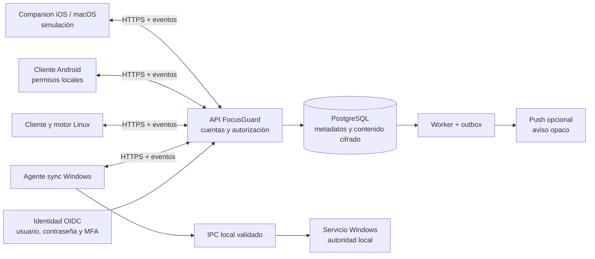

# Plan detallado: FocusGuard Cloud y sincronización entre dispositivos

Fecha: 11 de octubre de 2026.
Repositorio oficial actual (migrado el 13 de octubre): `D:\Users\Stuart\Documents\Portafolio\Trabajos\Totem\FocusGuard`. La referencia `E:\FocusGuard\FocusGuard-Autopilot` describe la ubicación inicial del documento.
Referencia de lectura: commit `cb14edb`, con cambios locales preexistentes.
Estado actualizado el 15 de octubre de 2026: Fases 0 y 1 están implementadas para staging; la aceptación principal de Fase 2, incluida la transferencia E2EE entre dos Windows, está completada con evidencia física/reportes directos y pruebas sintéticas. Fase 3 integra en Windows la sincronización automática, opt-in persistente, reanudación DPAPI, wake-up de red consentido, recuperación segura, conflictos, tombstones y reset global con vista previa. El backoff/Retry-After mantiene prioridad al reconectar. Falta la aceptación física de sincronización automática entre dos PCs; no se afirma que el bloqueo multidispositivo esté disponible.
Segunda revisión: 11 de octubre de 2026; correcciones de consistencia, seguridad y ejecución documentadas en la sección 22.
Ampliación del alcance: modo estricto remoto en todos los dispositivos, solicitado por el propietario; Apple conserva bloqueo simulado.
Autoridad del alcance: petición del propietario. Este documento propone ampliar el producto Windows actual; no sustituye automáticamente las especificaciones ni los ADR aceptados.

## 1. Resultado que se quiere conseguir

Una cuenta FocusGuard conecta Windows, Linux, Android, macOS e iPhone a un servicio cloud. Desde un dispositivo autorizado, la persona pulsa **Bloquear en todos mis dispositivos**, revisa perfil y hora de finalización, y los demás dispositivos reciben la misma intención de sesión. Cada dispositivo aplica lo que realmente soporta y devuelve una confirmación verificable.

Las pantallas de cuenta permiten crear usuario y contraseña, iniciar sesión, recuperar acceso, administrar perfil personal, vincular y revocar dispositivos y controlar los ajustes globales. La sincronización comparte únicamente los datos necesarios, con perfiles y ajustes privados cifrados de extremo a extremo.

El alcance incluye **modo estricto remoto en todos los dispositivos**: una sesión estricta iniciada desde un dispositivo autorizado se coordina en Windows, Linux, Android, macOS e iPhone. Windows/Linux/Android aplican únicamente las restricciones estrictas que hayan demostrado soportar; macOS/iPhone reciben la misma sesión y muestran su modo estricto simulado. No se degrada automáticamente una solicitud estricta a una sesión normal.

**Excepción explícita de esta primera etapa:** iOS/iPhone y macOS muestran el estado de sesión y una pantalla de bloqueo simulada dentro de la aplicación. No restringen otras aplicaciones, navegación ni funciones del sistema. Esta limitación aparece en onboarding, lista de dispositivos, revisión y pantalla activa.

### 1.1 Ejemplo verificable

1. La persona inicia sesión en Windows y vincula Android, Linux, un Mac y un iPhone.
2. Autoriza por separado en cada dispositivo recibir sesiones remotas normales.
3. Elige el perfil «Trabajo» y 50 minutos.
4. Pulsa «Bloquear en todos mis dispositivos».
5. Ve una revisión con destinos, alcance, dispositivos pendientes y finalización exacta.
6. Windows confirma los canales de bloqueo disponibles; Linux y Android confirman solo capacidades habilitadas y probadas.
7. Mac e iPhone muestran «En enfoque — modo simulado».
8. La computadora muestra, por ejemplo: «2 dispositivos protegidos, 1 pendiente y 2 en simulación».
9. Un Android pendiente al reconectarse consulta el estado vigente. Si se conecta 3 minutos después, quedan como máximo 47 minutos y puede aplicarlos dentro de la ventana tardía predeterminada de 10 minutos. Si vuelve cuando solo quedan 12 minutos, requiere confirmación local, salvo que se autorizara previamente una ventana mayor. Nunca reinicia los 50.
10. Al finalizar, cada motor libera localmente sus restricciones aunque el servidor no responda.

El botón expresa la intención global. El estado agregado expresa lo que los dispositivos han confirmado. Una aceptación HTTP o un envío push nunca equivalen a bloqueo aplicado.

## 2. Alcance, límites y supuestos decididos autónomamente

| Tema | Decisión de planificación |
|---|---|
| Usuarios | Una persona y sus propios dispositivos; sin supervisión de terceros |
| Identificador de acceso | Correo verificado como usuario, contraseña y nombre visible independiente |
| Cuenta | Obligatoria para vinculación y sincronización cloud; modo local Windows sigue disponible |
| Windows | Reutilizar servicio y canales actuales; no reemplazar el motor |
| Linux | Bloqueo normal y estricto remoto mediante adaptadores compatibles, con recuperación y pruebas reales |
| Android | Bloqueo normal y estricto remoto sujeto a permisos y viabilidad; declarar límites del sistema |
| iPhone y macOS | Cliente sincronizado con simulación visible, sin bloqueo del sistema |
| Modo estricto remoto | Incluido en todos los dispositivos; enforcement real donde se valide y simulación explícita en Apple |
| Sesiones globales | Temporizador normal como primer incremento; estricto remoto como entrega requerida; ciclos y agenda después |
| Infraestructura | Arquitectura autoalojable; proveedor concreto pendiente de evaluación operativa |
| Privacidad | Sin anuncios, venta de datos, telemetría de uso ni historial cloud por defecto |
| Zero Data Retention (ZDR) | Aplicar a categorías excluidas y contenido privado descifrado en cloud; no prometer ZDR total del servicio |
| Historial y reflexiones | Locales; sincronización futura solo mediante consentimiento separado |
| Distribución Apple | Prototipo web/PWA primero; nativo de prueba opcional con acceso a Mac |
| Entrega de esta tarea | Solo este Markdown |

Se propone un máximo inicial de 10 dispositivos por cuenta y sesiones cloud normales de 1 minuto a 24 horas, como límites configurables y revisables. No cambian los límites locales existentes de 1 minuto a 30 días ni el límite estricto inicial de cuatro horas.

Para estricto remoto, duración inicial entre 1 minuto y 4 horas en todas las plataformas. El límite se aplica en cloud y destino, sin exceder el máximo consentido localmente. Cualquier ampliación requiere un cambio explícito de política y pruebas; no se hereda automáticamente el máximo de una sesión local.

### 2.1 Supuestos que no deben convertirse en falsas garantías

- No hay activación simultánea garantizada entre dispositivos desconectados, suspendidos o apagados.
- Una sesión cloud no otorga permisos del sistema ni instala extensiones.
- Un cliente vinculado no puede ejecutar comandos arbitrarios en otro dispositivo.
- El cloud coordina; el servicio local decide si la operación es válida y cuándo liberar.
- No tener membresía Apple no impide todo prototipo. La simulación se adopta por alcance explícito, sin asumir que pagar una membresía habilitaría cualquier tipo de bloqueo.
- Ningún diseño puede garantizar cero fugas ante cualquier compromiso. «No fugar» se convierte en minimización, cifrado, controles, pruebas y respuesta a incidentes.
- Un servidor autoalojado sigue procesando metadatos operativos; no debe describirse como invisible para todos los proveedores.

## 3. Base existente y puntos de integración

Se revisaron `AGENTS.md`, `SPEC.md`, `UX_SPEC.md`, `THREAT_MODEL.md`, `AUTOPILOT.md`, ADR 0001/0002/0009, contratos, preferencias y proyectos relevantes.

| Componente actual | Evidencia y reutilización |
|---|---|
| .NET/C# | `Directory.Build.props` usa .NET 10, C# 14, nullable y warnings como errores |
| Dominio | `FocusGuard.Domain/Session.cs`: sesiones finitas, transiciones y límites |
| Servicio | `FocusGuard.Service`: autoridad de estado, activación y expiración |
| IPC Windows | `FocusGuard.Ipc.Windows`: identidad, autorización y mensajes acotados |
| Contratos | `FocusGuard.Contracts`: validación estricta, identidad y revisiones |
| Cliente | `FocusGuard.Client`: workflows, contratos, acceso local y preferencias |
| UI Windows actual | `FocusGuard.Host.Windows`: WinForms/WebView2 con React desde `FocusGuard.UI` |
| UI anterior | `FocusGuard.Desktop`: Avalonia; evitar añadir dos implementaciones divergentes |
| Estado local | `FocusGuard.Storage`: SQLite, perfiles e historial |
| Bloqueo de procesos | Agente por usuario y capas Windows existentes |
| Navegador | Extensión Manifest V3 y host de mensajería nativa |
| Diseño | `docs/design/FOCUSGUARD_DESIGN.md`, tokens y `zen.css` |

El README describe una base Avalonia y contiene advertencias históricas. El plan toma también en cuenta el host React/WebView2 existente y no trata el README como inventario actualizado de capacidades probadas.

ADR 0009 permite una sesión activa con protección degradada cuando solo algunos canales reconocen la política. El agregado cloud deberá conservar esta distinción; no debe exigir ficticiamente que todos los canales estén sanos para reconocer una protección parcial.

El grafo se consultó como navegación. Su informe incluye muchos artefactos compilados/minificados y referencia un commit anterior; las decisiones se apoyan en archivos fuente y especificaciones, no en la centralidad de símbolos minificados.

### 3.1 Ampliación propuesta de módulos

Nombres orientativos para implementación futura:

- `FocusGuard.Cloud.Contracts`: DTO versionados, errores y límites.
- `FocusGuard.Sync.Core`: reconciliación, revisiones, conflictos, deduplicación.
- `FocusGuard.Sync.Security`: integración de bibliotecas criptográficas y almacenamiento seguro.
- `FocusGuard.Sync.Agent`: proceso de usuario Windows independiente de la ventana.
- `FocusGuard.Cloud.Api`: ASP.NET Core, dispositivos, ajustes cifrados y sesiones.
- `FocusGuard.Cloud.Worker`: outbox, reintentos, expiración de entregas y tareas operativas.
- `FocusGuard.Platform.Linux`: adaptador local de bloqueo y recuperación.
- `FocusGuard.Android`: cliente nativo Kotlin con capacidades locales.
- `FocusGuard.Companion.Web`: prototipo responsive para Apple, con datos cloud reales.
- `tests/FocusGuard.Sync.*` y `tests/FocusGuard.Cloud.*`: suites futuras.

La UI React puede aportar tokens, estructura y lógica de presentación, pero WebView2, named pipes, Win32 y DPAPI no se trasladan directamente a Linux o móviles. Separar transporte, presentación y enforcement antes de reutilizar código.

## 4. Alternativas y decisión arquitectónica

| Alternativa | Esfuerzo | Ventajas | Costes y riesgos |
|---|---|---|---|
| A. Backend gestionado + auth gestionada + clientes mínimos | Medio | Validación rápida, menos operación propia | Dependencia del proveedor y más encargados de datos; E2EE y reconciliación siguen siendo necesarias |
| B. Monolito modular ASP.NET Core + PostgreSQL + identidad autoalojada | Alto | Encaja con C#, control operativo, interfaces abiertas, migración posible | Requiere operar identidad, backups, actualizaciones y vigilancia |
| C. P2P entre dispositivos con relay mínimo | Muy alto | Menos contenido central | NAT, móviles dormidos, disponibilidad y recuperación complicadas |

**Elegida para este plan: B**, con despliegue sencillo, una región y sin microservicios ni Kubernetes iniciales. Preserva el stack del proyecto y permite tratar la privacidad como parte de la arquitectura. La primera entrega reduce alcance funcional a dos Windows, sin reducir los controles de aislamiento o cifrado.

Identidad recomendada: Keycloak autoalojado como proveedor OIDC, sujeto a validar soporte, licencias, mantenimiento y configuración de seguridad. Evita desarrollar desde cero almacenamiento de contraseñas, MFA y recuperación. ASP.NET Core valida identidad y aplica autorización de producto; Keycloak no decide qué dispositivo puede bloquear otro. [Documentación OIDC](https://www.keycloak.org/securing-apps/oidc-layers), [configuración de producción](https://www.keycloak.org/server/configuration-production).

## 5. Arquitectura objetivo

### 5.1 Responsabilidades

**Cloud**

- Validar identidad, pertenencia, revocación y límites de cuenta.
- Guardar revisiones y sobres cifrados sin descifrar perfiles privados.
- Aceptar transacciones de sesión de forma idempotente.
- Mantener una secuencia por cuenta para ordenar intenciones concurrentes.
- Publicar avisos, conservar entregas pendientes y recibir estados.
- Exponer un snapshot coherente para reconexión.
- Operar retención, exportación y borrado.

**Agente de sincronización**

- Autenticarse sin alojar secretos en JavaScript.
- Verificar firmas, descifrar y validar contratos.
- Compilar la política apropiada al sistema y al usuario local.
- Presentar/recordar consentimiento de recepción remota.
- Solicitar activación por canales locales explícitamente autorizados.
- Persistir identificadores procesados y confirmaciones pendientes.
- Converger con el snapshot vigente sin reactivar órdenes antiguas.

**Motor local**

- Mantener autoridad de sesiones, salud por canal y finalización.
- Rechazar snapshots corruptos o acciones fuera del consentimiento.
- Aplicar exclusiones de seguridad y recuperación.
- Liberar independientemente de cuenta, UI, push o cloud.

### 5.2 Transportes

HTTPS para operaciones y snapshots; SignalR/WebSocket para aviso rápido con el cliente despierto. El evento contiene un cursor y una referencia, no una política aplicada automáticamente. El cliente consulta el snapshot autorizado para evitar ejecutar eventos obsoletos.

Polling de respaldo: 15–30 segundos en escritorio activo, con jitter; 60–300 segundos en reposo. Son valores iniciales de diseño, sujetos a medición. Android usa mecanismos permitidos por el sistema; no se promete polling continuo en segundo plano.

FCM es opcional y transmite únicamente un aviso opaco de actualización. Si se desactiva, mantener sincronización en primer plano y explicar la degradación. La prioridad push tiene restricciones operativas y no garantiza ejecución inmediata. [Prioridad FCM](https://firebase.google.com/docs/cloud-messaging/android-message-priority).

No abrir puertos entrantes en el equipo ni exponer el servicio local a Internet.

## 6. Cuenta, login y perfil personal

### 6.1 Pantallas requeridas

| Pantalla | Contenido | Estados y reglas |
|---|---|---|
| Bienvenida | «Continuar localmente», «Conectar mis dispositivos» | Explicar cuenta y alcance Apple |
| Crear cuenta | Correo/usuario, contraseña, confirmación, términos y privacidad | Validación, envío pendiente, rate limit, error recuperable |
| Verificar correo | Estado, reenviar, cambiar correo | Enlace de un solo uso, caducidad, límites |
| Iniciar sesión | Correo/usuario, contraseña, mostrar/ocultar, recuperar acceso | Mensaje genérico de credenciales inválidas |
| MFA | Código o llave compatible, códigos de recuperación | Reintentos limitados; no enviar códigos a logs |
| Recuperación | Solicitar enlace, crear nueva contraseña | Mismo resultado público exista o no la cuenta |
| Perfil personal | Nombre visible, correo verificado, idioma, zona horaria | Cambio de correo con verificación y reautenticación |
| Seguridad | Contraseña, MFA, sesiones, dispositivos, revocar | Operaciones sensibles requieren login reciente |
| Privacidad | Datos tratados, exportación, borrar cuenta | Consecuencias y retención claramente expuestas |

Distinguir **perfil personal de cuenta** de **perfil de bloqueo**. No reutilizar el mismo término sin aclaración en las pantallas.

### 6.2 Flujo de autenticación seguro

1. La pantalla de la app muestra «Iniciar sesión de forma segura».
2. Abre el navegador del sistema en el dominio de identidad FocusGuard.
3. El formulario de usuario y contraseña se sirve desde el proveedor OIDC, con apariencia FocusGuard y accesibilidad.
4. Authorization Code + PKCE S256, `state`, `nonce` y callbacks registrados.
5. El componente nativo intercambia el código y valida emisor/audiencia.
6. Los tokens quedan en almacenamiento seguro nativo; React recibe solo estado de cuenta sanitizado.
7. El usuario autenticado aún debe vincular y autorizar el dispositivo.

No implementar password grant ni pedir al bridge React que envíe la contraseña al servicio Windows. No incrustar un client secret en clientes públicos. El navegador externo y PKCE siguen las recomendaciones para clientes nativos. [RFC 8252](https://www.rfc-editor.org/info/rfc8252/), [RFC 9700](https://www.rfc-editor.org/rfc/rfc9700.html).

La PWA usa sesión web con cookies Secure/HttpOnly/SameSite y BFF; operaciones mutantes protegidas frente a CSRF. No almacenar refresh tokens en localStorage. Las claves de E2EE que necesita el navegador siguen estando expuestas al código autorizado del origen: es una limitación específica que exige CSP y control de scripts.

### 6.3 Políticas propuestas

- Contraseñas: mínimo 15 caracteres cuando se usen como único factor; permitir gestores, pegado y contraseñas largas sin truncado silencioso.
- Comprobar contraseñas comprometidas con un mecanismo que no envíe la contraseña completa.
- MFA disponible desde la primera fase; obligatorio para administración de infraestructura.
- Access token de unos 5 minutos; sesiones de refresh rotables, revocables, con límites de inactividad y absolutos configurados.
- Validar que el proveedor detecte reutilización de refresh tokens y revoca la familia afectada; no asumirlo sin prueba de configuración.
- Cambio de contraseña o incidente: opción de cerrar todas las sesiones.
- Recuperación de login nunca equivale a recuperación de claves E2EE.
- El algoritmo de hash lo opera el proveedor. Si alguna credencial propia es imprescindible, usar implementación probada y parámetros medidos; Argon2id es una opción recomendada por OWASP. [Password Storage](https://cheatsheetseries.owasp.org/cheatsheets/Password_Storage_Cheat_Sheet.html).

## 7. Vinculación, identidad y autorización de dispositivos

### 7.1 Estado y capacidades

Estados del dispositivo: `pending`, `active`, `paused`, `revoked`. Presencia independiente: `online`, `offline`, `unknown`. Salud de protección independiente: `ready`, `degraded`, `simulation`, `unsupported`.

Registrar ID aleatorio por instalación, plataforma, versión, claves públicas, fecha de alta, última conexión aproximada y capacidades. Evitar seriales, IMEI, MAC de red, fingerprint invasivo o identificadores publicitarios.

Nombre visible del equipo cifrado; usar IDs opacos para routing. Las capacidades informadas por el cliente permiten UX y compatibilidad, pero no demuestran por sí solas que hubo bloqueo real.

Cada instalación mantiene pares de claves separados para firma y cifrado. El secreto no se copia a otros dispositivos. Reinstalar crea una identidad nueva.

### 7.2 Vincular el primer dispositivo

1. Login y correo verificado.
2. Crear identidad criptográfica local.
3. Crear cuenta de sincronización y primera lista firmada de dispositivos.
4. Generar claves E2EE y recuperación separada.
5. Mostrar el kit de recuperación una vez; pedir confirmación de guardado.
6. Establecer si puede iniciar sesiones, recibirlas y qué perfil local aplicará.
7. Registrar consentimiento con alcance y versión.
8. Realizar una prueba de sincronización sin iniciar bloqueo.

### 7.3 Vincular otro dispositivo mediante QR o código

1. Login en la misma cuenta.
2. El cliente nuevo crea claves y una solicitud con nonce de 256 bits.
3. Mostrar QR/código de asociación, ID de solicitud y expiración propuesta de 5 minutos.
4. Un dispositivo confiable ve el equipo/plataforma y compara una huella corta en ambos.
5. Aprobar explícitamente en el dispositivo existente.
6. El dispositivo confiable firma la nueva membresía y cifra las claves compartidas para la clave pública exacta del nuevo dispositivo.
7. El servidor consume la solicitud una sola vez en transacción.
8. El nuevo cliente valida la membresía, descifra y confirma recepción.
9. Solo entonces aparece «Conectado».
10. Configurar recepción remota en el propio nuevo dispositivo.

El QR no contiene contraseñas, refresh tokens ni claves de cuenta. El código manual tiene límites estrictos de intentos y no reemplaza la comprobación de identidad y huella. No aprobar solicitudes solo por compartir correo.

Si no existe dispositivo confiable, usar el kit de recuperación E2EE. Si también se perdió, recuperar el login permite reinicializar la sincronización con claves nuevas, no descifrar el contenido anterior.

La recuperación de membresía necesita una raíz de firma de recuperación separada de la clave de contenido, respaldada cifrada en el kit. La primera vinculación fija su clave pública como ancla. Una transición de recuperación exige login reciente y firma de esa raíz; solo poseer la clave compartida de cifrado no autoriza añadir dispositivos. Sin kit ni dispositivo confiable, la reinicialización crea una nueva generación de cuenta sync, revoca la membresía anterior y exige nuevo consentimiento local de recepción en todos los equipos. Nunca sustituir silenciosamente su ancla.

### 7.4 Permisos por dispositivo

Opciones: «Puede iniciar sesiones globales», «Puede iniciar sesiones estrictas remotas», «Puede recibir sesiones», «Incluido por defecto», «Aceptar temporizadores normales», «Aceptar modo estricto remoto», «Duración remota máxima» y «Perfil local asignado».

Recibir estricto remoto requiere habilitación local separada, inicialmente desactivada, con límites, canales autorizados, advertencias, recuperación preparada y prueba de disponibilidad. El usuario puede preautorizar futuras sesiones estrictas desde sus dispositivos confiables; no necesita confirmar cada inicio en cada equipo si sigue dentro de ese consentimiento. El cloud no puede otorgar esa preautorización ni ampliar sus límites.

La preautorización es una ampliación propuesta del protocolo existente, no una capacidad actual. Antes de implementarla, actualizar SPEC/ADR para describir confirmación remota, reconocimiento de trabajo sin guardar y preparación de recovery. Propuesta inicial: credencial de recuperación local provisionada con el propietario presente, mostrada una vez, almacenada solo como hash salado y confirmada como guardada. Emitir tickets únicamente mientras siga válida; no generar en segundo plano un código que nadie pueda guardar. Reutilizarla durante su vigencia requiere decisión explícita en el ADR; si se exige código nuevo por sesión, el destino requiere preparación local interactiva antes de emitir el ticket. Nunca fingir el ACK de código guardado. Rotarla mediante revisión local, fuera de una sesión activa.

El consentimiento estricto identifica iniciadores, perfiles/revisiones permitidos y canales mínimos. Un dispositivo nuevo no hereda permiso de iniciar estricto por defecto. Revocar consentimiento bloquea preparaciones/commits nuevos; no cambia el fin de una ejecución ya aplicada.

La habilitación de permisos OS, recovery y recepción remota se hace localmente. Ningún ajuste cloud los activa silenciosamente. En Windows multiusuario, ligar la cuenta cloud al SID/perfil local; el servicio valida esa identidad y no aplica órdenes a sesiones de otros usuarios.

### 7.5 Revocación

Reautenticar para revocar; registrar transacción, cerrar conexiones, negar tokens operativos y futuros comandos/ACK. Un ACK de un dispositivo revocado ya no cambia el agregado.

La denegación de acceso es inmediata; rotar claves requiere un miembro confiable o kit disponible. Hasta completar la rotación, impedir publicaciones nuevas de contenido compartido, sin impedir expiración/recovery local.

Rotar la época de cifrado para datos futuros y distribuir nuevas claves solo a los miembros autorizados. Un dispositivo revocado puede conservar contenido que ya recibió; no prometer borrado remoto comprobable.

Si está offline y mantiene una sesión ya aceptada, esta vence localmente según su límite. Revocar la cuenta no debe crear un bloqueo indefinido ni afirmar que se logró borrado inmediato del dispositivo.

## 8. Semántica de «Bloquear en todos»

### 8.1 Intención global y estado local

Separar:

- `GlobalSessionIntent`: perfil/revisión, destinos congelados, inicio, fin, modo y política de aplicación tardía.
- `DeviceSessionExecution`: recibido, validado, preparación, activación, capacidades aplicadas y resultado local.
- `GlobalSessionAggregate`: resumen derivado de ACK recientes, con fecha de observación.

Estados por ejecución:

| Estado | Significado |
|---|---|
| Pending | Orden aceptada en cloud, sin respuesta local |
| Received | Cliente obtuvo el snapshot |
| Prepared | Política local validada y lista, aún sin bloqueo |
| Applied | Canales requeridos y soportados confirmados |
| AppliedDegraded | Parte de la protección prevista fue confirmada |
| Simulated | Pantalla de enfoque aplicada sin enforcement |
| Rejected | Sin permiso, perfil incompatible o sesión local incompatible |
| Expired | Ventana terminada; no debe activarse |
| Stopped | Parada normal aplicada |
| Interrupted | Motor/sistema interrumpió una sesión normal |
| RecoveryPending | Recuperación local estricta autorizada, aún dentro de su demora |
| Recovered | Recuperación estricta completada en ese destino |
| Unknown | La confirmación quedó obsoleta; se desconoce el estado actual |

### 8.2 Flujo transaccional

1. El cliente origen verifica conexión, cuenta, membresía y permiso de inicio.
2. Selecciona perfil cifrado, revisión y destinos incluidos en ese instante.
3. Solicita disponibilidad, capacidades y situación actual.
4. Presenta revisión: hora exacta, alcance real, simulaciones y pendientes.
5. Firma la intención con clave autorizada y envía una clave de idempotencia.
6. Cloud valida los campos de routing, autorización y límites; en una transacción asigna secuencia, almacena intención y outbox.
7. Un fallo entre commit y publicación se recupera desde outbox.
8. Cada destino consulta estado vigente, verifica firma, membresía, caducidad y consentimiento.
9. Descifra el snapshot, valida todos los límites y mapea reglas locales.
10. Ejecuta preparación/activación por el contrato local autorizado: flujo normal o flujo estricto remoto específico según el modo; no convertir uno en otro.
11. Persiste el resultado y envía ACK firmado.
12. El origen actualiza el agregado por dispositivo.

La firma del origen cubre los campos de intención disponibles antes del envío: IDs, destinos, revisión de membresía, época, schema, inicio/fin, modo y digest del ciphertext. La secuencia asignada al aceptar se devuelve en un recibo del servidor que vincula esa secuencia al digest de la intención. No exigir al origen firmar una secuencia que todavía no existe. El ACK del destino firma también la secuencia recibida. El servidor puede comprobar límites públicos, pero el contenido cifrado solo lo validan clientes; ambos deben imponer límites de tamaño y los clientes los límites internos de política.

La secuencia del servidor sirve para coordinación operacional. La autenticidad de la intención depende de la firma del dispositivo, no de la firma del servidor; un servidor comprometido aún puede ocultar o reordenar mensajes válidos, dentro de los límites de detección descritos en la sección de privacidad.

### 8.3 Entrega y reconexión

- Entrega al menos una vez; efectos locales idempotentes mediante `commandId`, `sessionId` y secuencia.
- Tras reconectar, obtener snapshot/cursor; no ejecutar una cola histórica a ciegas.
- Una parada recibida antes del inicio deja una marca terminal que impide aplicar el inicio atrasado.
- Un comando expirado se reconoce como Expired, nunca revive.
- Guardar estado suficiente antes de confirmar para sobrevivir a crash.
- Detectar ACK duplicados, fuera de orden o vinculados a otra sesión.
- La activación de una sesión normal no se restaura automáticamente después de reboot: conservar el comportamiento Windows actual.
- Una sesión estricta remota ya comprometida y aplicada usa persistencia local íntegra y recuperación tras reboot solo en plataformas donde ese comportamiento esté probado. Mantiene el fin original; restaurar esa ejecución no significa aceptar de nuevo un comando remoto viejo.
- Persistir una marca de interrupción y no reinterpretar la misma intención global como una orden nueva. La UI requiere una nueva acción explícita si quiere iniciar otra sesión.
- Si se perdió identidad local por reinstalación, no aplicar sesiones anteriores sin nueva vinculación.
- Reintentos con backoff exponencial, jitter y límite de tiempo; no bucles infinitos.

### 8.4 Política de dispositivos tardíos

Esta sección regula sesiones normales. Para Strict prevalecen los tickets y reglas de la sección 8.8.

Por defecto, los dispositivos que ya pertenecían al conjunto de destinos pueden aplicar el tiempo restante si todavía no aceptaron esa sesión, está vigente y su consentimiento permite recepción remota.

Los dispositivos vinculados después del inicio no se incluyen automáticamente. Mostrar «Unirse a la sesión activa» con revisión local. No reiniciar una ejecución ya interrumpida o parada.

Para evitar bloquear mucho más tarde de lo esperado, ofrecer un límite local de aplicación tardía; por defecto propuesto 10 minutos desde el inicio. Fuera de esa ventana, marcar «Requiere confirmación local». Este límite se explica en la revisión y puede elegirse antes de iniciar; no altera una sesión activa.

### 8.5 Conflictos

| Caso | Regla |
|---|---|
| Dos inicios simultáneos | Una transacción por cuenta/revisión; el segundo devuelve conflicto con la sesión vigente |
| Sesión local estricta activa | Rechazar superposición y no cambiarla |
| Solicitud estricta sin permiso local específico | Rechazar; no heredar consentimiento de modo normal |
| Preparación estricta con destino offline | No hacer commit «en todos»; cancelar o revisar otro conjunto explícitamente |
| Parada normal contra una sesión estricta | Rechazar en API y en cada motor local |
| Sesión local normal activa | No sustituirla silenciosamente; rechazar y ofrecer resolución explícita |
| Editar perfil mientras bloquea | Nueva revisión para sesiones futuras; snapshot activo inmutable |
| Parar y recibir inicio viejo | La secuencia y marca terminal impiden reiniciar |
| Cambiar duración en otro equipo | No extender la sesión activa; iniciar una nueva tras finalizar |
| Saltar descanso | Fuera del temporizador MVP; en ciclos futuros cambio firmado y revisión de fase |
| Dispositivo nuevo durante sesión | Fuera del conjunto congelado; adhesión local explícita |

Hay como máximo una intención global vigente por cuenta, normal o estricta. No se usa «último timestamp gana» para acciones que alteran bloqueo.

### 8.6 Tiempo, expiración y seguridad

UTC en contratos, zona local en pantalla y reloj monotónico para el transcurso. Estimar desfase con servidor y margen de incertidumbre; si el cliente no puede acotar el tiempo fiable, rechazar activación remota y explicar la causa.

Un retraso nunca añade duración. En cada destino: fin permitido = el menor entre fin global, límite local consentido y duración restante validada. No depender de heartbeats cloud para mantener una sesión válida; las leases de enforcement local siguen la semántica existente.

El mínimo anterior es un límite de seguridad, no autorización para truncar silenciosamente la sesión revisada. Antes de preparar/aplicar, si el tiempo restante hasta el fin global supera el máximo local consentido, el destino rechaza y el origen debe revisar una duración menor o un conjunto diferente. Los destinos que aceptan conservan el fin absoluto revisado; Strict no convierte un ticket limitado en uno de duración distinta durante commit.

Los canales liberan según expiración local, pérdida de autoridad local o integridad inválida. Un mensaje cloud corrupto se rechaza y no toca una sesión local válida. Una persistencia activa local corrupta conserva la recuperación/fail-open del proyecto.

### 8.7 Parar globalmente y recuperación

«Finalizar en todos» se admite para sesiones cloud normales desde un iniciador autorizado. Devuelve resultados por dispositivo; los offline quedan «Parada pendiente» y mantienen como máximo su fin original.

Recuperación estricta Windows continúa offline, elevada y con demora según especificación. No sincronizar códigos locales de recuperación ni permitir que una orden cloud evite ese procedimiento.

Una sesión estricta remota rechaza «Finalizar en todos», parada normal, saltar descansos, desactivar enforcement y cambios que reduzcan el snapshot activo. Puede terminar por expiración, recuperación local documentada o liberación de seguridad por integridad/autoridad local según las reglas existentes. El origen no puede desbloquear dispositivos reales desde el cloud omitiendo sus requisitos locales de recuperación.

Logout, desinstalación de UI o caída del proveedor de identidad no añaden duración. El logout desconecta sincronización, pero una sesión ya aceptada termina por el motor local.

### 8.8 Modo estricto remoto en todos los dispositivos

**Objetivo:** iniciar una sesión estricta finita desde cualquiera de los cinco clientes autorizado para hacerlo, y propagar el mismo modo, perfil inmutable y fin absoluto al conjunto elegido. La modalidad real o simulada se indica por destino, sin afirmar enforcement universal.

#### Preparación, revisión y commit

1. Seleccionar «Modo estricto» y «Mis dispositivos», con duración y perfil.
2. Reautenticar en el origen; exigir MFA si está configurado y mostrar nombre del perfil para confirmación deliberada. Escribir el nombre no sustituye autenticación.
3. Comprobar consentimiento estricto vigente, pertenencia, límites, capacidades, salud, ausencia de sesiones incompatibles y recuperación local preparada en cada destino real.
4. Enviar preparación firmada sin aplicar bloqueo. Cada motor valida el snapshot y devuelve un ticket firmado de un solo uso, vinculado a sesión, hash, modo, fin, consentimiento, membresía y plazo de preparación.
5. Las preparaciones caducan como máximo en dos minutos, liberan reservas y nunca aplican restricciones por sí mismas. Reconducir el protocolo preparado Windows al plazo vigente del servicio.
6. Mostrar destinos «Estricto real», «Estricto limitado», «Simulación Apple» o «No preparado», junto con hora exacta y canales. Un dispositivo cuya capacidad estricta no esté validada queda «No compatible»; no convertirlo silenciosamente en normal.
7. Para la acción «en todos», exigir tickets vigentes de todos los destinos seleccionados, incluidos los clientes Apple de simulación. Si alguno está offline/no preparado, esperar dentro del plazo o cancelar. El usuario puede cambiar explícitamente el conjunto y repetir revisión; la UI deja de presentarlo como todos sus dispositivos.
8. Tras la confirmación final, el origen firma el commit con todos los tickets y el fin revisado. Cloud lo persiste transaccionalmente y publica mediante outbox.
9. Cada destino verifica commit, ticket, vigencia y consentimiento de nuevo, persiste su decisión y activa exactamente una vez. Windows utiliza el flujo estricto local autorizado, sin simular confirmaciones ni eludir recovery.
10. Los motores reales devuelven ACK del modo, snapshot, fin y canales; Apple devuelve Simulated con modo solicitado Strict. La pantalla origen muestra cualquier pendiente o activación parcial.

Cada ticket vincula el digest de política lógica, digest compilado local, revisión del mapeo de apps, versión del consentimiento y canales mínimos. Cambiar mapeo/permiso/consentimiento tras preparar invalida el ticket; no recompilar una política distinta al hacer commit. El estado de recovery preparado se acredita sin enviar su secreto ni hash de credencial al cloud.

Fijar el fin absoluto antes de preparar y mostrarlo en la revisión final: preparar consume tiempo de la sesión. Si hacen falta tickets nuevos, renovar la revisión visible. Los tickets deben estar vigentes tanto al aceptar el commit como al consumirlo en cada destino; nunca activar un ticket vencido porque su recibo de servidor sea antiguo y válido.

**No hay atomicidad garantizada de aplicación entre sistemas.** Tener todos los tickets antes del commit reduce fallos, pero un dispositivo puede perder red o permisos después. No mostrar «estricto aplicado en todos» hasta recibir los ACK correspondientes, y seguir distinguiendo las simulaciones. No enviar una parada normal como rollback de un estricto ya aplicado; los destinos activos mantienen expiración y recuperación local.

#### Desconexión y aplicación tardía

- Un destino sin preparar no se añade posteriormente a una sesión estricta por una regla de aplicación tardía normal.
- Un destino preparado que pierde red tras el commit puede aplicar al reconectar solo si su ticket sigue vigente, no ejecutó ya la sesión y el fin/límites siguen siendo válidos.
- Si el ticket expiró, no bloquear de forma sorpresiva. Exigir preparación y confirmación local explícitas para adherirse por el tiempo restante; nunca reiniciar ni extender el fin global.
- La pérdida de acceso cloud, logout o revocación no eliminan la ejecución estricta ya aplicada. Impiden órdenes nuevas; el motor sigue su fin y recuperación offline.
- Recuperar un destino afecta únicamente a ese destino: el agregado muestra Recovered, mientras los demás permanecen estrictos hasta expirar o recuperar localmente.

#### Alcance real por plataforma

| Plataforma | Estricto remoto previsto | Condición de aceptación |
|---|---|---|
| Windows | Servicio estricto local, snapshot íntegro y recuperación existente | Pruebas de expiración, reboot, reloj, canales y recovery offline |
| Linux | Motor local con persistencia finita y recuperación independiente | Implementación específica y pruebas instaladas antes de declarar capacidad |
| Android | Controles estrictos dentro de las APIs/permisos consentidos y probados | Advertir evasiones del OS; no prometer resistir force-stop, administrador o pérdida de permisos |
| macOS | Modo estricto simulado dentro de la app | Mostrar aviso; no afirmar protección del sistema ni persistencia de bloqueo |
| iPhone | Modo estricto simulado dentro de la app | Mismo estado cloud; cerrar/cambiar de app sigue siendo posible |

«Estricto» resiste cancelación impulsiva dentro de capacidades declaradas; conserva los límites del proyecto frente a un administrador determinado. Android/Linux no se anuncian con garantías equivalentes a Windows sin evidencia. El estricto remoto de todos los dispositivos es un requisito del plan y tiene una fase obligatoria; las limitaciones de plataforma se hacen visibles, no se ocultan mediante ACK ficticios.

#### Estados de coordinación y reserva de cuenta

- Preparing → Ready → Committed; Preparing/Ready también pasan a Cancelled o PreparationExpired. Toda reserva caduca en un máximo de dos minutos y se libera sin intervención del origen.
- El commit hace compare-and-swap desde Ready y valida membresía, destinos, tickets y revisiones. Cancel y commit concurrentes tienen un solo ganador; si gana commit, cancelar devuelve conflicto y nunca genera parada.
- Committed es una decisión, no enforcement. El agregado muestra Active, PartiallyApplied o Unknown según ACK y se vuelve Expired al llegar el fin original. Los destinos conservan sus estados locales.
- Un commit sin ningún ACK libera la exclusión de cuenta al llegar su fin; no deja la cuenta ocupada indefinidamente. Un fallo parcial no autoriza activaciones con tickets vencidos.
- Parar una sesión normal prohíbe inicios tardíos, pero un destino offline puede seguir bloqueado hasta su fin/reconcile. Una nueva sesión advierte ese posible solapamiento y el destino rechaza mientras siga ocupado localmente.
- Preparar reserva el lugar de sesión global frente a inicios normal/Strict concurrentes; no reemplaza una sesión vigente ni impide recovery local.

## 9. Ajustes globales interdispositivo

### 9.1 Propiedad y prioridad

Orden: límites de seguridad del sistema > snapshot de sesión activa > consentimiento local > override local explícito > ajustes globales > valores predeterminados.

| Ajuste | Cloud | Override local | Efecto |
|---|---|---|---|
| Idioma | Sí | Sí | Presentación |
| Tema Dark/Light | Sí | Sí | Presentación |
| Movimiento reducido | Sí | Sí; respetar OS | Accesibilidad |
| Duración predeterminada | Sí | Sí | Próxima sesión |
| Presets de ciclos | Sí, fase posterior | Sí | Próximas sesiones |
| Perfil por defecto | Sí, ID lógico | Mapeo por OS | Próxima sesión |
| Reglas web | Sí, cifradas | Compatibilidad local | Snapshot futuro |
| Grupos lógicos de apps | Sí, cifrados | Resolución local | Snapshot futuro |
| Inclusión de dispositivos | Sí | Consentimiento local prevalece | Próximo inicio |
| Modo predeterminado normal/estricto | Sí, cifrado | Consentimiento y revisión locales prevalecen | Próxima sesión, sin activar permisos |
| Permiso de estricto remoto y recovery | No concedido por cloud | Solo local, desactivado inicialmente | Capacidad estricta |
| Notificaciones | Preferencia global | Permiso OS prevalece | Presentación |
| Zona horaria de agenda | Sí, explícita | No inferir del último equipo | Agenda futura |
| Permisos OS y extensión | No | Solo local | Capacidad real |
| Rutas ejecutables/hash locales | No en MVP | Solo local | Reglas del equipo |
| Posición/tamaño de ventana | No | Solo local | UI |
| Habilitar enforcement | No automáticamente | Solo local | Protección |
| Recovery code | Nunca | Solo local | Recuperación |
| Historial/reflexiones | No por defecto | Local | Privacidad |

La preferencia actual `EnforcementEnabled` no se copia como permiso remoto. El campo global puede expresar una intención de producto, pero habilitar bloqueo requiere consentimiento y preparación local.

### 9.2 Protocolo de ajustes

- Documento cifrado versionado por entidad, con revisión base y ETag.
- El servidor aplica compare-and-swap con baseRevision. El cliente cifra y firma proposedRevision = baseRevision + 1; el servidor acepta exactamente esa revisión o devuelve conflicto. El cursor global de transporte se asigna después y queda fuera del AEAD del documento. El servidor no necesita leer ajustes.
- El cliente conserva base descifrada, borrador y nueva versión remota para merge de tres vías.
- Si campos distintos cambiaron, merge local seguro; si el mismo campo cambió, mostrar conflicto.
- Operaciones de política, consentimientos y borrado no se fusionan silenciosamente.
- Tombstones de borrado para impedir resurrección desde un equipo offline.
- Edición offline guardada como «Pendiente de sincronizar»; no publicar éxito global antes del commit.
- Versiones nuevas desconocidas provocan actualización requerida y conservan el estado local.
- «Pausar sync» no detiene el motor local ni borra datos.
- «Restablecer ajustes globales» requiere vista previa y no altera snapshots activos.

### 9.3 Perfiles portables

Usar un perfil lógico con grupos de apps y dominios. Windows traduce el grupo a rutas/hash, Android a package names y Linux a identificadores compatibles. Los detalles de instalación se guardan localmente.

Si falta mapeo, señalar exactamente qué grupos no pueden aplicarse. No convertir una regla incompleta en protección completa. Un identificador de app en otra plataforma no es una ruta ejecutable válida.

## 10. Privacidad, cifrado y gestión de claves

### 10.1 Clasificación de datos

| Datos | Ubicación/visibilidad | Justificación |
|---|---|---|
| Correo y hash de contraseña | Proveedor de identidad | Login y recuperación |
| ID cuenta/dispositivo, plataforma, versión | Cloud | Autorización y compatibilidad |
| Claves públicas, revocaciones, épocas | Cloud | Vinculación verificable |
| Nombre, perfiles, dominios, ajustes | Cloud cifrado E2EE | Sincronización privada |
| Idioma/zona horaria del perfil personal, si se sincronizan | Documento cifrado | El servidor no necesita interpretar estas preferencias |
| Sesión: ID, destinos, inicio/fin, estado básico | Cloud como metadatos | Routing, caducidad, estado agregado |
| Detalle de perfil y reglas de sesión | Cifrado E2EE | Ejecución local |
| ACK básico/código de resultado | Cloud, mínimo | Confirmar entrega/aplicación |
| Motivo detallado o etiqueta sensible | Cifrado o solo local | Evitar fuga por diagnóstico |
| URLs visitadas, contenido web, lista de procesos | No enviados | Innecesarios para coordinar |
| Objetivos/reflexiones e historial detallado | Local | Fuera de sync inicial |
| Tokens push | Cloud restringido | Aviso opcional |
| IP y logs de seguridad | Mínimos y con retención | Protección operacional |
| Kit recuperación E2EE | En poder de la persona | Recuperar claves |

No recolectar navegación, capturas de pantalla, teclado, contactos, archivos personales, localización precisa ni inventario completo de apps.

### 10.2 Esquema E2EE propuesto

- Clave aleatoria de cuenta para cifrar contenido; versiones/épocas separadas.
- AEAD mediante biblioteca probada, propuesta XChaCha20-Poly1305 con nonce aleatorio correcto y claves de 256 bits.
- Firma Ed25519 de cambios y comandos; claves de firma separadas de cifrado.
- Envolver la clave de cuenta para cada dispositivo mediante una construcción pública de biblioteca auditada.
- Asociar como authenticated data: cuenta, entidad, schema, revisión, época y destino cuando corresponda.
- Verificar firma del dispositivo autorizado además de autenticidad AEAD; compartir clave de cuenta no basta para demostrar autoría.
- Conservar lista de miembros firmada, cadena de cambios y ancla local para detectar sustitución de claves.
- Antes de activar remotamente, obtener membresía vigente con TTL corto; sin comprobación suficientemente fresca, no aceptar inicios nuevos.
- El servidor registra cambios de membresía secuenciados y los clientes verifican autorización de quien los firmó.
- Tras revocación, nueva época para contenido futuro; reencriptación del estado actual según inventario.
- No diseñar primitivas criptográficas propias. Validar vectores equivalentes C#, Kotlin y navegador y revisión externa antes del lanzamiento.

La documentación de libsodium ofrece construcciones AEAD y APIs probadas; la interoperabilidad concreta y el paquete elegido deben validarse antes de fijar el formato. [AEAD](https://libsodium.gitbook.io/doc/secret-key_cryptography/aead), [mensajes cifrados](https://doc.libsodium.org/secret-key_cryptography/encrypted-messages).

### 10.3 Recuperación E2EE

Generar secreto de recuperación aleatorio de alta entropía, separado de contraseña y recovery local Windows. El cloud guarda solo una copia de la clave de cuenta envuelta con una clave derivada de ese secreto mediante KDF estándar.

Probar que resetear contraseña no revela claves ni contenido anterior. Cuando no existe secreto ni dispositivo confiable, ofrecer reinicializar cifrado, con pérdida explícita del acceso al contenido cloud antiguo. No incluir una llave maestra de soporte.

Cambiar contraseña conserva la clave E2EE; rotar claves E2EE no sustituye la revocación de tokens de identidad.

Tras rotar contenido, publicar una envoltura de la época nueva bajo la clave pública de recuperación anclada. Así el kit vigente recupera la época nueva sin revelar su secreto al dispositivo que rota. Probar recuperación tras varias revocaciones. Ante compromiso del kit, sustituir también sus raíces/secretos mediante proceso explícito; no prometer que un kit antiguo deja de descifrar copias históricas.

### 10.4 Almacenamiento y límites

Windows: almacén/DPAPI ligado al usuario con ACL correctas. Android: Keystore para proteger secretos según capacidades verificadas. Linux: Secret Service/keyring; si no está disponible, pedir desbloqueo explícito del vault o restringir sync, sin persistencia insegura silenciosa. Apple nativo futuro: Keychain.

La PWA es una vía de simulación con garantías menores ante compromiso del origen: JavaScript puede acceder a claves durante uso. Mantener dependencias locales, sin scripts de terceros, CSP estricta, service worker controlado y ausencia de persistencia privada innecesaria.

E2EE protege contenido almacenado/interceptado, pero no oculta IP, tiempos, destinos ni un endpoint comprometido. Un servidor malicioso puede retrasar o suprimir mensajes; firmas, secuencias y anclas ayudan a detectar manipulación, sin garantizar disponibilidad ni frescura perfecta en clientes offline.

### 10.5 «No compartir datos»

Compromiso: no vender datos ni compartirlos con publicidad, brokers, analytics o herramientas de IA. El proveedor cloud aloja ciphertext y metadatos; el proveedor de correo trata correo de recuperación; FCM opcional trata token y aviso mínimo. Declarar esos encargados y permitir desactivar push.

No afirmar «ningún tercero procesa datos» si se usa infraestructura ajena. Evaluar región, subprocesadores, retención y acceso administrativo antes de elegir proveedor.

### 10.6 Retención propuesta

Esta tabla describe persistencia necesaria. Las categorías excluidas por 10.7 no se incorporan a logs ni backups. Guardar ciphertext sigue siendo retener datos, aunque el servidor no pueda leerlos.

| Clase | Retención inicial propuesta |
|---|---|
| Solicitudes de vinculación | 5 min de validez; eliminación dentro de 24 h |
| Entregas/intenciones terminales | 7 días tras fin para reconciliación |
| Tombstones y deduplicación | 90 días; clientes más antiguos requieren resync completa |
| Logs operativos sanitizados | 14 días |
| Eventos de seguridad | 30 días, mínimo necesario |
| Backups cifrados | 30 días |
| Exportaciones temporales | Máximo 24 h o generación local |
| Perfil/ajustes vigentes | Hasta borrado de entidad o cuenta |

Tras borrar cuenta: desactivar acceso de inmediato, eliminar datos activos dentro de 72 horas y dejar que backups expiren dentro de 30 días. Conservar un registro mínimo de supresión separado para reaplicar borrados al restaurar un backup; no resucitar cuentas eliminadas.

Exportación de contenido descifrado realizada en cliente confiable. El servidor exporta metadatos y ciphertext si no tiene las claves. La eliminación de cuenta no deja sesiones locales sin fecha de liberación.

Antes del borrado mostrar ejecuciones estrictas conocidas y explicar que borrar cuenta no desbloquea. El motor conserva snapshot, fin y recovery necesarios hasta terminar; la limpieza del vault sync no puede borrar esa autoridad local. Limpiar datos locales de sync después, según consentimiento y estado real. No garantizar borrado inmediato de equipos offline.

Estos tiempos son decisiones del producto, pendientes de revisión de obligaciones aplicables; no se presentan como cumplimiento legal certificado.

### 10.7 Zero Data Retention: solo donde sea factible y aplicable

**Decisión:** ZDR total no es compatible con el alcance actual: login, dispositivos vinculados, sincronización offline, recovery, revocación y protección contra replay requieren persistencia. Aplicar **retención cero cloud a categorías expresamente excluidas**, preferentemente sin recopilarlas, y **no recepción ni retención del contenido descifrado de documentos E2EE**. No confundir ausencia de retención, cifrado y borrado diferido.

| Categoría | ¿Retención cero cloud? | Tratamiento |
|---|---|---|
| Navegación real, URLs visitadas, contenido web, teclado, capturas, contactos e inventario completo de apps | Sí, por no recopilación | Nunca transmitir ni incorporar a diagnósticos; un dominio configurado como regla pertenece al perfil cifrado |
| Objetivos, reflexiones e historial detallado local | Sí, en el alcance inicial | No se envían; almacenamiento local declarado por separado |
| Perfiles, reglas y ajustes E2EE descifrados | Sí, en backend/proveedores de sync | Cifrar en cliente; API, worker, soporte y BFF no reciben claves para descifrarlos |
| Bodies, cookies, tokens y claves en logs/tracing | Sí, en diagnóstico | No capturar payloads, incluso cifrados; almacenes funcionales autorizados de tokens se tratan aparte |
| Correo, hash de contraseña, estado y perfil de identidad | No | Persistencia mínima necesaria para cuenta y seguridad |
| Documentos cifrados, snapshots y envolturas de recovery | No | Persistencia para sincronización con retención/borrado de 10.6 |
| Sesiones, tickets, ACK, revocaciones y deduplicación | No | Metadatos mínimos con TTL para integridad y reconexión |
| Logs técnicos/de seguridad y backups | No | Retención limitada declarada, sin contenido privado ni credenciales |
| Correo transaccional y push opcional | No garantizado | Validar políticas del proveedor; token y aviso opaco mínimos |

El correo, contraseña y nombre procesados por identidad no quedan cubiertos por una promesa de ausencia de datos en claro en todo el sistema. La garantía E2EE cubre documentos privados de sincronización. Los dispositivos descifran y almacenan políticas necesarias: no se promete retención cero local.

#### Controles y criterio de aceptación

1. Lista permitida de campos de log: tipo, resultado sanitizado, duración e IDs opacos necesarios. Desactivar bodies, headers sensibles, query strings y variables locales en errores; no habilitar debug con payload completo en producción.
2. Revisar API, identidad, BFF, proxy, CDN/WAF si existen, contenedores, APM, worker, colas, soporte y backups. Sin grabación de sesiones ni captura de payloads por defecto.
3. Evitar caché de respuestas privadas en CDN/service worker. La PWA almacena recursos estáticos; cualquier vault privado local requiere diseño y declaración propios.
4. Revisar core dumps, swap y snapshots operativos por exposición de secretos. No prometer borrado físico instantáneo de RAM, SSD o infraestructura ajena.
5. Probar canarios en destinos reales: contenido E2EE descifrado ausente del servidor; payloads y credenciales ausentes de logs/tracing y copias de esos logs. Verificar también purga/restore de datos retenidos.
6. Antes de anunciar ZDR, documentar alcance y evidencia por proveedor/componente. Si no puede verificarse, declarar «retención mínima» o «no recopilamos esta categoría» según corresponda. Borrar al terminar un TTL no equivale a ZDR.

Conservar eventos mínimos de seguridad y obligaciones aplicables. OWASP recomienda excluir secretos/contenido sensible y definir retención de logs; no sustituir controles de seguridad por apagar toda trazabilidad. [Guía de logging OWASP](https://cheatsheetseries.owasp.org/cheatsheets/Logging_Cheat_Sheet.html).

No añadir servicios de IA para obtener una modalidad ZDR: este producto no necesita procesar contenido con IA. Cualquier integración futura exigiría revisión separada de endpoints, excepciones y condiciones antes de enviar datos.

## 11. Modelo de datos y contratos

### 11.1 Tablas propuestas

| Entidad | Campos principales |
|---|---|
| Accounts | ID interno, issuer/sub OIDC únicos, estado, createdAt, deletionAt |
| Devices | accountId, deviceId, plataforma, versión, claves públicas, capacidades, estado, lastSeen |
| MembershipRevisions | accountId, revision, epoch, firmante, digest, cadena firmada |
| DeviceConsents | deviceId, scope, versión, maxDuration, receipt cifrado/firmado |
| PairingRequests | requestId, accountId, huella, nonceHash, expiresAt, consumedAt |
| EncryptedDocuments | accountId, entityId, tipo, schema, revision, epoch, ciphertext, firma |
| GlobalSessions | accountId, sessionId, sequence, startAt, endAt, modo, estado |
| StrictPreparations | accountId, preparationId, intentDigest, destinos, baseRevision, expiresAt, estado |
| StrictPreparationTickets | preparationId, deviceId, ticketDigest, consentRevision, mappingRevision, policyDigests, expiresAt, firma |
| SessionTargets | sessionId, deviceId congelado, snapshot cifrado o referencia exacta |
| CommandReceipts | commandId, deviceId, estado, channelHealth, sequence, receivedAt |
| IdempotencyRecords | accountId, key, requestDigest, responseRef, expiresAt |
| Outbox | eventId, cursor, destinos, intentRef, retryAt, estado |
| Tombstones | accountId, entityId, revision, deletedAt |
| SecurityEvents | tipo, IDs opacos, fecha y razón sanitizada |

Separar base/esquema de identidad y base de aplicación, con roles propios. Foreign keys y constraints por cuenta; índice único para usuario OIDC y claves de idempotencia. Una sola sesión global vigente se impone transaccionalmente, con serialización/lock por cuenta.

Autorización por objeto siempre en servidor, con defensa adicional mediante RLS cuando sea operable. No confiar en `accountId` recibido del cliente como autoridad.

### 11.2 API propuesta

| Endpoint conceptual | Uso |
|---|---|
| GET /v1/me | Perfil y estado de cuenta |
| PATCH /v1/me | Campos permitidos de perfil personal |
| PUT /v1/documents/account-preferences | Idioma, zona horaria y preferencias privadas, cifradas y con CAS |
| GET /v1/devices | Dispositivos propios |
| POST /v1/pairings | Solicitud de vinculación |
| POST /v1/pairings/{id}/approve | Membresía firmada y entrega de claves |
| POST /v1/devices/{id}/revoke | Revocación y época nueva |
| PATCH /v1/devices/{id}/preferences | Preferencias de coordinación |
| GET /v1/sync/snapshot | Snapshot/cursor vigente |
| GET /v1/documents/{id} | Documento cifrado |
| PUT /v1/documents/{id} | CAS con If-Match |
| DELETE /v1/documents/{id} | Tombstone versionado |
| POST /v1/sessions | Iniciar intención global normal; no activar estricto sin preparación/commit |
| POST /v1/sessions/strict/prepare | Preparar intención estricta y reunir tickets por destino |
| POST /v1/sessions/{id}/strict/tickets | Publicar ticket firmado del destino, sin aplicar bloqueo |
| POST /v1/sessions/{id}/strict/commit | Comprometer estricto con tickets y confirmación firmada |
| POST /v1/sessions/{id}/strict/cancel-preparation | Cancelar reservas antes del commit; nunca parar una ejecución activa |
| POST /v1/sessions/{id}/stop | Parar sesión normal |
| POST /v1/sessions/{id}/receipts | ACK firmado de ese dispositivo |
| GET /v1/sessions/{id} | Agregado con timestamps |
| POST /v1/export | Exportación de metadatos/ciphertext |
| DELETE /v1/account | Borrado con reautenticación |

OIDC gestiona login/logout/reset/MFA; no duplicar endpoints de contraseñas dentro de FocusGuard API.

Límites iniciales: envelope de comando 64 KiB; documento de perfil 256 KiB; 10 dispositivos; 100 perfiles; páginas de 50 entidades; no permitir payloads ilimitados. Son límites del cloud, independientes del máximo actual de IPC local; el adaptador compila y valida antes de enviar al servicio.

Los límites incluyen serialización, base64, firmas y tickets. Un perfil de 256 KiB no cabe necesariamente en un envelope de 64 KiB: el comando puede referenciar un snapshot cifrado inmutable por ID/revisión/digest. Retener el snapshot y sus envolturas mientras exista preparación/ejecución y durante los 7 días de reconciliación; borrar el perfil editable no elimina ese snapshot. El destino debe descargarlo, validar el digest y compilarlo antes de emitir Prepared; si supera límites del IPC/política local, devolver PolicyUnsupported antes de bloquear. No fragmentar ni relajar el contrato local para ocultar exceso de tamaño.

El envelope incluye `schemaVersion`, `commandId`, `sessionId`, `accountId`, `originDeviceId`, `targetDeviceIds`, `membershipRevision`, `keyEpoch`, `issuedAtUtc`, `startAtUtc`, `endAtUtc`, `mode`, `ciphertext` y `originSignature`. El transporte añade `sequence` y `serverReceipt` tras el commit, separados de la intención firmada por el origen.

Firmar representación canónica acordada, no JSON serializado incidentalmente. Rechazar campos desconocidos en comandos y mensajes locales con el mismo rigor del proyecto.

### 11.3 Errores y autorización

Errores funcionales tipados: Unauthorized, DeviceRevoked, ConsentRequired, Conflict, PolicyUnsupported, SessionAlreadyActive, SessionExpired, RateLimited, VersionUnsupported, KeyEpochUnknown, ClockUncertain.

No devolver stack traces, secretos ni reglas privadas. Para IDs de otra cuenta responder sin revelar existencia. Cada request valida emisor, audiencia, expiración, cuenta, scope, dispositivo activo y pertenencia de objetos.

Identidad de cuenta y firma de dispositivo son necesarias para mutaciones de sincronización. Nunca usar una clave API compartida incluida en instaladores. Revocaciones se consultan al mutar y al establecer conexión; las sesiones activas de eventos se cierran cuando corresponda.

También las lecturas de snapshots/documentos y la conexión de eventos requieren dispositivo vinculado activo, no solo un token de cuenta válido. Emitir una sesión operativa ligada a deviceId y huella de clave tras una prueba de posesión con challenge de un solo uso. Las peticiones firman método, ruta, digest, timestamp y nonce/requestId; el servidor verifica vinculación y evita replay. No asumir que un JWT OIDC de usuario identifica la instalación.

Para Strict, la reautenticación produce una autorización de operación breve, de un solo uso, ligada a digest de intención, iniciador y revisión de destinos. El backend comprueba frescura de autenticación y MFA cuando corresponda; un booleano enviado por la UI no acredita reautenticación. El origen firma commit y prueba operativa. Validar este flujo con OIDC/BFF y almacén nativo en Fase 1/4B.

Un ACK firmado prueba qué cliente informó un resultado y evita alteraciones, pero no constituye atestación hardware ni prueba frente a un cliente manipulado. Applied solo se emite después de confirmación del motor y de sus canales; la evidencia de enforcement real se obtiene mediante pruebas instaladas. Renombrar «atestación» de presencia como «reporte firmado de estado» en contratos y documentación para no prometer resistencia a un administrador determinado.

## 12. UX detallada y simulaciones Apple

### 12.1 Navegación

Conservar Focus, Perfiles, Agenda, Actividad y Settings. Dentro de Settings: Cuenta, Perfil personal, Dispositivos, Sync global, Seguridad y Privacidad.

En Focus añadir selector «Este dispositivo / Mis dispositivos». La acción global requiere cuenta y muestra el conjunto exacto de destinos antes de aplicar.

### 12.2 Lista de dispositivos

Cada tarjeta muestra nombre, plataforma, última conexión, incluida/excluida, capacidades, protección y estado de sync. Acciones: renombrar, probar conexión sin bloqueo, configurar recepción, pausar y revocar.

No mostrar un punto verde como prueba de bloqueo. «Conectado» describe transporte; «Protección aplicada» describe confirmación; «Simulación» describe alcance.

Mostrar salud de apps y web por separado; permitir entender protección parcial sin leer logs.

### 12.3 Pantalla Apple activa

Texto sugerido:

> En enfoque · Trabajo  
> 42:18 restantes · Finaliza a las 15:50  
> **Modo simulado:** esta app muestra la sesión sincronizada. No bloquea aplicaciones ni sitios del sistema.

Mantener este aviso visible y accesible también en vista compacta. Cambiar de app o cerrar el navegador no está impedido. Al volver al primer plano, consultar snapshot; nunca calcular estado definitivo solo a partir de una animación.

Mac e iPhone emiten `Simulated`; no `Applied`. Pueden iniciar sesiones normales o estrictas en otros equipos si el permiso correspondiente está autorizado, con el mismo login y firmas. Solo pueden parar globalmente sesiones normales; no omitir recuperación estricta de destinos reales. En modo estricto simulado, mostrar también «Estricto simulado: no impide cerrar esta app ni usar otras aplicaciones».

### 12.4 Estados de interfaz

- «Conectando…»: sin afirmar datos actuales.
- «Cambios guardados aquí, pendientes de sincronizar».
- «Sesión aplicada en Windows; Android aún no confirmó».
- «Este equipo no tiene permiso para recibir bloqueos».
- «La sesión terminó antes de que este equipo se conectara».
- «Se perdió la conexión. El bloqueo local finaliza a las…».
- «Tu cuenta fue desconectada; esta sesión local conserva su finalización».
- «Ajustes en conflicto»: comparar versiones y resolver.
- «Clave no disponible»: vincular mediante equipo confiable o kit.

Accesibilidad: teclado completo, foco visible, labels de formulario, anuncios de estado acotados, contraste, targets táctiles, fuente escalable y movimiento reducido. No depender de color ni animaciones para informar seguridad.

## 13. Plan por plataforma

### 13.1 Windows

1. Crear agente sync por usuario; la ventana no mantiene por sí sola la conexión.
2. Tokens/claves bajo identidad de usuario, fuera de JS y del servicio privilegiado.
3. Ampliar IPC con mensajes dedicados y rol explícito; no reutilizar rol Desktop para eludir permisos.
4. Consentimiento duradero local sobre recepción, duración y perfil.
5. Mapear snapshot cloud a preparación/activación normal o estricta del servicio mediante contratos específicos. La recepción estricta requiere consentimiento local y recovery listo; ninguna confirmación se falsifica desde el bridge.
6. Preservar independencia de canales apps/browser según ADR 0009.
7. Validar cierre de UI, crash del agente, reinicio y expiración sin cloud.
8. Actualizar distribución/installer solo durante implementación futura y con gates existentes.

### 13.2 Linux

1. MVP de referencia: Ubuntu LTS soportado al implementar; indicar versión exacta en matriz de pruebas.
2. Cliente desktop candidato: Avalonia para shell y lógica compartida, con UI consistente; spike previo a decisión final.
3. Separar agente de usuario y UI; IPC local con permisos Unix, no named pipes Windows.
4. Motor de procesos solo de la sesión autorizada del usuario, sin rootkit, kernel ni vigilancia.
5. Extensión y host native messaging donde el navegador sea compatible.
6. Probar permisos, procesos protegidos, Wayland/X11 y expiración.
7. Keyring obligatorio para persistencia de secretos.
8. Distribución por paquete firmado/checksummed adecuado y documentación; no afirmar soporte universal de distros.
9. Implementar estricto remoto en su fase obligatoria: persistencia íntegra finita, resistencia a cierre de UI, recuperación offline independiente y pruebas de reboot/reloj/expiración. No habilitar la capacidad antes de pasar esos gates.

### 13.3 Android

1. Cliente Kotlin con login, vinculación, ajustes y temporizador.
2. Separar sincronización del adaptador que detecta/restringe apps.
3. Spike de viabilidad para bloqueo de apps mediante APIs/servicios permitidos y consentimiento explícito.
4. Evaluar AccessibilityService solo con eventos mínimos, sin lectura del contenido de pantalla; cumplir declaración y política vigente.
5. UsageStats por sí solo informa uso, no suspende universalmente aplicaciones.
6. No dar por disponible `setPackagesSuspended`: requiere roles administrativos específicos; MDM/device-owner fuera del producto personal.
7. Si una técnica requiere overlay o lanzar una actividad, validar permisos y restricciones actuales; no usar bypass de seguridad.
8. Para sitios, evaluar módulo VPN/DNS separado, voluntario y local; sin interceptar TLS ni registrar tráfico. Documentar incompatibilidad con otras VPN y alcance limitado; bloquear paths HTTPS no se obtiene simplemente filtrando DNS.
9. FCM opcional despierta/avisa; reconcile al abrir, recuperar conexión y recibir eventos.
10. Probar Doze, ahorro de batería, force-stop, reboot y permisos revocados.
11. Si no hay protección confirmada, mostrar «Solo temporizador» o «Protección limitada»; nunca informar bloqueo total.
12. No bloquear llamadas de emergencia, ajustes de recuperación ni herramientas de accesibilidad.
13. Incluir estricto remoto con permiso separado, rechazo de parada normal, fin inmutable y recovery local offline. Validar persistencia donde sea viable y mostrar limitaciones frente a force-stop, reboot y revocación de permisos; sin permisos abusivos ni falsas garantías.

Las restricciones de inicio de actividades y los roles de administración están documentados por Android; la viabilidad exacta debe probarse. [Activity security](https://developer.android.com/guide/components/activities/secure-bal), [DevicePolicyManager](https://developer.android.com/reference/android/app/admin/DevicePolicyManager). El uso de AccessibilityService requiere revisar la política aplicable antes de distribución. [Política Google Play](https://support.google.com/googleplay/android-developer/answer/10964491?hl=en).

### 13.4 iOS / iPhone y macOS

Entrega inicial: companion responsive/PWA sobre HTTPS con login real, dispositivo lógico vinculado y sincronización real en primer plano; el bloqueo del sistema es simulado.

Recibir y representar también Strict: ticket de preparación simulado, commit verificado, temporizador con fin absoluto y ACK Simulated. Probar que cambiar de app sigue permitido y que la vista cloud jamás cuenta estos ACK como enforcement estricto real.

No depender de APNs, ejecución permanente ni privilegios Screen Time. En PWA Apple, cuando el navegador está cerrado/suspendido, mostrar pendiente hasta que vuelva a abrirse; no prometer actualización inmediata de la pantalla.

Alternativa futura de prueba: cliente nativo iOS en simulador y, si hay Mac/Xcode/cuenta personal, dispositivo personal dentro de las limitaciones de Apple. No planificar TestFlight/App Store sin la membresía correspondiente. Apple permite ciertas pruebas personales sin membresía pagada; esa posibilidad no cambia el alcance simulado. [Comparación de membresías](https://developer.apple.com/support/compare-memberships/).

macOS conserva también simulación por decisión de producto. Implementar bloqueo real allí o en iPhone exige un plan separado sobre permisos, distribución y recuperación.

## 14. Seguridad y amenazas cloud

| Amenaza | Control | Evidencia requerida |
|---|---|---|
| Lectura entre cuentas/IDOR | Autorización por objeto, scopes y defensa RLS | Pruebas A/B con todos los endpoints |
| Robo de token | Almacén OS, token corto, rotación/revocación | Reutilización y revocación probadas |
| QR robado/replay | Nonce, TTL, un solo uso, aprobación y huella | Código expirado/duplicado/falsificado rechazado |
| Sustitución de clave | Membresía firmada y ancla local | Clave reemplazada no se acepta |
| Servidor/backup leído | E2EE + cifrado operativo + separación | Canarios privados ausentes de DB/logs |
| Mensajes duplicados | Idempotencia y marcas terminales | Ninguna activación doble |
| Extensión de bloqueo | Fin inmutable y límites locales | Replays y retrasos no extienden |
| Cuenta comprometida intenta estricto remoto | MFA/reautenticación, firma del origen, consentimiento local, duración máxima y recovery offline | Login solo no otorga permisos; rechazo fuera del alcance consentido |
| Commit estricto sin tickets o alterado | Tickets firmados, TTL, hash, modos y destinos vinculados | No activa y libera reservas expiradas |
| Crash antes de ACK | Persistencia y reconciliación | Misma ejecución recupera estado sin reiniciar |
| Dispositivo revocado | Invalidación de conexiones, época y permisos | No modifica futuros estados |
| DoS | Rate limiting, cuotas y circuit breakers | Recursos limitados y motores locales estables |
| XSS/bridge malicioso | CSP, origen fijo, contratos y sin secretos JS | Inyección no accede a tokens nativos |
| Supply chain | Dependencias fijadas, SBOM, firma de releases | Artefacto alterado rechazado |
| Fuga por soporte | Logs sanitizados y exportación voluntaria | Sin URLs, contraseñas, reglas o claves |
| Caída de cloud/identidad | Sesiones locales finitas y recovery offline | Expiran/liberan sin red |

Acceso de administración separado del login de usuarios, MFA fuerte, mínimo privilegio y auditoría. No crear funciones de impersonación que descifren datos de usuarios. Administradores no deben emitir comandos válidos sin la firma y el consentimiento de un dispositivo autorizado.

## 15. Operación, distribución y mantenimiento

### 15.1 Infraestructura mínima

- Entornos dev, staging y producción aislados; claves y datos separados.
- API/worker en contenedores, PostgreSQL persistente y proveedor OIDC separado.
- Proxy HTTPS con configuración estricta; endpoints administrativos fuera del público.
- DB no pública, usuarios separados, secretos mediante gestor o mecanismo operativo equivalente.
- Una región inicial declarada; backups cifrados en ubicación definida y con acceso restringido.
- Health/readiness sin información privada.
- Keycloak en modo producción y base soportada; no usar almacenamiento de desarrollo. [Base de datos Keycloak](https://www.keycloak.org/server/db).
- Sin Redis obligatorio inicial; PostgreSQL/outbox basta para primera escala. Evaluar bus/backplane solo con medidas y necesidad real.
- Migraciones aditivas, backups previos y compatibilidad mínima entre versiones.

### 15.2 Releases

Windows: distribución existente y validación del instalador versionado. Linux: paquetes de referencia y hash/firma. Android: primero entorno privado de pruebas con build firmado; Play Store solo tras validar políticas y canal. Apple: HTTPS/PWA; nativo de prueba explícitamente separado.

CI futura: compilación, tests, validación de contratos, seguridad de dependencias, SBOM, pruebas de migración y empaquetado. No publicar artefactos automáticamente desde branches no confiables.

Despliegue progresivo: staging, cuentas de prueba, grupo piloto, producción limitada y ampliación. Flags independientes para cuenta, ajustes, sesión remota y plataformas. Un flag cloud puede impedir nuevos comandos, pero no destruir una sesión local válida ni evitar expiración.

### 15.3 Recuperación operativa

Propuesta inicial: RPO de 24 h para beta y objetivo de 15 min para producción mediante recuperación puntual cuando se habilite; RTO beta de 8 h y producción de 4 h. Son objetivos internos, no SLA vendido.

Restaurar backups en staging, reaplicar supresiones y comparar cursores/épocas. Los clientes detectan retroceso de secuencia y no ejecutan órdenes restauradas viejas.

Rotación de claves operativas separada de claves E2EE. Simulacro trimestral de pérdida de base, caída de identidad y compromiso de token. Documentar runbooks, responsables y canal de reporte de seguridad antes de beta pública.

### 15.4 Costes

No fijar precios de proveedores sin cotización actual. Preparar estimación de compute API/worker/identidad, PostgreSQL y backups, correo transaccional, dominio, egress, monitoreo y revisión de seguridad.

Modelar carga: dispositivos activos simultáneos, conexiones abiertas, comandos por día, bytes de documentos y reconexiones. Ejemplo de dimensionamiento de prueba: 100 cuentas × 5 equipos = 500 dispositivos; no implica 500 conexiones siempre activas.

Presupuesto técnico inicial bajo/medio para piloto; esfuerzo operativo relevante por autoalojar identidad. Antes de contratar, comparar dos proveedores con región, subprocesadores, backups, exportación y costes de salida.

## 16. Fases de implementación futura

Las tareas siguientes son backlog propuesto. Al crear el plan no se agregaron a TASKS.md; al iniciar la Fase 0 se registró CLOUD-0 como pendiente, sin marcar los prototipos completados. Cada fase requiere checkpoint, seguridad/UX/recuperación y validaciones apropiadas según AGENTS.md al implementarse.

### Fase 0 — Contratos y decisiones (3–5 días de ingeniería)

Fase0 completada el11 de octubre de2026: [auditoría de los ocho requisitos](cloud-phase0/COMPLETION-AUDIT.md), ADR0016–0021, OpenAPI31 operaciones/57schemas,33 tests, spikes Linux/Android reales en entornos de ensayo y selección de dependencias. El propietario autorizó código y Android virtual durante su ejecución. Samsung/OneUI/ARM64 y producto completo siguen en sus fases correspondientes; Windows instalado intacto. Cierre de diseño/viabilidad, no despliegue ni garantía de bloqueo interdispositivo implementado.

1. Inventariar versiones actuales, rutas de activación, permisos IPC y pruebas instaladas.
2. Formalizar ADR de autoridad cloud/local, E2EE, identidad, consentimientos y reboot.
3. Definir contratos OpenAPI, envelopes, canonicalización, límites y errores.
4. Preparar UX escrita para login, settings y dispositivos.
5. Elegir bibliotecas de seguridad mantenidas, con licencias compatibles.
6. Spike Android y shell Linux; registrar limitaciones reales.
7. Validar acceso a dispositivos físicos y opción Apple PWA.
8. Inventariar categorías con retención cero, persistencia necesaria y puntos de captura de proveedores según 10.7.

Aceptación: ninguna ambigüedad sobre fin local, parada, revocación, simulación o restauración normal tras reboot.

### Fase 1 — Identidad y cuenta (5–8 días)

1. Configurar OIDC de staging con clientes públicos y web/BFF separados.
2. Formularios login/registro/verificación/reset en identidad.
3. Perfil personal y seguridad.
4. Almacén nativo de tokens; estado sanitizado en React.
5. Rate limits, protección contra enumeración y MFA.
6. Logout y revocación de sesión.

Aceptación: login, recuperación y logout funcionan sin secretos en frontend/logs; el bloqueo local existente no depende de cuenta.

### Fase 2 — Vinculación y E2EE (8–12 días)

1. Identidad criptográfica de instalación.
2. Primer dispositivo, claves y kit de recuperación.
3. QR/código, huella y aprobación.
4. Membresía firmada, epochs y revocación.
5. Vault/keystore por OS y vectors interoperables.
6. Migración inicial de ajustes seleccionados con consentimiento.

Aceptación: segundo Windows descifra un documento propio, otra cuenta no accede, QR replay falla y reset de contraseña no descifra contenido.

#### Estado de implementación — 13 de octubre de 2026

- Windows ya tiene identidad de instalación protegida con DPAPI, kit de recuperación mostrado por diálogo nativo, solicitud/código de vinculación, comparación de huella en ambos equipos, aprobación nativa y membresía firmada con historial, epochs, rotación y revocación. El código es un identificador de solicitud, no una credencial; aprobar sigue exigiendo comparar la huella. La solicitud firmada y la aprobación no se pueden reproducir. El flujo actual usa lista/código manual; todavía no dibuja ni escanea un QR.
- La transferencia única de ajustes cifra sólo tema, idioma y duración predeterminada; compartir e importar muestran una selección nativa y preservan las preferencias excluidas.
- Android usa AppAuth/PKCE, Android Keystore y vault cifrado; verifica membresía, sobres del dispositivo y recovery, confirma recepción y renueva su sesión de transporte. Fotos posteriores del propietario confirman el Samsung físico vinculado con membresía verificada. La alpha.3 corrige la pantalla de vínculo y pasa 8/8 pruebas instrumentadas más lint en AVD Android 15/API 35; esa actualización cosmética no se declara instalada en el Samsung. Android todavía no aplica bloqueo.
- El fixture real de Keycloak 26.8 + Neon TLS + Windows DPAPI aprobó 122 comprobaciones: dos identidades emparejadas, lectura y descifrado del documento por el segundo dispositivo, aislamiento de otra cuenta, replay de solicitud rechazado, revocación/rotación, reinicio del proveedor de identidad y cambio real de contraseña sintética; esa contraseña nueva no descifra el documento. Los datos sintéticos se borraron al finalizar.
- Host Windows: 221/221; UI React: 236/236; protocolo/interop C#/Node: 38/38; dispositivos C#: 19/19; Android alpha.3: lint y pruebas instrumentadas 8/8 en AVD.

**Aceptación física de Fase 2 completada el 14 de octubre por reporte directo del propietario:** .166 instalada en la PC del hermano; tras login, reinicio y reabrir, las capturas muestran el dispositivo vinculado; el propietario confirma que tema, idioma y duración se importaron desde su PC y permanecieron guardados. Reglas, perfiles y permisos del hermano tampoco se resetearon; estos datos son locales y no se sincronizan entre PCs en esta versión. No se obtuvo hash del binario instalado en el hermano ni captura del preview. No se modificó la cuenta personal ni se desplegó una revisión nueva del API durante esta validación.

Seguimiento del 13 de octubre: la API desplegada `tnc-api-staging-00016-gc7` y Android alpha.2 corrigieron la recepción Approved tras vencer el plazo Pending, con prueba de posesión, digest vigente y estado Active. Fixture124, Android7/7+lint y vectores38/38. Las fotos posteriores aceptan la recepción física en el Samsung. Alpha.3 sólo corrige la presentación del estado vinculado y no cambia API ni vault; [investigación y resultados](progress/20261013-android-pairing-api-drift.md).

Aceptación posterior: fotos del propietario confirman el Samsung físico vinculado y su membresía verificada, conservando la huella original; Windows sigue vinculado y sin solicitudes pendientes. Se cierra la recepción Android. La transferencia E2EE al segundo Windows se aceptó después, el 14 de octubre, mediante importación reportada de tema/idioma/duración desde la PC del propietario; la sesión y ajustes persistieron al reiniciar y reabrir FocusGuard. Reglas, perfiles y permisos locales no se resetearon y no se sincronizan entre PCs.

Ensayo anterior: el propietario compartió desde la PC del hermano hacia la suya y confirmó tema/idioma; el 14 de octubre confirmó propietario→hermano con tema/idioma/duración, persistencia tras reabrir y conservación de los valores locales de reglas/perfiles/permisos. El 14 de octubre se aceptó .166 en la PC del propietario (hash de producción, health-check 0, sesión y vínculo activos); en el hermano, login y vínculo persistieron tras reinicio. El gate físico de descifrado y la preservación local quedan aceptados por reporte directo. No hay hash del binario del hermano ni captura del preview. Las pruebas de importación parcial, cancelación, extensión y sesión normal quedan como smoke complementarios; ver [registro y pasos actualizados](cloud-phase0/PHASE2-PHYSICAL-ACCEPTANCE.md).

Revalidación integrada posterior, 14 de octubre: con Docker disponible, `cloud/deploy/Test-KeycloakNeon.ps1 -NativeOnly` pasó **125 checks** contra Keycloak 26.8, Neon TLS, API y DPAPI usando solo identidades sintéticas; incluye descifrado de documento por segundo dispositivo, aislamiento, replay, revocación, renovación y cambio de contraseña. El realm sobrevivió al reinicio del contenedor, que terminó detenido. No se desplegó API ni se usó la cuenta personal. Una ejecución intermedia informó UserInfo `invalid_token`; la repetición final en el código sin instrumentación volvió a pasar 125/125, aunque el origen de aquel fallo transitorio no se estableció. Detalle en [verificación final](progress/20261014-phase2-final-check.md).

Auditoría requisito por requisito del 14 de octubre: [matriz de cierre Fase 2](cloud-phase0/PHASE2-COMPLETION-AUDIT.md). La aceptación principal de Fase 2 quedó cerrada con la prueba física y su preservación local. Seguimiento posterior: los objetivos `.164` ya no aparecen en `artifacts/installer`; `.165` y `.166` se conservaron. La auditoría de `.160`–`.163` encontró inicialmente 12 carpetas (2,54 GB); una lectura posterior confirma ocho `setup-payload/setup-publish` ausentes y cuatro directorios de extensión todavía presentes (2,62 MB). El preflight de borrado fue rechazado por política. Detalles: [auditoría de artefactos antiguos](progress/20261015-old-installer-artifacts-audit.md).

Tramo adicional Fase 2 — Host conserva `MembershipChain` del endpoint firmado y usa `PinnedSettingsAuthor` para resolver al autor del documento en la revisión firmante, no solo contra miembros actuales. Una historia vacía o inválida falla cerrado al leer ajustes. `HostMembershipHistoryTests` usa DPAPI real y valida la cadena completa; Host 222/222 en ese checkpoint. [Checkpoint](progress/20261014-phase2-host-membership-chain.md).

### Fase 3 — Ajustes globales (5–8 días)

Preparación local iniciada el 13 de octubre: núcleo independiente `FocusGuard.Sync.Core` para los tres ajustes MVP, merge de tres vías, conflictos, guardas CAS/ACK, tombstones y overrides. El trabajo local ya está integrado al Host, UI y bridge Windows con opt-in explícito. Tras consentir, el Host ejecuta y reanuda el loop automático; no significa que el propietario ya haya validado convergencia física entre las dos PCs. La aceptación principal de Fase 2 quedó completada el 14 de octubre. Detalle histórico y límites en [checkpoint de preparación](progress/20261013-phase3-settings-preparation.md).

Los hitos locales siguientes son un historial cronológico, no un checklist de trabajo vigente. Cada tramo conserva lo que faltaba en la fecha de su corte; sus pendientes de integración quedaron resueltos por los hitos posteriores. El estado vigente incluye los tramos 21–30 y la integración Windows .175 descrita debajo; quedan la aceptación física entre dos PCs y, después, la validación contra staging.

Segundo tramo local: outbox con escritura en vuelo/borrador posterior, persistencia DPAPI Windows y lease OS para actualización atómica entre instancias. Conserva ID/bytes ante pérdida de ACK y exige recuperación ante corrupción o escritura no confirmada. No sustituye el transporte firmado ni habilita sincronización; [checkpoint de outbox](progress/20261013-phase3-settings-outbox.md).

Tercer tramo local: scheduler caller-owned que prepara el ciclo automático ante inicio explícito, edición y reconexión, sujeto a consentimiento previo y al control de reintentos. Un checkpoint DPAPI opcional ahora conserva backoff/Retry-After por dispositivo/cuenta y restaura el delay completo con reloj monotónico tras reinicio; no está enlazado a la aplicación ni autoactiva consentimiento. Sigue pendiente integración real y aceptación en dos PCs; [scheduler](progress/20261014-phase3-settings-scheduler.md) y [checkpoint durable](progress/20261014-phase3-durable-retry.md).

Cuarto tramo local: `SettingsAutomaticSyncRuntime` compone consentimiento persistente, sesión que puede cancelar un tick, reintentos/checkpoint durable y scheduler. La creación no inicia trabajo; el propietario debe invocar el loop y el consentimiento nuevo requiere opt-in deliberado. Revocar detiene el tick y conserva ajustes/outbox. Se validó localmente con 132 pruebas. No está conectado a FocusGuard Desktop ni a servicios reales; [checkpoint de integración local](progress/20261014-phase3-consent-runtime.md).

Quinto tramo local: el checkpoint de backoff corrupto ya tiene recuperación deliberada bajo lease. Sin confirmación no borra; con ella elimina solo el archivo del store y temporales huérfanos de nombre exacto. El controlador continúa detenido hasta que el llamador invoque recovery explícito. No reemplaza la verificación de reautenticación en UI; [checkpoint de recuperación](progress/20261014-phase3-checkpoint-recovery.md).

Sexto tramo local: `SettingsSyncLocalStorage` prepara una carpeta estable cuyo nombre es hash del scope, verifica propietario, fija DACL a usuario/SYSTEM/Administrators y rechaza reparse points. Se probó con ACL Windows reales y DPAPI, sin tocar la carpeta instalada. Sigue pendiente integrar al Host y resolver migración/rollback de los datos existentes; [checkpoint de ruta protegida](progress/20261014-phase3-private-path.md).

Séptimo tramo local: una prueba de integración corre dos runtimes aislados con consentimiento/vault/checkpoint DPAPI por dispositivo. Firma y AEAD FG-E2EE-1 son reales; el server de prueba solo guarda ciphertext y verifica CAS/firma. Cambios de tema e idioma convergen tras reconexión. Cinco repeticiones consecutivas y suite 136/136. No sustituye la prueba física Fase 2 ni ejercita API/OIDC; [checkpoint de dos runtimes](progress/20261014-phase3-two-runtime.md).

Octavo tramo local: el test Kestrel HTTPS con pinning ejecuta dos `SettingsAutomaticSyncRuntime` con tokens/sesiones/proofs y claves distintas. Middleware valida bearer sintético, session hash, DeviceId, anti-replay y firma; ledger valida autor FG-E2EE-1 y CAS. Tema e idioma convergen y el servidor no observa campos en claro. Cinco repeticiones y suite 136/136. No toca staging ni reemplaza dos PCs físicas; [checkpoint HTTPS de dos runtimes](progress/20261014-phase3-two-runtime-https.md).

Noveno tramo local: `ConflictResolved` despierta solo tras resolución persistida; ediciones normales respetan el intervalo anti-loop y Retry-After/backoff permanecen protegidos. `SettingsConflictResolutionService` exige la revisión, máscara y borrador exactos vistos por el usuario, preserva campos no disputados y rechaza tombstones. La prueba HTTPS de dos runtimes causa conflicto concurrente por duración, resuelve y propaga el valor elegido; stale-review y reset no borran datos. Cinco repeticiones y suite 139/139. No conectado al Host/UI; [checkpoint de wake-up y resolución](progress/20261014-phase3-conflict-wakeup.md).

Décimo tramo local: `SettingsSyncDesktopTick` compone worker y proyección al archivo `DesktopSettings` bajo lease, omite el archivo cuando el consentimiento está apagado y clasifica fallos locales como Storage. `SettingsConflictResolutionService` también proyecta la elección antes de despertar el runtime. La prueba HTTPS dual-runtime verifica convergencia visible en ambos archivos y conserva enforcement, perfiles y otras preferencias locales; suite 141/141. No observa aún guardados del Host ni está conectado a la aplicación; [checkpoint de proyección](progress/20261014-phase3-desktop-projection.md).

Undécimo tramo local: `SettingsAutomaticSyncCoordinator` proporciona el punto para guardar una edición seleccionada por el usuario y señalizar solo después del commit durable y la proyección local. La prueba deja consentimiento apagado, edita un campo, verifica que no hay tick y luego activa consentimiento: el runtime consume el borrador persistido. Sigue pendiente dirigir las acciones reales del Host por esta entrada; [checkpoint](progress/20261014-phase3-local-edit-wakeup.md).

Duodécimo tramo local: `HostSettingsSyncSession` reúne la cadena de membresía anclada al vault, transporte autenticado, E2EE, outbox/consentimiento/checkpoint DPAPI, proyección, edición, conflictos y runtime. Comprueba que sender y vault correspondan a la misma cuenta y que el dispositivo tenga `WriteSettings`; su identificador global es distinto del documento de transferencia manual. Construir la sesión no crea datos ni inicia red; el opt-in rechazado no hace I/O; solo tras confirmación prepara baseline y persiste consentimiento tras inicializarlo. Host 224/224, Sync 139/139. En ese checkpoint todavía faltaba el cableado de Host y UI; se completó en el siguiente tramo. La aceptación principal de Fase 2 ya está cerrada. [Checkpoint](progress/20261014-host-settings-sync-session.md).

Decimotercer tramo local — integración y revisión de conflictos: `HostAccountService` crea la composición desde el vault y la cadena firmada actuales, presenta opt-in nativo, restaura únicamente consentimiento DPAPI existente, enruta solo tema/idioma/duración, actualiza estados desde cada tick y cancela el tick antes de completar la revocación. La UI compara valores por campo; el bridge transmite revisión y elección y el Host deriva los valores del outbox vigente. Rechaza campos ajenos, valores arbitrarios y review obsoleto. Host234/234, Sync139/139, UI240/240. Installer `.167` pasó su gate local sin instalación. [Checkpoint](progress/20261015-phase3-host-lifecycle.md).

Decimocuarto tramo local — recuperación de conflicto de reset: se ofrecen dos decisiones deliberadas. “Mantener el reset” conserva el tombstone local rebasado sobre la revisión remota vigente para que el worker publique una nueva escritura CAS; “cancelar reset” adopta el snapshot remoto. Ambas rutas revalidan revisión, máscara y borrador dentro de la actualización DPAPI, proyectan solo los tres ajustes globales y despiertan el runtime tras persistir. El bridge solo recibe revisión y opción; no acepta valores. Host236/236, Sync143/143, UI243/243. Installer `.168` pasó guard de producción, verificación de renderer, `scripts/test-installer.ps1` y self-test; SHA-256 `76F22B9EA6066D7F9B6D7FFBEEC422297FB47638CE0E314557B9F67C2B9B6F4C`; no instalado ni desplegado. [Checkpoint](progress/20261015-phase3-reset-conflict-plan.md).

Decimoquinto tramo local — recuperación de retry en Host: la UI ofrece «Reparar reintento» solo cuando el scheduler identifica que el propio checkpoint DPAPI falló; un error `Storage` de la proyección de preferencias no permite usar esa reparación. El cuadro Windows explica que la operación borra únicamente el checkpoint y temporales reconocidos, mantiene outbox/ajustes/consentimiento y reanuda el loop existente después de aceptar. La recuperación y el envío del siguiente tick se serializan para impedir que un reporte antiguo restaure el estado de atención. Pruebas Host 238/238, Sync 145/145 y UI 245/245; se cubre también el reinicio de sesión con consentimiento ya persistido, sin volver a habilitarlo. Setup `.169` pasó guard de producción, `scripts/test-installer.ps1` y self-test; SHA-256 `2B6C56386F339C392148ACEE61258EBCD847BD6718BA1EC7E5B899A70A6EA5B3`; no instalado ni desplegado. [Checkpoint](progress/20261015-phase3-host-retry-recovery.md).

Decimosexto tramo local — dos sesiones `HostSettingsSyncSession` completas sobre HTTPS fijado de loopback. Cada sesión restaura su identidad/membresía desde un vault DPAPI separado, confirma consentimiento explícito y mantiene outbox/preferencias por dispositivo; el servidor sintético valida bearer, sesión, replay, prueba firmada y CAS, y recibe solo el documento E2EE. Un cambio de tema converge al reconectarse el segundo Host; cambios simultáneos de duración producen conflicto CAS y se resuelven por la acción real de `HostAccountService`, eligiendo el valor del otro dispositivo. Ambos outboxes y archivos locales convergen, manteniendo `ReduceMotion`, notificaciones y enforcement separados. La prueba completa pasó tres ejecuciones consecutivas; Host239/239. Solo cambió cobertura de pruebas, así que el Setup `.169` no necesitó regeneración. No despliega ni instala y no sustituye PCs físicas ni API staging. [Checkpoint](progress/20261015-phase3-host-dual-session-https.md).

Decimoséptimo tramo local — reset global explícito, reanudación y conflicto de tombstone: el usuario solo ve la acción con consentimiento activo y sync estable; el diálogo Windows muestra valores actuales y destino antes de aceptar. Cancelar no escribe nada. Confirmar compara de nuevo revisión/valores dentro del lease DPAPI, publica un tombstone compartido y proyecta únicamente tema/idioma/duración predeterminada; perfiles, reglas, permisos y snapshots de sesión quedan fuera. Si cambia el outbox mientras la vista previa está abierta, el reset se rechaza y el draft nuevo se conserva. Dos sesiones Host HTTPS confirman el envío/aplicación del tombstone; después ambas se recrean desde DPAPI y reanudan sin `EnableAsync` ni nuevo POST. Una edición posterior seguida de reset offline produce conflicto de tombstone; la acción Host lo rebasea sobre la revisión remota, publica el tombstone y el peer converge. Defaults compartidos y preferencias locales persisten. Host240/240, Sync145/145, UI246/246, integración HTTPS 3/3; Setup standalone `.170`, guard, `test-installer` y self-test pasan; SHA-256 `A1FAE72E7CA0C60A3D4A97B574452602145DC8CBA399879E44533205D3A537C7`. No instalado ni desplegado. [Checkpoint](progress/20261015-phase3-global-settings-reset.md).

Decimoctavo tramo local — wake-up de reconexión en Host Windows: `MainForm` escucha `NetworkAvailabilityChanged` y `NetworkAddressChanged`, coalesce señales y despierta el scheduler solo para una sesión consentida. No inicia sincronización con el consentimiento revocado ni adelanta backoff/Retry-After; los handlers se retiran al cerrar/dispose. La secuencia idle→network event→request y el no-op después de revocar están cubiertos. Host240/240 y Sync145/145; Setup `.171` pasó guard, tests y self-test; SHA-256 `5A439119DE2606B10F2B6F31A33EC6FBC90143BC1E21C1F52E534CF7983F8310`. No instalado. [Checkpoint](progress/20261015-phase3-connectivity-wakeup.md).

Decimonoveno tramo local — aceptación del API real con base aislada: `Test-KeycloakNeon.ps1 -NativeOnly -LocalPostgres` ejecuta el mismo harness de OIDC/DPAPI/API contra Keycloak y PostgreSQL efímeros en Docker. Los 125 checks pasan, incluida escritura/lectura E2EE, CAS, rechazo de replay, aislamiento por cuenta y revocación; los contenedores se eliminan al terminar. El API permite conexión PostgreSQL sin TLS solo en `Development`, con `SSL Mode=Disable` explícito y una IP loopback; en cualquier otro caso fuerza `VerifyFull`. No usa Neon/staging y no reemplaza la aceptación física de dos PCs. [Checkpoint](progress/20261015-phase3-api-local-postgres.md).

Vigésimo tramo local — sincronización y composición Host contra el ledger PostgreSQL real: dos dispositivos con membresía firmada, sesiones y vaults DPAPI independientes ejercitan dos `SettingsAutomaticSyncRuntime` contra `ContentDocumentLedger` y dos `HostSettingsSyncSession` contra las rutas HTTP reales `/v1/documents` en TestServer. Tema converge, un conflicto CAS de duración se resuelve al publicar la siguiente revisión y el tombstone se proyecta en el peer sin alterar preferencias locales. La subprueba Host usa bearer/userinfo sintéticos e issuer HTTPS; los 125 checks separados validan OIDC/Keycloak/JWT reales. En ese corte el harness pasó 142 checks (125 OIDC/API + 14 runtime/ledger + 3 Host/API-router); `-Phase3SyncOnly` repitió 17. [Checkpoint](progress/20261015-phase3-api-local-postgres.md).

Vigésimo primer tramo local — cursor durable de cuenta: PostgreSQL mantiene un cursor monotónico separado de la revisión/ETag del documento, lo incrementa en la misma transacción CAS y lo devuelve en `X-FG-Cursor` y el snapshot JSON. El transporte verifica que header/cuerpo coincidan, detecta retrocesos y sigue siendo compatible con APIs antiguas que omiten el cursor. El outbox DPAPI guarda el último cursor aplicado; `SettingsSyncWorker` rechaza un cursor menor que el persistido. Sync147/147; el harness local pasa 143 checks y `-Phase3SyncOnly` 18. Setup candidato `.172` generado y validado localmente, no instalado ni desplegado. [Checkpoint](progress/20261015-phase3-account-cursor.md).

Vigésimo segundo tramo local — reconciliación condicional por cursor: `GET /v1/sync/cursor` valida la misma membresía, sesión y proof de dispositivo que los documentos. El scheduler consulta el cursor primero; si coincide con el cursor DPAPI y no hay borrador, vuelo o conflicto, termina en `Idle` sin descargar/descifrar el documento. Si cambia, continúa con el snapshot E2EE; APIs anteriores devuelven 404 en la ruta nueva y el cliente cae al GET completo. El cursor sigue una política fail-closed ante retroceso. Sync150/150 (incluido el fallback 404→GET integrado), Host240/240 y la integración local completa 145 checks; `-Phase3SyncOnly` 20. Setup `.173` generado y validado localmente, no instalado ni desplegado. [Checkpoint](progress/20261015-phase3-cursor-poll.md).

Vigésimo tercer tramo local — edición completa desde UI al peer: la prueba dual-host HTTPS invoca `preferences.set` por `NativeBridgeDispatcher`, deriva el cambio con el `HostAccountService` real y verifica que tema, idioma y duración se publican y llegan al segundo Host. Se mantienen distintos `ReduceMotion`, notificaciones de ciclo y enforcement por dispositivo. Host240/240. `cloud/deploy/Test-ApiContainerSmoke.ps1` construye y ejecuta la imagen Docker Linux/amd64 con PostgreSQL efímero; `/health/live` y `/health/ready` devuelven 200 y el cursor anónimo 401. El cambio solo amplió cobertura y `.173` no requiere regeneración. [Checkpoint](progress/20261015-phase3-bridge-two-host.md).

Vigésimo cuarto tramo local — preservación de consentimiento y outbox al actualizar: `scripts/test-installer.ps1` extrae los comandos de limpieza del instalador y rechaza destinos bajo `%LOCALAPPDATA%`, `LocalApplicationData` o las rutas de identidad/sync del usuario (`FocusGuard\Identity`, `FocusGuard\devices`, `FocusGuard\Sync`). Así evita borrar accidentalmente el vault DPAPI, el consentimiento y el outbox durante una actualización. El test del instalador pasa; este guard de código no equivale a instalar/actualizar en una PC física. [Checkpoint](progress/20261015-phase3-update-preservation.md).

Vigésimo quinto tramo local — estados de consentimiento/sync visibles en la cuenta: el test de `AccountPanel` verifica `Enabling` con controles bloqueados, el mensaje de cancelación, `Pending` con ajustes guardados esperando red y `Enabled` estable. UI246/246 y `npm run check` pasan; no cambió código de producto ni se regeneró `.173`. Esto prepara la lectura de estado de la prueba física, pero no demuestra convergencia real. [Checkpoint](progress/20261015-phase3-pending-ui-state.md).

Vigésimo sexto tramo local — cancelación segura del opt-in: `account.settings.sync.enable` cruza el `NativeBridgeDispatcher` y el `HostAccountService` real; al cancelar el prompt nativo, Host informa `Cancelled`, conserva el JSON local y no crea ni el vault DPAPI de dispositivo ni el vault de identidad. La suite Host pasa; se añadió solo cobertura de tests y `.173` sigue vigente. [Checkpoint](progress/20261015-phase3-consent-cancel.md).

Vigésimo séptimo tramo local — imagen API con TLS de producción: `Test-ApiContainerSmoke.ps1` construye la imagen del Dockerfile API y la ejecuta en `Production`, conectada a PostgreSQL efímero mediante TLS `VerifyFull` con CA efímera de prueba. Liveness/readiness son 200, la ruta nueva del cursor exige autenticación (401 sin bearer) y un SAN de PostgreSQL que no corresponde a `localhost` es rechazado durante el inicio. Imagen, contenedores, volumen y certificados se limpian; no se contacta staging ni se regenera `.173`. [Checkpoint](progress/20261015-phase3-api-prod-docker-tls.md).

Vigésimo octavo tramo local — carrera de edición y cursor: mientras `SettingsSyncWorker` espera la respuesta del polling, una edición local queda confirmada en DPAPI. El cursor remoto responde igual al cursor durable; el worker vuelve a cargar el outbox y aun así lee el snapshot, publica el borrador y confirma el eco cifrado. Sync151/151; no cambió código de producto ni `.173`. [Checkpoint](progress/20261015-phase3-cursor-edit-race.md).

Vigésimo noveno tramo local — opt-in aceptado desde la UI: `account.settings.sync.enable` cruza `NativeBridgeDispatcher` y `HostAccountService`; al confirmar el prompt, el servicio habilita el `HostSettingsSyncSession`, crea el baseline E2EE y persiste consentimiento en DPAPI antes de iniciar su runner. Host241/241. El fixture entrega una sesión ya compuesta y transporte de test; el endpoint real/API y dos PCs siguen en sus acceptance separados. [Checkpoint](progress/20261015-phase3-consent-enable.md).

Trigésimo tramo local — creación productiva después del opt-in: el test del bridge no inyecta una sesión prearmada; `HostAccountService` carga el vault DPAPI emparejado, comprueba membresía y crea `HostSettingsSyncSession` desde la fábrica productiva. Dos casos cubren la sesión vigente y la renovación firmada, guardando el secreto nuevo en DPAPI. Una regresión impide inyectar handler HTTP con configuración normal; la DLL no expone un seeder de identidad. El harness local activa además el Host mediante el bridge con un bearer JWT real de Keycloak y el API/PostgreSQL, verifica la membresía, almacena el baseline E2EE y conserva las preferencias locales; 152 checks totales con Keycloak/PostgreSQL/DPAPI. El `TestServer` no reemplaza TLS de red y el Host no restaura aquí su sesión OIDC. Setup `.174` y ZIP pasan build, guard, `test-installer` y self-test; hashes y gate físico actualizado en el runbook. Contenedores efímeros eliminados; no se instaló ni se llamó a staging. [Checkpoint](progress/20261015-phase3-production-session-creation.md).

Los overrides locales y la exportación portátil se integraron en Windows `.175`; la convergencia visual viva se corrigió y se empaquetó en `.176`. `.178` añade dos rutas de recuperación local: releer preferencias después de que el arranque agotó sus intentos y mantener actualizado un override DPAPI editado mientras sync está revocada; `.179` conserva el override al importar con sync revocada. La integración HTTPS dual Host ahora comprueba que el override persiste al reabrir ambas sesiones, prevalece ante un nuevo tema compartido del peer y al retirarlo proyecta el último valor global sin publicar. Host259/259, Sync160/160, UI254/254, 152 checks Keycloak/PostgreSQL, build, guard, `test-installer`, self-test, TypeScript, formato y graphify pasan. El propietario reportó convergencia de tema/idioma/duración en 30–45 s en dos Windows, sesión/vínculo/consentimiento tras cierre/reapertura, conflicto de duración offline y reset compartido normal propagados. Sigue pendiente el conflicto offline de tombstone/reset, overrides/portátil en peer y comparación de preferencias locales; la segunda PC ya no está disponible. Matriz viva y runbook en [PHASE3-ACCEPTANCE-MATRIX.md](cloud-phase0/PHASE3-ACCEPTANCE-MATRIX.md) y [runbook de aceptación física](cloud-phase0/PHASE3-PHYSICAL-ACCEPTANCE.md). No sustituir gates físicos por pruebas locales ni llamar staging antes de completar la aceptación física requerida.

La integración HTTPS dual Host también cubre los tres overrides: tema/idioma/duración prevalecen ante una revisión compartida distinta, sobreviven a reconstruir ambas sesiones y a un reset/tombstone global; también permanecen al rebasar el reset tras una edición concurrente del peer. Un test Host adicional cambia una excepción durante la revisión del conflicto antes de aceptar; la rebase conserva el último valor local y no lo publica. El peer recibe el tombstone; al retirar los overrides, el propietario aplica los defaults sin publicar. Reglas, enforcement, movimiento reducido y notificaciones permanecen locales. Es evidencia local; no reemplaza el gate físico pendiente.

El conflicto CAS normal de duración también se probó con tema/idioma overridden en ambos Hosts: ambos mantienen sus valores de presentación mientras converge la duración; retirar las excepciones no genera otro POST.

El candidato `.180` añadió texto de consecuencias EN/ES a la confirmación nativa de reset y a la revisión de conflicto. `.181` también identifica en la revisión normal o de reset qué campos mantienen un override local activo, para que la decisión de conflicto no se confunda con retirar esos valores. UI254/254, Host261/261, build, guard, `test-installer`, package-self-test y graphify pasan; Setup/ZIP `.181` generados y hasheados, no instalados. Los gates físicos y staging permanecen separados. [Checkpoint](progress/20261015-phase3-reset-override-boundary-ux.md).

1. Documentos cifrados CAS/ETag.
2. Snapshot/cursor, outbox y avisos.
3. Edición offline, conflictos y tombstones.
4. Overrides locales y visualización «Pendiente».
5. Exportar/restablecer ajustes de forma explícita.

Aceptación: tema, idioma y duración convergen entre dos Windows; las rutas de apps y permisos no se copian.

### Fase 4 — Bloqueo global normal Windows (8–12 días)

1. Consentimiento y rol sync IPC.
2. Intención firmada, idempotencia y conjunto congelado.
3. Adaptador de preparación/activación.
4. ACK por canal, agregado y caducidad de presencia.
5. Parada global normal y reconciliación.
6. Desconexión, expiración offline, reboot/interrupción.
7. Prueba real con dos Windows y canales disponibles.

Aceptación: acción global produce dos ejecuciones reales verificadas; duplicados/retries no reinician; el fin local funciona sin cloud.

### Fase 4B — Estricto remoto Windows y protocolo global (8–12 días)

1. Implementar permiso de iniciar estricto y consentimiento de recepción local separado.
2. Preparación sin bloqueo, tickets de un solo uso, cancelación de reservas y commit firmado.
3. Confirmación deliberada en el origen y reautenticación; recovery preparado por destino.
4. Integrar el flujo estricto real del servicio sin eludir restricciones existentes.
5. Persistir identidad de ejecución, decisión de commit y fin para restauración estricta validada.
6. Rechazar stop normal, cambios del snapshot y extensiones remotas.
7. Reconciliar pérdida de ACK, commit duplicado y destino desconectado después de preparar.
8. Pruebas instaladas en dos Windows: cierre de UI, reboot, reloj, corrupción, expiración sin red y recovery offline.

Aceptación: el origen inicia estricto real en dos Windows consentidos; no puede cancelarlo por parada normal, cada destino conserva su fin y recovery, y cualquier resultado parcial se muestra sin fingir atomicidad.

### Fase 5 — Companion Apple simulado (4–7 días)

1. Login web seguro y dispositivo vinculado.
2. Layout iPhone/macOS responsive.
3. Ajustes y sesión real sincronizados.
4. Pantalla simulado con fin absoluto.
5. Reconcile al primer plano y logout/revocación.
6. Pruebas Safari iPhone/macOS o documentar falta de acceso físico.
7. Preparación/commit de Strict simulados y origen Apple autorizado para iniciar estricto real en otros destinos.

Aceptación: ambos aparecen como Simulated; nunca aumenta el contador de dispositivos protegidos reales.

### Fase 6 — Android normal y estricto dentro del alcance validado (10–20 días)

1. Login, vinculación, vault y sync.
2. Ejecutar decisión de viabilidad del spike; sin inventar capacidades.
3. Consentimiento y permisos.
4. Enforcer de apps viable, degradación explícita y fin local.
5. Push opcional y reconcile.
6. Pruebas Pixel y al menos un fabricante adicional.
7. Sitios web como subfase independiente si VPN/DNS resulta viable.
8. Preparar distribución y declaraciones de permisos.
9. Integrar el protocolo estricto remoto, consentimiento separado, límites reales y recuperación offline; certificar capacidades por escenario sin prometer resistencia a force-stop.

Aceptación: protección real solo donde se comprobó; force-stop, pérdida de permisos y falta de push producen estados honestos.

### Fase 7 — Linux normal y estricto remoto (8–15 días)

1. Shell de referencia y transporte.
2. Vault y consentimientos.
3. Motor de usuario y extensión compatibles.
4. Preparación/activación/ACK/expiración.
5. Instalación y desinstalación seguras.
6. Matriz de pruebas en distro/entornos declarados.
7. Integrar estricto remoto y persistencia con recovery independiente; habilitar capacidad solo tras prueba instalada de reboot, reloj y expiración sin red.

Aceptación: sesión coordinada con Windows, recuperación local y alcance de navegador verificados.

### Fase 8 — Ciclos y agenda global (8–15 días)

1. Reutilizar modelo de ciclos finitos.
2. Snapshot inmutable de fases compartidas.
3. Identidad de ocurrencia y claims duraderos.
4. Zona horaria de cuenta explícita y mapeo IANA/Windows.
5. Semántica DST, cambios de zona y dispositivos tardíos.
6. Conflictos con sesiones activas y pausas.
7. No restaurar automáticamente sesiones normales interrumpidas.

Aceptación: una ocurrencia se ejecuta como máximo una vez por destino; DST y reconexión no duplican ni extienden.

### Fase 8B — Aceptación de estricto remoto en los cinco clientes (10–18 días)

1. Coordinar una cuenta con Windows, Linux, Android, macOS e iPhone.
2. Probar inicio estricto desde cada plataforma con permiso explícito de iniciador.
3. Preparar todos los destinos y distinguir real, limitado y simulado antes del commit.
4. Probar un destino offline antes de preparar y otro desconectado después de preparar.
5. Verificar que no hay degradación automática a normal ni rollback por parada normal.
6. Validar expiración sin cloud y recovery independiente donde haya enforcement real.
7. Verificar que recuperar un destino no desbloquea los demás.
8. Probar que Apple conserva simulación y no incrementa los contadores de protección real.
9. Documentar capacidades Android/Linux no viables como bloqueos de aceptación de esa capacidad, sin reemplazar pruebas por mocks.

Aceptación: los cinco clientes representan y coordinan Strict; el enforcement real se demuestra por plataforma/canal declarado. Ninguna plataforma incapaz aparece protegida. La ausencia de validación real de Android/Linux se reporta como requisito pendiente, no como cumplimiento completo.

### Fase 9 — Privacidad, endurecimiento y beta (8–15 días)

1. Revisión de auth, E2EE y aislamiento por especialista.
2. Pruebas de fuga con canarios y revisión de logs.
3. Exportación/borrado/retención y restore con supresiones.
4. Carga, caos y consumo/batería.
5. Instaladores, firmados y rollback.
6. Política de privacidad basada en tratamiento real.
7. Piloto, métricas técnicas mínimas y feedback voluntario.
8. Verificar ZDR parcial/no recopilación, excepciones y texto público mediante evidencia por componente/proveedor.

Aceptación: gates de sección 18; ninguna capacidad pendiente se anuncia como disponible.

### 16.1 Dependencias y estimación

Ruta principal: 0 → 1 → 2 → 3 → 4 → 4B → 5/6/7 → 8B → 9. Companion Apple sigue a 2/3 y valida modos tras 4/4B. Android/Linux dependen de 0/2/4/4B. Agenda/ciclos (8) siguen la semántica estable de sesiones y necesitan aceptación adicional antes de combinarlos con estricto remoto.

Estimaciones orientativas para un desarrollador con experiencia: núcleo cloud + dos Windows, aproximadamente 6–9 semanas; cobertura normal de cinco plataformas con Apple simulado, aproximadamente 12–20 semanas. Revisiones externas, políticas de distribución y falta de hardware pueden ampliar esos rangos. Los días son esfuerzo, no compromisos de calendario.

El estricto remoto añade 18–30 días de protocolo e integración transversal (4B + 8B), además del trabajo específico incluido en Android/Linux. La suma de todas las fases, incluida agenda/ciclos, es 95–167 días de ingeniería: aproximadamente 19–34 semanas de cinco días para una persona, antes de contingencias. Reservar un 15–20% adicional para interoperabilidad, auditoría y hardware: orientación de calendario de 22–40 semanas. Los rangos anteriores describen incrementos parciales; no son la estimación completa. Reestimar tras Fase 0; no asumir capacidades aún no demostradas.

## 17. Matriz de validación

| Caso | Resultado esperado |
|---|---|
| Login correcto/incorrecto | Acceso o error genérico; sin enumeración |
| Reset contraseña | Nueva sesión; sin acceso automático a claves |
| Cuenta A usa deviceId de B | Rechazo sin filtrar existencia/contenido |
| QR caducado/duplicado | Rechazo y ningún dispositivo añadido |
| Clave pública sustituida | Huella/firma/membresía invalida |
| Inicio global dos Windows | ACK real por canal y fin original |
| UI origen cerrada | Las ejecuciones locales siguen según límites |
| Destino offline | Pending, sin afirmación de bloqueo |
| Destino se conecta antes del fin | Tiempo restante dentro del consentimiento |
| Destino se conecta después del fin | Expired; cero activación |
| Dos inicios concurrentes | Uno aceptado y otro conflicto |
| Stop antes de start atrasado | No reinicia |
| Crash tras activación antes de ACK | Reconcile idempotente |
| Reboot normal Windows | Interrupted; no replay del mismo inicio |
| Sesión estricta local existente | Orden global rechazada |
| Inicio estricto en todos | Tickets vigentes, commit único y ACK por destino con modo/alcance |
| Inicio estricto desde Apple | Autorización del origen y mismo flujo; Apple sigue Simulated |
| Consentimiento solo normal | Strict rechazado antes de activación |
| Ticket estricto expirado o falsificado | Sin activación; reservas liberadas |
| Destino offline antes de preparar | No commit «en todos» ni degradación automática |
| Destino offline después de commit | Pendiente/parcial; aplica solo con ticket válido y tiempo restante |
| Stop normal de Strict | Rechazo tanto cloud como local |
| Reboot estricto validado | Misma ejecución, snapshot y fin; nunca reinicia la duración |
| Recovery estricto de un destino | Solo ese destino Recovered; los otros siguen activos |
| Logout/revocación durante Strict | Sin órdenes nuevas, fin/recovery local preservados |
| Cloud caído durante sesión | Expira/libera localmente |
| Reloj adelantado/atrasado | No extensión indebida; incertidumbre explícita |
| Perfil editado durante bloqueo | Snapshot activo intacto |
| Permiso Android revocado | Degraded/Rejected según estado real |
| Android force-stop | Sin nueva garantía; al abrir reconcile |
| Apple background/cerrado | Pending/Unknown; Simulated al volver |
| ACK Apple | No cuenta como Applied |
| Borrado de ajuste con equipo offline | No resucita entidad |
| Cambio concurrente mismo campo | Conflicto visible |
| Dispositivo revocado | No firma nuevos comandos aceptables |
| Cuenta borrada y restore backup | Supresión reaplicada |
| Canarios privados | Solo ciphertext en almacenes funcionales autorizados y sus backups; ningún payload, ni cifrado, en logs/tracing |
| ZDR/no recopilación | Categorías excluidas ausentes de todos los destinos cloud; sin promesa global sobre metadatos necesarios |
| Cliente antiguo/schema futuro | Error compatible, sin borrar datos |
| Paquete corrupto | No se instala/aplica |
| Recovery estricto no provisionado/ACK inexistente | No emite ticket; preparación local explícita requerida |
| Cancel y commit concurrentes | Un ganador; cancelar tras commit no desbloquea |
| Preparación abandonada o commit sin ACK | Reserva caduca; cuenta no queda ocupada indefinidamente |
| Mapeo/consentimiento cambiado tras preparar | Ticket invalidado; sin política distinta en commit |
| Documento CAS cifrado concurrente | Revisión prevista aceptada o conflicto; nunca fallo AEAD por revisión asignada después |
| Perfil grande referenciado por digest | Descarga/compilación antes de Prepared; rechazo temprano si excede IPC |
| Kit utilizado tras rotar claves | Recupera época vigente y membresía mediante raíz de recuperación |
| Login sin dispositivo vinculado | Sin acceso a snapshots/eventos ni inicio remoto |
| Replay de prueba operativa o autorización Strict | Rechazo; autorización ligada a una sola operación |
| Borrado cuenta durante Strict | Expiración/recovery del motor permanecen disponibles |
| Navegador/agent local caído | Salud por canal según ADR 0009 |

Pruebas de dominio con TimeProvider; integración con base/identidad reales de staging; tests de contrato entre lenguajes; E2E entre dispositivos reales para enforcement y mockup únicamente para Apple. No sustituir una prueba de bloqueo real por un temporizador visible.

## 18. Métricas y criterios de salida

Objetivos iniciales a medir, condicionados a equipo despierto, conectado, permisos correctos y política compatible:

- p95 de aceptación cloud a ACK de aplicación Windows/Linux: ≤5 s.
- Android en primer plano: ≤5 s; segundo plano se reporta por escenarios y fabricante, sin SLA universal.
- Cero ejecución duplicada en suite de replays.
- Cero extensión del fin original por desconexión/retry/reboot.
- Finalización local dentro del intervalo medido del motor; objetivo de liberar en ≤2 s cuando el equipo está despierto.
- Todo estado Applied tiene ACK de ejecución. Mientras está conectado, el destino renueva un reporte firmado de estado aproximadamente cada 15 s; más de 45 s sin reporte reciente implica Unknown en la vista cloud, conservando la última confirmación con su hora. Son umbrales iniciales a medir; su caducidad no detiene el motor local. No se presenta ese reporte como atestación hardware.
- 100% de dispositivos Apple etiquetados Simulated.
- Strict remoto tiene consentimiento separado, preparación/commit y fin validado en el 100% de los destinos que lo aceptan. Ningún stop normal termina enforcement estricto y ninguna recuperación cloud sustituye recovery local.
- La prueba integrada cubre los cinco clientes y diferencia enforcement estricto real, limitado y simulado; la aceptación completa no se declara si falta evidencia de una capacidad exigida.
- Cero hallazgos altos/críticos abiertos de auth, claves, aislamiento o bloqueo indefinido al publicar beta.
- Cero canarios sensibles en tablas no cifradas, logs, tracing, push y reportes de soporte.
- Exportación y borrado pasan pruebas de restore/retención.
- La matriz 10.7 tiene evidencia por componente/proveedor; no anunciar ZDR total ni omitir excepciones. Las categorías de retención cero están ausentes también de canales secundarios.
- Build/tests y empaquetado correspondientes pasan antes de distribuir.

Gates: no liberar si hay riesgo de bloqueo permanente, fuga entre cuentas, claves irrecuperables por flujo defectuoso, simulación presentada como real o revocación que permite comandos futuros.

## 19. Riesgos abiertos con salida concreta

| Incertidumbre | Resolución prevista |
|---|---|
| Hardware Apple/Android/Linux disponible | Inventario y prueba en Fase 0; no afirmar validación física sin evidencia |
| Viabilidad Android y políticas | Spike y revisión oficial; degradación documentada si no viable |
| Shell Linux | Comparar reutilización Avalonia y host específico con prueba pequeña |
| Provider/region/costes | Comparar opciones al contratar; no asumir un VPS existente |
| Integración de agente por usuario Windows | Prueba de identidad/SID y rol IPC antes de activar |
| E2EE multiplaforma | Vectores, almacenamiento, recovery y revisión independiente |
| Membresía/frescura ante servidor comprometido | Especificación firmada y límites documentados; no prometer disponibilidad |
| Reboot de sesión normal | Mantener interrupción actual y tombstone persistente |
| Persistencia/recovery estrictos Android/Linux | Fases 6/7/8B: pruebas físicas y alcance de resistencia; capacidad pendiente hasta demostrarse |
| Aplicación parcial de un commit estricto | Tickets previos, ACK y presentación honesta; expiración/recovery locales sin rollback inseguro |
| Cambio de política de recuperación para preautorización | Decisión SPEC/ADR en Fase 0/4B; hasta formalizar y probar, Strict exige preparación local y no se declara autónomo |
| Semántica agenda global | Fase posterior con DST/claims; no copiar agendas sin diseño |
| SDKs/versions/políticas futuras | Revalidar documentación al comenzar implementación |

No hace falta contestar estos puntos para usar este plan; cada uno queda asignado a una fase y a una comprobación concreta.

## 20. Primera entrega vertical recomendada

**Dos Windows reales, una cuenta, vinculación segura, tres ajustes cifrados y una sesión normal global.**

Es el primer incremento de validación, no la entrega final del alcance. Después se exige Fase 4B con dos Windows en estricto remoto y Fase 8B con coordinación Strict de los cinco clientes, manteniendo Apple simulado.

Se completa cuando:
1. Dos Windows se vinculan con aprobación y recuperación E2EE documentada.
2. Tema, idioma y duración convergen sin copiar permisos ni rutas.
3. Una sesión normal finita se aplica en ambos con ACK de canales reales.
4. Un equipo offline se muestra pendiente y una orden vencida nunca se aplica.
5. Cerrar UI o perder cloud no impide expiración.
6. Otra cuenta no puede leer/mutar datos.
7. Revocación, replays y reboot pasan la matriz relevante.
8. La interfaz presenta el alcance y las limitaciones de forma clara.

Siguiente acción de validación: preparar, durante la implementación futura, una prueba de 5 minutos con dos instalaciones Windows de ensayo, cloud de staging y un perfil inocuo; registrar timestamps de inicio/ACK/fin y repetir con un destino sin red. No ejecutar todavía esa prueba ni modificar la instalación actual.

## 21. Registro de esta entrega

- Se creó únicamente este archivo Markdown.
- Se inspeccionó el repositorio de E: en modo lectura para fundamentar el plan.
- No se implementaron formularios, backend, claves, clientes ni simulaciones.
- No se modificaron código, TASKS.md, especificaciones ni ADR.
- No se compilaron binarios, ejecutaron pruebas de bloqueo, instalaron servicios ni desplegaron recursos.
- Los cambios locales de otras tareas se consideran preexistentes/ajenos a esta entrega.
- Las fuentes externas apoyan restricciones y patrones técnicos; objetivos de métricas, retención, fases y arquitectura son decisiones propuestas de este documento.
- A petición del propietario, se incorporó estricto remoto en todos los dispositivos: alcance, consentimiento, protocolo, contratos, UX, tareas, riesgos y pruebas. Esta ampliación modifica únicamente este plan y conserva la simulación iOS/macOS.

## 22. Resultado del segundo check

Fecha: 11 de octubre de 2026. Revisión documental de arquitectura, contratos, privacidad, fallos, UX y dependencias, contrastada con SPEC y ADR 0011. No equivale a auditoría externa ni validación del software.

| Hallazgo | Riesgo | Corrección aplicada |
|---|---|---|
| Preautorización Strict sin definir recovery guardado | Activar sin recuperación utilizable o eludir el protocolo Windows | Provisión local explícita, decisión SPEC/ADR y gate antes de tickets |
| Revisión cifrada desconocida antes del commit | AEAD/firma inválidos después de guardar | proposedRevision determinista con CAS; cursor de transporte separado |
| Reservas/commits parciales sin fin de coordinación | Cuenta permanentemente ocupada o cancelación que desbloquea | Estados, TTL, CAS cancel/commit y expiración de exclusión |
| Login de cuenta confundido con dispositivo autorizado | Lectura/órdenes desde instalación no vinculada | Prueba de posesión, sesión operativa y reautenticación ligada a intención |
| Tickets sin mapeo/consentimiento congelados | Política aplicada distinta de la revisada | Digests compilados y revisiones locales vinculados al ticket |
| Perfil de 256 KiB frente a envelope de 64 KiB | Falla tardía después de aceptación | Referencias inmutables por digest y validación antes de Prepared |
| Recovery E2EE sin autoridad de membresía/rotación | Kit no recupera épocas nuevas o bootstrap ambiguo | Raíz de firma separada, envolturas actualizadas y generación nueva explícita |
| Borrado de cuenta y ACK con garantías excesivas | Perder autoridad de recovery o afirmar atestación inexistente | Motor conserva fin/recovery; reporte firmado sin garantía hardware |
| Ejemplo tardío y estimación completa inconsistentes | Expectativa incorrecta de activación y calendario | Ejemplo dentro de TTL y suma explícita de fases con contingencia |

**Resultado:** plan corregido y utilizable como diseño/backlog. Implementación aún condicionada a formalizar el consentimiento/recovery estricto en SPEC/ADR, validar capacidades Android/Linux y revisar criptografía interoperable. Esos gates tienen tareas y pruebas asignadas; no se declara que las funciones existan ni que todos los riesgos estén resueltos.

Alcance del check: se modificó únicamente este Markdown. No se ejecutaron bloqueos, builds, servicios ni despliegues; las nuevas pruebas son requisitos para implementación futura.

